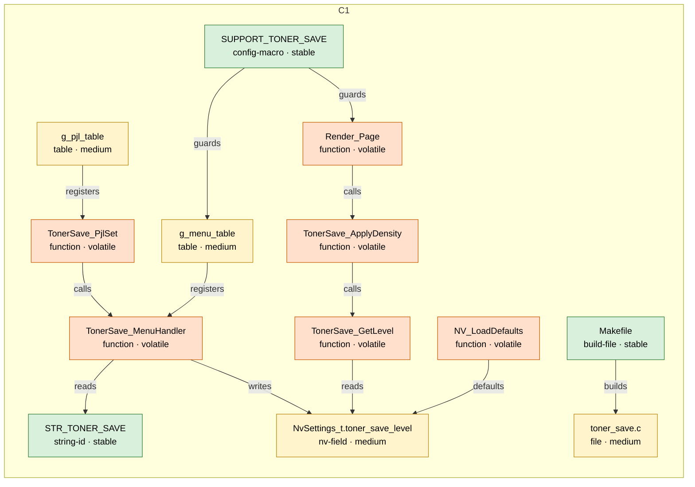
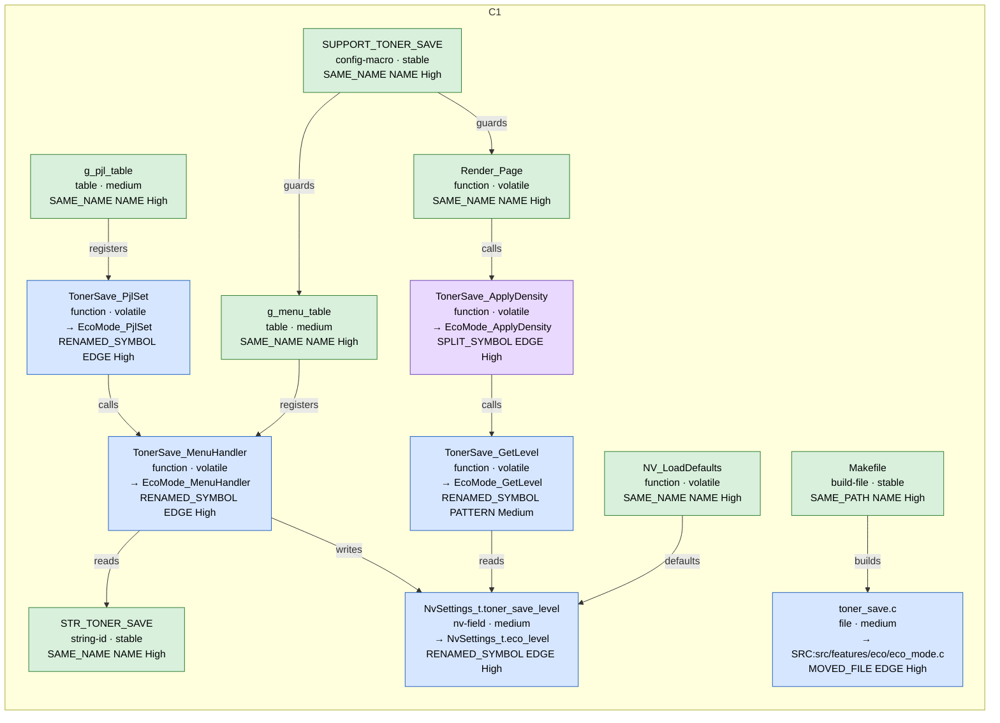

# Ví dụ: Request Links (T1-rename-multi, dữ liệu mẫu viết tay)

## Sau Checkpoint A – màu theo độ ổn định

Legend: green = stable · yellow = medium · orange = volatile (trace order in B) · grey dashed = outside the request

| from | type | to | evidence |
|---|---|---|---|
| N009 `g_menu_table` | registers | N007 `TonerSave_MenuHandler` | REQ-A:src/panel/menu_table.c:12 |
| N010 `g_pjl_table` | registers | N008 `TonerSave_PjlSet` | REQ-A:src/cmd/pjl_commands.c:27 |
| N011 `Render_Page` | calls | N006 `TonerSave_ApplyDensity` | REQ-A:src/print/render.c:12 |
| N006 `TonerSave_ApplyDensity` | calls | N005 `TonerSave_GetLevel` | REQ-A:src/features/toner_save/toner_save.c:22 |
| N008 `TonerSave_PjlSet` | calls | N007 `TonerSave_MenuHandler` | REQ-A:src/features/toner_save/toner_save.c:39 |
| N005 `TonerSave_GetLevel` | reads | N004 `NvSettings_t.toner_save_level` | REQ-A:src/features/toner_save/toner_save.c:17 |
| N007 `TonerSave_MenuHandler` | writes | N004 `NvSettings_t.toner_save_level` | REQ-A:src/features/toner_save/toner_save.c:32 |
| N007 `TonerSave_MenuHandler` | reads | N001 `STR_TONER_SAVE` | REQ-A:src/features/toner_save/toner_save.c:33 |
| N012 `NV_LoadDefaults` | defaults | N004 `NvSettings_t.toner_save_level` | REQ-A:src/settings/nv_settings.c:15 |
| N002 `SUPPORT_TONER_SAVE` | guards | N011 `Render_Page` | REQ-A:src/print/render.c:11 |
| N002 `SUPPORT_TONER_SAVE` | guards | N009 `g_menu_table` | REQ-A:src/panel/menu_table.c:11 |
| N003 `Makefile` | builds | N013 `toner_save.c` | REQ-A:Makefile:6 |

## Sau Checkpoint B – màu theo kết quả neo

Legend: green = name kept · blue = renamed/moved · purple = split/merged · orange = Low confidence · red = not found/rewritten/removed · white = not anchored · grey dashed = outside the request
