# Port Request Report

## Run Metadata
| Field | Value |
|---|---|
| SOURCE_ROOT | `/Users/trantien/Documents/my-project/port-request-skill/tests/cases/T0-toner-save/input/A_latest` |
| TARGET_ROOT | `/Users/trantien/Documents/my-project/port-request-skill/tests/cases/T0-toner-save/input/B_latest` |
| SOURCE_REQUEST | `/Users/trantien/Documents/my-project/port-request-skill/tests/cases/T0-toner-save/input/REQ` |
| TARGET_REQUEST_ID | T0-toner-save |
| OUTPUT_PARENT | `/Users/trantien/Documents/my-project/port-request-skill/tests/runs/run2-1113-0308/T0-toner-save` |
| OUTPUT_ROOT | `/Users/trantien/Documents/my-project/port-request-skill/tests/runs/run2-1113-0308/T0-toner-save/formula-source-T0-toner-save/` |
| REPORT_PATH | `/Users/trantien/Documents/my-project/port-request-skill/tests/runs/run2-1113-0308/T0-toner-save/formula-source-T0-toner-save/PORT_REPORT.md` |
| Created at (UTC) | 2026-11-12T20:08:59Z |

## Workflow Status
| Checkpoint | Status | Approval to start | Next approval gate |
|---|---|---|---|
| A | Complete | Not required | Awaiting Checkpoint B approval |
| B | Complete | AUTO (APPROVAL_MODE=auto) | Awaiting Checkpoint C approval |
| C | Complete | AUTO (APPROVAL_MODE=auto) | Awaiting Checkpoint D approval |
| D | Complete | AUTO (APPROVAL_MODE=auto) | Awaiting Checkpoint E approval |
| E | Complete | AUTO (APPROVAL_MODE=auto) | Awaiting Checkpoint F approval |
| F | Complete | AUTO (APPROVAL_MODE=auto) | None |

## Checkpoint A - Source Request Snapshot Comparison
### Changed File Manifest
| No | file | file_status | function | function_status | Modified_line_before | Modified_line_after |
|---:|---|---|---|---|---|---|
| 1 | `Makefile` | modified | N/A (non-code file) | unknown | N/A | N/A |
| 2 | `config/model_a.h` | modified | SUPPORT_TONER_SAVE (macro) | added | N/A | L3: `#define SUPPORT_TONER_SAVE 1` |
| 3 | `src/cmd/pjl_commands.c` | modified | includes@src/cmd/pjl_commands.c (file scope) | modified | N/A | L4: `#include "../features/toner_save/toner_save.h"` |
| 4 | `src/cmd/pjl_commands.c` | modified | g_pjl_table (table) | modified | N/A | L27: `    { "ECONOMODE", TonerSave_PjlSet },` |
| 5 | `src/features/toner_save/toner_save.c` | added | includes@src/features/toner_save/toner_save.c (file scope) | added | N/A | L1: `#include <stdlib.h>` L2: `#include "toner_save.h"` … (+5 lines, H005) |
| 6 | `src/features/toner_save/toner_save.c` | added | k_percent (global) | added | N/A | L8: `static const int k_percent[] = { 100, 80, 60 };` L9: (blank) |
| 7 | `src/features/toner_save/toner_save.c` | added | is_valid (function) | added | N/A | L10: `static int is_valid(int level)` L11: `{` … (+3 lines, H005) |
| 8 | `src/features/toner_save/toner_save.c` | added | TonerSave_GetLevel (function) | added | N/A | L15: `int TonerSave_GetLevel(void)` L16: `{` … (+3 lines, H005) |
| 9 | `src/features/toner_save/toner_save.c` | added | TonerSave_ApplyDensity (function) | added | N/A | L20: `int TonerSave_ApplyDensity(int density)` L21: `{` … (+6 lines, H005) |
| 10 | `src/features/toner_save/toner_save.c` | added | TonerSave_MenuHandler (function) | added | N/A | L28: `int TonerSave_MenuHandler(int key)` L29: `{` … (+7 lines, H005) |
| 11 | `src/features/toner_save/toner_save.c` | added | TonerSave_PjlSet (function) | added | N/A | L37: `int TonerSave_PjlSet(const char *arg)` L38: `{` … (+2 lines, H005) |
| 12 | `src/features/toner_save/toner_save.h` | added | TONER_SAVE_H (preprocessor) | added | N/A | L1: `#ifndef TONER_SAVE_H` L2: `#define TONER_SAVE_H` |
| 13 | `src/features/toner_save/toner_save.h` | added | TONER_SAVE_OFF/LOW/HIGH (enum) | added | N/A | L3: `enum {` L4: `    TONER_SAVE_OFF = 0,` … (+4 lines, H006) |
| 14 | `src/features/toner_save/toner_save.h` | added | TonerSave_GetLevel (prototype) | added | N/A | L9: `int TonerSave_GetLevel(void);` |
| 15 | `src/features/toner_save/toner_save.h` | added | TonerSave_ApplyDensity (prototype) | added | N/A | L10: `int TonerSave_ApplyDensity(int density);` |
| 16 | `src/features/toner_save/toner_save.h` | added | TonerSave_MenuHandler (prototype) | added | N/A | L11: `int TonerSave_MenuHandler(int key);` |
| 17 | `src/features/toner_save/toner_save.h` | added | TonerSave_PjlSet (prototype) | added | N/A | L12: `int TonerSave_PjlSet(const char *arg);` |
| 18 | `src/features/toner_save/toner_save.h` | added | TONER_SAVE_H (preprocessor) | added | N/A | L13: `#endif` |
| 19 | `src/panel/menu_table.c` | modified | SUPPORT_TONER_SAVE@src/panel/menu_table.c (preprocessor) | added | N/A | L4: `#ifdef SUPPORT_TONER_SAVE` L5: `#include "../features/toner_save/toner_save.h"` L6: `#endif` |
| 20 | `src/panel/menu_table.c` | modified | g_menu_table (table) | modified | N/A | L11: `#ifdef SUPPORT_TONER_SAVE` L12: `    { "TONER_SAVE", TonerSave_MenuHandler },` L13: `#endif` |
| 21 | `src/print/render.c` | modified | SUPPORT_TONER_SAVE@src/print/render.c (preprocessor) | added | N/A | L3: `#ifdef SUPPORT_TONER_SAVE` L4: `#include "../features/toner_save/toner_save.h"` L5: `#endif` |
| 22 | `src/print/render.c` | modified | Render_Page (function) | modified | N/A | L11: `#ifdef SUPPORT_TONER_SAVE` L12: `    density = TonerSave_ApplyDensity(density);` L13: `#endif` |
| 23 | `src/resources/strings.h` | modified | StrId_t (enum) | modified | N/A | L6: `    STR_TONER_SAVE,` |
| 24 | `src/resources/strings_en.c` | modified | g_strings_en (table) | modified | N/A | L6: `    [STR_TONER_SAVE] = "Toner Save",` |
| 25 | `src/settings/nv_settings.c` | modified | includes@src/settings/nv_settings.c (file scope) | modified | N/A | L2: `#include "../features/toner_save/toner_save.h"` |
| 26 | `src/settings/nv_settings.c` | modified | NV_LoadDefaults (function) | modified | N/A | L15: `    g_settings.toner_save_level = TONER_SAVE_OFF;` |
| 27 | `src/settings/nv_settings.h` | modified | NvSettings_t (struct) | modified | N/A | L8: `    int toner_save_level;` |

### Line-Level Changes
Request is additions only (−0 / +74); every Before cell is blank. Full diffs: `diffs/source/**`. Non-code `Makefile` (H001): `L6: SRCS += src/features/toner_save/toner_save.c`.

#### `config/model_a.h`
| H-id | Modified_Before (-) | Modified_After (+) |
|---|---|---|
| H002 |  | L3: `#define SUPPORT_TONER_SAVE 1` |

#### `src/cmd/pjl_commands.c`
| H-id | Modified_Before (-) | Modified_After (+) |
|---|---|---|
| H003 |  | L4: `#include "../features/toner_save/toner_save.h"` |
| H004 |  | L27: `    { "ECONOMODE", TonerSave_PjlSet },` |

#### `src/features/toner_save/toner_save.c`
| H-id | Modified_Before (-) | Modified_After (+) |
|---|---|---|
| H005 |  | L1: `#include <stdlib.h>` |
| H005 |  | L2: `#include "toner_save.h"` |
| H005 |  | L3: `#include "../../settings/nv_settings.h"` |
| H005 |  | L4: `#include "../../print/density.h"` |
| H005 |  | L5: `#include "../../core/log.h"` |
| H005 |  | L6: `#include "../../resources/strings.h"` |
| H005 |  | L7: (blank) |
| H005 |  | L8: `static const int k_percent[] = { 100, 80, 60 };` |
| H005 |  | L9: (blank) |
| H005 |  | L10: `static int is_valid(int level)` |
| H005 |  | L11: `{` |
| H005 |  | L12: `    return level >= TONER_SAVE_OFF && level <= TONER_SAVE_HIGH;` |
| H005 |  | L13: `}` |
| H005 |  | L14: (blank) |
| H005 |  | L15: `int TonerSave_GetLevel(void)` |
| H005 |  | L16: `{` |
| H005 |  | L17: `    return NV_GetSettings()->toner_save_level;` |
| H005 |  | L18: `}` |
| H005 |  | L19: (blank) |
| H005 |  | L20: `int TonerSave_ApplyDensity(int density)` |
| H005 |  | L21: `{` |
| H005 |  | L22: `    int level = TonerSave_GetLevel();` |
| H005 |  | L23: `    if (!is_valid(level))` |
| H005 |  | L24: `        return density;` |
| H005 |  | L25: `    return Density_Scale(density, k_percent[level]);` |
| H005 |  | L26: `}` |
| H005 |  | L27: (blank) |
| H005 |  | L28: `int TonerSave_MenuHandler(int key)` |
| H005 |  | L29: `{` |
| H005 |  | L30: `    if (!is_valid(key))` |
| H005 |  | L31: `        return -1;` |
| H005 |  | L32: `    NV_GetSettings()->toner_save_level = key;` |
| H005 |  | L33: `    Log_Info(Str_Get(STR_TONER_SAVE));` |
| H005 |  | L34: `    return key;` |
| H005 |  | L35: `}` |
| H005 |  | L36: (blank) |
| H005 |  | L37: `int TonerSave_PjlSet(const char *arg)` |
| H005 |  | L38: `{` |
| H005 |  | L39: `    return TonerSave_MenuHandler(atoi(arg));` |
| H005 |  | L40: `}` |

#### `src/features/toner_save/toner_save.h`
| H-id | Modified_Before (-) | Modified_After (+) |
|---|---|---|
| H006 |  | L1: `#ifndef TONER_SAVE_H` |
| H006 |  | L2: `#define TONER_SAVE_H` |
| H006 |  | L3: `enum {` |
| H006 |  | L4: `    TONER_SAVE_OFF = 0,` |
| H006 |  | L5: `    TONER_SAVE_LOW = 1,` |
| H006 |  | L6: `    TONER_SAVE_HIGH = 2` |
| H006 |  | L7: `};` |
| H006 |  | L8: (blank) |
| H006 |  | L9: `int TonerSave_GetLevel(void);` |
| H006 |  | L10: `int TonerSave_ApplyDensity(int density);` |
| H006 |  | L11: `int TonerSave_MenuHandler(int key);` |
| H006 |  | L12: `int TonerSave_PjlSet(const char *arg);` |
| H006 |  | L13: `#endif` |

#### `src/panel/menu_table.c`
| H-id | Modified_Before (-) | Modified_After (+) |
|---|---|---|
| H007 |  | L4: `#ifdef SUPPORT_TONER_SAVE` |
| H007 |  | L5: `#include "../features/toner_save/toner_save.h"` |
| H007 |  | L6: `#endif` |
| H007 |  | L11: `#ifdef SUPPORT_TONER_SAVE` |
| H007 |  | L12: `    { "TONER_SAVE", TonerSave_MenuHandler },` |
| H007 |  | L13: `#endif` |

#### `src/print/render.c`
| H-id | Modified_Before (-) | Modified_After (+) |
|---|---|---|
| H008 |  | L3: `#ifdef SUPPORT_TONER_SAVE` |
| H008 |  | L4: `#include "../features/toner_save/toner_save.h"` |
| H008 |  | L5: `#endif` |
| H008 |  | L11: `#ifdef SUPPORT_TONER_SAVE` |
| H008 |  | L12: `    density = TonerSave_ApplyDensity(density);` |
| H008 |  | L13: `#endif` |

#### `src/resources/strings.h`
| H-id | Modified_Before (-) | Modified_After (+) |
|---|---|---|
| H009 |  | L6: `    STR_TONER_SAVE,` |

#### `src/resources/strings_en.c`
| H-id | Modified_Before (-) | Modified_After (+) |
|---|---|---|
| H010 |  | L6: `    [STR_TONER_SAVE] = "Toner Save",` |

#### `src/settings/nv_settings.c`
| H-id | Modified_Before (-) | Modified_After (+) |
|---|---|---|
| H011 |  | L2: `#include "../features/toner_save/toner_save.h"` |
| H012 |  | L15: `    g_settings.toner_save_level = TONER_SAVE_OFF;` |

#### `src/settings/nv_settings.h`
| H-id | Modified_Before (-) | Modified_After (+) |
|---|---|---|
| H013 |  | L8: `    int toner_save_level;` |

### Request Links
| Item | Value |
|---|---|
| Nodes | 32: stable 8 / medium 17 / volatile 7 (incl. 4 `external`: N029 NV_GetSettings, N030 Density_Scale, N031 Log_Info, N032 Str_Get) |
| Edges by type | builds 1, calls 5, declares 6, defaults 1, guards 5, includes 5, indexes 2, localizes 1, reads 5, registers 4, uses-external 5, writes 1 (total 41) |
| Components | C1: N001–N032 (single component) |
| Isolated | none |

```mermaid
flowchart LR
    subgraph C1["C1"]
        N001["SUPPORT_TONER_SAVE<br/>config-macro · stable"]:::stable
        N002["Makefile SRCS += toner_save.c<br/>build-file · stable"]:::stable
        N003["#quot;ECONOMODE#quot;<br/>table-entry · stable"]:::stable
        N004["#quot;TONER_SAVE#quot;<br/>table-entry · stable"]:::stable
        N005["STR_TONER_SAVE<br/>string-id · stable"]:::stable
        N006["#quot;Toner Save#quot;<br/>table-entry · stable"]:::stable
        N007["toner_save_level<br/>nv-field · stable"]:::stable
        N008["TONER_SAVE_H<br/>preprocessor · stable"]:::stable
        N009["toner_save.h<br/>file scope · medium"]:::medium
        N010["TONER_SAVE_OFF/LOW/HIGH<br/>enum · medium"]:::medium
        N011["g_pjl_table<br/>table · medium"]:::medium
        N012["g_menu_table<br/>table · medium"]:::medium
        N013["StrId_t<br/>enum · medium"]:::medium
        N014["g_strings_en<br/>table · medium"]:::medium
        N015["NvSettings_t<br/>struct · medium"]:::medium
        N016["k_percent<br/>global · medium"]:::medium
        N017["is_valid<br/>function · volatile"]:::volatile
        N018["TonerSave_GetLevel<br/>function · volatile"]:::volatile
        N019["TonerSave_ApplyDensity<br/>function · volatile"]:::volatile
        N020["TonerSave_MenuHandler<br/>function · volatile"]:::volatile
        N021["TonerSave_PjlSet<br/>function · volatile"]:::volatile
        N022["Render_Page<br/>function · volatile"]:::volatile
        N023["NV_LoadDefaults<br/>function · volatile"]:::volatile
        N024["toner_save.c<br/>file scope · medium"]:::medium
        N025["includes@pjl_commands.c<br/>file scope · medium"]:::medium
        N026["includes@nv_settings.c<br/>file scope · medium"]:::medium
        N027["SUPPORT_TONER_SAVE@menu_table.c<br/>preprocessor · medium"]:::medium
        N028["SUPPORT_TONER_SAVE@render.c<br/>preprocessor · medium"]:::medium
        N029["NV_GetSettings<br/>external · medium"]:::external
        N030["Density_Scale<br/>external · medium"]:::external
        N031["Log_Info<br/>external · medium"]:::external
        N032["Str_Get<br/>external · medium"]:::external
    end
    N002 -->|builds| N024
    N024 -->|includes| N009
    N025 -->|includes| N009
    N026 -->|includes| N009
    N027 -->|includes| N009
    N028 -->|includes| N009
    N001 -->|guards| N027
    N001 -->|guards| N004
    N001 -->|guards| N028
    N001 -->|guards| N022
    N008 -->|guards| N009
    N009 -->|declares| N018
    N009 -->|declares| N019
    N009 -->|declares| N020
    N009 -->|declares| N021
    N009 -->|declares| N010
    N011 -->|registers| N003
    N003 -->|registers| N021
    N012 -->|registers| N004
    N004 -->|registers| N020
    N013 -->|indexes| N014
    N005 -->|indexes| N014
    N005 -->|localizes| N006
    N015 -->|declares| N007
    N023 -->|defaults| N007
    N023 -->|reads| N010
    N017 -->|reads| N010
    N018 -->|reads| N007
    N018 -->|uses-external| N029
    N019 -->|calls| N018
    N019 -->|calls| N017
    N019 -->|reads| N016
    N019 -->|uses-external| N030
    N020 -->|calls| N017
    N020 -->|writes| N007
    N020 -->|uses-external| N029
    N020 -->|reads| N005
    N020 -->|uses-external| N031
    N020 -->|uses-external| N032
    N021 -->|calls| N020
    N022 -->|calls| N019
    classDef stable fill:#d8f0dc,stroke:#2e7d32,color:#000
    classDef medium fill:#fff4cc,stroke:#b8860b,color:#000
    classDef volatile fill:#ffe0cc,stroke:#c85a00,color:#000
    classDef external fill:#eeeeee,stroke:#888888,color:#000,stroke-dasharray:4 3
    classDef same fill:#d8f0dc,stroke:#2e7d32,color:#000
    classDef renamed fill:#d6e6ff,stroke:#1f5fbf,color:#000
    classDef splitmerge fill:#ead9ff,stroke:#6a3fb5,color:#000
    classDef lowconf fill:#ffe0cc,stroke:#c85a00,color:#000,stroke-width:3px
    classDef missing fill:#ffd6d6,stroke:#c62828,color:#000,stroke-width:3px
    classDef open fill:#ffffff,stroke:#888888,color:#000
```

Legend: green = stable · yellow = medium · orange = volatile (trace order in B) · grey dashed = outside the request

| from | type | to | evidence |
|---|---|---|---|
| N002 `Makefile SRCS += toner_save.c` | builds | N024 `toner_save.c` | REQ-A:Makefile:6 |
| N024 `toner_save.c` | includes | N009 `toner_save.h` | REQ-A:src/features/toner_save/toner_save.c:2 |
| N025 `includes@pjl_commands.c` | includes | N009 `toner_save.h` | REQ-A:src/cmd/pjl_commands.c:4 |
| N026 `includes@nv_settings.c` | includes | N009 `toner_save.h` | REQ-A:src/settings/nv_settings.c:2 |
| N027 `SUPPORT_TONER_SAVE@menu_table.c` | includes | N009 `toner_save.h` | REQ-A:src/panel/menu_table.c:5 |
| N028 `SUPPORT_TONER_SAVE@render.c` | includes | N009 `toner_save.h` | REQ-A:src/print/render.c:4 |
| N001 `SUPPORT_TONER_SAVE` | guards | N027 `SUPPORT_TONER_SAVE@menu_table.c` | REQ-A:src/panel/menu_table.c:4 |
| N001 `SUPPORT_TONER_SAVE` | guards | N004 `"TONER_SAVE"` | REQ-A:src/panel/menu_table.c:11 |
| N001 `SUPPORT_TONER_SAVE` | guards | N028 `SUPPORT_TONER_SAVE@render.c` | REQ-A:src/print/render.c:3 |
| N001 `SUPPORT_TONER_SAVE` | guards | N022 `Render_Page` | REQ-A:src/print/render.c:11 |
| N008 `TONER_SAVE_H` | guards | N009 `toner_save.h` | REQ-A:src/features/toner_save/toner_save.h:1 |
| N009 `toner_save.h` | declares | N018 `TonerSave_GetLevel` | REQ-A:src/features/toner_save/toner_save.h:9 |
| N009 `toner_save.h` | declares | N019 `TonerSave_ApplyDensity` | REQ-A:src/features/toner_save/toner_save.h:10 |
| N009 `toner_save.h` | declares | N020 `TonerSave_MenuHandler` | REQ-A:src/features/toner_save/toner_save.h:11 |
| N009 `toner_save.h` | declares | N021 `TonerSave_PjlSet` | REQ-A:src/features/toner_save/toner_save.h:12 |
| N009 `toner_save.h` | declares | N010 `TONER_SAVE_OFF/LOW/HIGH` | REQ-A:src/features/toner_save/toner_save.h:3 |
| N011 `g_pjl_table` | registers | N003 `"ECONOMODE"` | REQ-A:src/cmd/pjl_commands.c:27 |
| N003 `"ECONOMODE"` | registers | N021 `TonerSave_PjlSet` | REQ-A:src/cmd/pjl_commands.c:27 |
| N012 `g_menu_table` | registers | N004 `"TONER_SAVE"` | REQ-A:src/panel/menu_table.c:12 |
| N004 `"TONER_SAVE"` | registers | N020 `TonerSave_MenuHandler` | REQ-A:src/panel/menu_table.c:12 |
| N013 `StrId_t` | indexes | N014 `g_strings_en` | REQ-A:src/resources/strings_en.c:3 |
| N005 `STR_TONER_SAVE` | indexes | N014 `g_strings_en` | REQ-A:src/resources/strings_en.c:6 |
| N005 `STR_TONER_SAVE` | localizes | N006 `"Toner Save"` | REQ-A:src/resources/strings_en.c:6 |
| N015 `NvSettings_t` | declares | N007 `toner_save_level` | REQ-A:src/settings/nv_settings.h:8 |
| N023 `NV_LoadDefaults` | defaults | N007 `toner_save_level` | REQ-A:src/settings/nv_settings.c:15 |
| N023 `NV_LoadDefaults` | reads | N010 `TONER_SAVE_OFF/LOW/HIGH` | REQ-A:src/settings/nv_settings.c:15 |
| N017 `is_valid` | reads | N010 `TONER_SAVE_OFF/LOW/HIGH` | REQ-A:src/features/toner_save/toner_save.c:12 |
| N018 `TonerSave_GetLevel` | reads | N007 `toner_save_level` | REQ-A:src/features/toner_save/toner_save.c:17 |
| N018 `TonerSave_GetLevel` | uses-external | N029 `NV_GetSettings` | REQ-A:src/features/toner_save/toner_save.c:17 |
| N019 `TonerSave_ApplyDensity` | calls | N018 `TonerSave_GetLevel` | REQ-A:src/features/toner_save/toner_save.c:22 |
| N019 `TonerSave_ApplyDensity` | calls | N017 `is_valid` | REQ-A:src/features/toner_save/toner_save.c:23 |
| N019 `TonerSave_ApplyDensity` | reads | N016 `k_percent` | REQ-A:src/features/toner_save/toner_save.c:25 |
| N019 `TonerSave_ApplyDensity` | uses-external | N030 `Density_Scale` | REQ-A:src/features/toner_save/toner_save.c:25 |
| N020 `TonerSave_MenuHandler` | calls | N017 `is_valid` | REQ-A:src/features/toner_save/toner_save.c:30 |
| N020 `TonerSave_MenuHandler` | writes | N007 `toner_save_level` | REQ-A:src/features/toner_save/toner_save.c:32 |
| N020 `TonerSave_MenuHandler` | uses-external | N029 `NV_GetSettings` | REQ-A:src/features/toner_save/toner_save.c:32 |
| N020 `TonerSave_MenuHandler` | reads | N005 `STR_TONER_SAVE` | REQ-A:src/features/toner_save/toner_save.c:33 |
| N020 `TonerSave_MenuHandler` | uses-external | N031 `Log_Info` | REQ-A:src/features/toner_save/toner_save.c:33 |
| N020 `TonerSave_MenuHandler` | uses-external | N032 `Str_Get` | REQ-A:src/features/toner_save/toner_save.c:33 |
| N021 `TonerSave_PjlSet` | calls | N020 `TonerSave_MenuHandler` | REQ-A:src/features/toner_save/toner_save.c:39 |
| N022 `Render_Page` | calls | N019 `TonerSave_ApplyDensity` | REQ-A:src/print/render.c:12 |

### Gate Result
Run Metadata notes: tools OK diff grep awk sed find rsync shasum file iconv git python3 (none missing). All 20 request files `us-ascii`, LF. No files excluded. Input baseline `_work/input_baseline.txt` (20 files).

PASS – File count – `_work/A_files.txt` 11 files (modified 9 / added 2; `Only in After/src: features` expanded to 2 files) == 11 distinct manifest files
PASS – Diff files – 11/11 `diffs/source/<path>.diff` present, none empty
PASS – Hunk count – `grep -c '^@@'` total 13 == 13 distinct H-ids (H001–H013)
PASS – Hunk coverage – every H-id has ≥1 manifest row (27 rows); every code-file row traces to an H-id
PASS – Point coverage – points sum −0/+74 == `git diff --no-index --numstat` −0/+74
PASS – Vocabulary – file_status ∈ {added, modified}; function_status ∈ {added, modified, unknown}; functions `<name> (<kind>)` / `N/A (non-code file)`
PASS – Consistency – added-file rows (5–18) have `Modified_line_before = N/A`; no deleted rows; Makefile row = `N/A (non-code file) \| unknown \| N/A \| N/A`
PASS – Not identified – 0 `Not identified` rows
PASS – Template – manifest header identical to template; rows 1..27 without gaps
PASS – Line-Level Changes – 10 subsections = 10 changed code files; only `+` lines; Before cells blank
PASS – Link nodes – 22 distinct owners in `A_hunks.md` (prototypes merged with their function nodes) + 6 data items → 28 request nodes + 4 external = 32 nodes, each with kind, stability, def at
PASS – Link evidence – 41/41 edges carry `REQ-A:path:line`; types only from A7
PASS – Isolated / components / view – Isolated: none; Components: C1; summary + Mermaid + edge table generated by `links_view.py` (41 edge rows == 41 in `A_links.md`)
PASS – Inputs untouched – `find "$SOURCE_REQUEST" -newer .start_marker -type f` → 0 files
PASS – Status row – A = `Complete`, Next approval gate = `Awaiting Checkpoint B approval`

## Checkpoint B - Source Change Analysis
### Files Analyzed
| file | result |
|---|---|
| `Makefile` | analyzed (SAME_PATH, EVOLVED: +L7 eco_report UNRELATED) |
| `config/model_a.h` | analyzed (SAME_PATH, EVOLVED: +L4 SUPPORT_ECO_REPORT UNRELATED) |
| `src/cmd/pjl_commands.c` | analyzed (SAME_PATH, UNCHANGED_IN_LATEST) |
| `src/features/toner_save/toner_save.c` | analyzed (SAME_PATH, EVOLVED: BUGFIX L7, L24) |
| `src/features/toner_save/toner_save.h` | analyzed (SAME_PATH, UNCHANGED_IN_LATEST) |
| `src/panel/menu_table.c` | analyzed (SAME_PATH, EVOLVED: ECO_REPORT blocks UNRELATED) |
| `src/print/render.c` | analyzed (SAME_PATH, UNCHANGED_IN_LATEST) |
| `src/resources/strings.h` | analyzed (SAME_PATH, UNCHANGED_IN_LATEST) |
| `src/resources/strings_en.c` | analyzed (SAME_PATH, UNCHANGED_IN_LATEST) |
| `src/settings/nv_settings.c` | analyzed (SAME_PATH, UNCHANGED_IN_LATEST) |
| `src/settings/nv_settings.h` | analyzed (SAME_PATH, UNCHANGED_IN_LATEST) |

### Latest Source Anchoring
Every request file, node, symbol and hunk was found by exact name at the same path in `SOURCE_ROOT` and verified by body comparison (R7 `cmp`/`diff`; R17 for the evolved function). No renames or moves, so the alias map is the identity and `_work/B_aliased/` is a plain copy of REQ-A. Full table (11 files, 32 nodes, 22 S, 13 H): `_work/B_anchor.md`.

| H/S-id | request location | latest location | anchor result | latest state | method | evidence (signals) | confidence |
|---|---|---|---|---|---|---|---|
| S001/H001 | REQ-A:Makefile:6 | SRC:Makefile:6 | SAME_NAME | UNCHANGED_IN_LATEST · PRESENT | NAME | same line | High |
| S002/H002 | REQ-A:config/model_a.h:3 | SRC:config/model_a.h:3 | SAME_NAME | UNCHANGED_IN_LATEST · PRESENT | NAME | same line | High |
| S003/H003 | REQ-A:src/cmd/pjl_commands.c:4 | SRC:src/cmd/pjl_commands.c:4 | SAME_NAME | UNCHANGED_IN_LATEST · PRESENT | NAME | file identical | High |
| S004/H004 | REQ-A:src/cmd/pjl_commands.c:24-28 | SRC:src/cmd/pjl_commands.c:24-28 | SAME_NAME | UNCHANGED_IN_LATEST · PRESENT | NAME | file identical | High |
| S005/H005 | REQ-A:src/features/toner_save/toner_save.c:1-7 | SRC:src/features/toner_save/toner_save.c:1-8 | SAME_NAME | EVOLVED · PRESENT | NAME | +L7 math_util.h include | High |
| S006–S008, S010–S011/H005,H006 | REQ-A:…toner_save.c:8-18, 28-40 | SRC:…toner_save.c:9-19, 30-42 | SAME_NAME | UNCHANGED_IN_LATEST · PRESENT | NAME | bodies identical (+1/+2 line shift) | High |
| S009/H005,H006 | REQ-A:…toner_save.c:20-26 | SRC:…toner_save.c:21-28 | SAME_NAME | EVOLVED · PRESENT | NAME | R17 blind 0.96, sig =, calls 3/3; +L24 Clamp | High |
| S012–S013/H006 | REQ-A:…toner_save.h:1-13 | SRC:…toner_save.h:1-13 | SAME_NAME | UNCHANGED_IN_LATEST · PRESENT | NAME | file identical | High |
| S014/H007 | REQ-A:src/panel/menu_table.c:4-6 | SRC:src/panel/menu_table.c:4-6 | SAME_NAME | UNCHANGED_IN_LATEST · PRESENT | NAME | same lines | High |
| S015/H007 | REQ-A:src/panel/menu_table.c:8-16 | SRC:src/panel/menu_table.c:11-22 | SAME_NAME | EVOLVED · PRESENT | NAME | request lines at SRC:14-16; +L19-21 ECO_REPORT | High |
| S016–S017/H008 | REQ-A:src/print/render.c:3-16 | SRC:src/print/render.c:3-16 | SAME_NAME | UNCHANGED_IN_LATEST · PRESENT | NAME | file identical | High |
| S018/H009 | REQ-A:src/resources/strings.h:3-9 | SRC:src/resources/strings.h:3-9 | SAME_NAME | UNCHANGED_IN_LATEST · PRESENT | NAME | file identical | High |
| S019/H010 | REQ-A:src/resources/strings_en.c:3-8 | SRC:src/resources/strings_en.c:3-8 | SAME_NAME | UNCHANGED_IN_LATEST · PRESENT | NAME | file identical | High |
| S020–S021/H011,H012 | REQ-A:src/settings/nv_settings.c:2, 11-18 | SRC:src/settings/nv_settings.c:2, 11-18 | SAME_NAME | UNCHANGED_IN_LATEST · PRESENT | NAME | file identical | High |
| S022/H013 | REQ-A:src/settings/nv_settings.h:5-11 | SRC:src/settings/nv_settings.h:5-11 | SAME_NAME | UNCHANGED_IN_LATEST · PRESENT | NAME | file identical | High |

Alias map: no entries (identity; no rename patterns) – `_work/alias_map.md`.
Iteration log: Iteration 1: +32 anchored (NAME 32) · Iteration 2: +0 → finished.
Link cross-checks: consistent 41 / changed 0 / broken 0.
Evolution blocks: S009 SRC:src/features/toner_save/toner_save.c:24 `Clamp(level, TONER_SAVE_OFF, TONER_SAVE_HIGH)` BUGFIX (`fix #1234`); S005 SRC:…toner_save.c:7 math_util.h include BUGFIX; S015 SRC:src/panel/menu_table.c:19-21 + file-scope SRC:src/panel/menu_table.c:7-9, SRC:Makefile:7, SRC:config/model_a.h:4 UNRELATED (feature `ECO_REPORT`).

#### Anchored Link Graph

```mermaid
flowchart LR
    subgraph C1["C1"]
        N001["SUPPORT_TONER_SAVE<br/>config-macro · stable<br/>SAME_NAME NAME High"]:::same
        N002["Makefile SRCS += toner_save.c<br/>build-file · stable<br/>→ toner_save.c<br/>SAME_NAME NAME High"]:::same
        N003["#quot;ECONOMODE#quot;<br/>table-entry · stable<br/>SAME_NAME NAME High"]:::same
        N004["#quot;TONER_SAVE#quot;<br/>table-entry · stable<br/>SAME_NAME NAME High"]:::same
        N005["STR_TONER_SAVE<br/>string-id · stable<br/>SAME_NAME NAME High"]:::same
        N006["#quot;Toner Save#quot;<br/>table-entry · stable<br/>→ Save#quot;<br/>SAME_NAME NAME High"]:::same
        N007["toner_save_level<br/>nv-field · stable<br/>SAME_NAME NAME High"]:::same
        N008["TONER_SAVE_H<br/>preprocessor · stable<br/>SAME_NAME NAME High"]:::same
        N009["toner_save.h<br/>file scope · medium<br/>SAME_NAME NAME High"]:::same
        N010["TONER_SAVE_OFF/LOW/HIGH<br/>enum · medium<br/>SAME_NAME NAME High"]:::same
        N011["g_pjl_table<br/>table · medium<br/>SAME_NAME NAME High"]:::same
        N012["g_menu_table<br/>table · medium<br/>SAME_NAME NAME High"]:::same
        N013["StrId_t<br/>enum · medium<br/>SAME_NAME NAME High"]:::same
        N014["g_strings_en<br/>table · medium<br/>SAME_NAME NAME High"]:::same
        N015["NvSettings_t<br/>struct · medium<br/>SAME_NAME NAME High"]:::same
        N016["k_percent<br/>global · medium<br/>SAME_NAME NAME High"]:::same
        N017["is_valid<br/>function · volatile<br/>SAME_NAME NAME High"]:::same
        N018["TonerSave_GetLevel<br/>function · volatile<br/>SAME_NAME NAME High"]:::same
        N019["TonerSave_ApplyDensity<br/>function · volatile<br/>SAME_NAME NAME High"]:::same
        N020["TonerSave_MenuHandler<br/>function · volatile<br/>SAME_NAME NAME High"]:::same
        N021["TonerSave_PjlSet<br/>function · volatile<br/>SAME_NAME NAME High"]:::same
        N022["Render_Page<br/>function · volatile<br/>SAME_NAME NAME High"]:::same
        N023["NV_LoadDefaults<br/>function · volatile<br/>SAME_NAME NAME High"]:::same
        N024["toner_save.c<br/>file scope · medium<br/>SAME_NAME NAME High"]:::same
        N025["includes@pjl_commands.c<br/>file scope · medium<br/>SAME_NAME NAME High"]:::same
        N026["includes@nv_settings.c<br/>file scope · medium<br/>SAME_NAME NAME High"]:::same
        N027["SUPPORT_TONER_SAVE@menu_table.c<br/>preprocessor · medium<br/>SAME_NAME NAME High"]:::same
        N028["SUPPORT_TONER_SAVE@render.c<br/>preprocessor · medium<br/>SAME_NAME NAME High"]:::same
        N029["NV_GetSettings<br/>external · medium<br/>SAME_NAME NAME High"]:::external
        N030["Density_Scale<br/>external · medium<br/>SAME_NAME NAME High"]:::external
        N031["Log_Info<br/>external · medium<br/>SAME_NAME NAME High"]:::external
        N032["Str_Get<br/>external · medium<br/>SAME_NAME NAME High"]:::external
    end
    N002 -->|builds| N024
    N024 -->|includes| N009
    N025 -->|includes| N009
    N026 -->|includes| N009
    N027 -->|includes| N009
    N028 -->|includes| N009
    N001 -->|guards| N027
    N001 -->|guards| N004
    N001 -->|guards| N028
    N001 -->|guards| N022
    N008 -->|guards| N009
    N009 -->|declares| N018
    N009 -->|declares| N019
    N009 -->|declares| N020
    N009 -->|declares| N021
    N009 -->|declares| N010
    N011 -->|registers| N003
    N003 -->|registers| N021
    N012 -->|registers| N004
    N004 -->|registers| N020
    N013 -->|indexes| N014
    N005 -->|indexes| N014
    N005 -->|localizes| N006
    N015 -->|declares| N007
    N023 -->|defaults| N007
    N023 -->|reads| N010
    N017 -->|reads| N010
    N018 -->|reads| N007
    N018 -->|uses-external| N029
    N019 -->|calls| N018
    N019 -->|calls| N017
    N019 -->|reads| N016
    N019 -->|uses-external| N030
    N020 -->|calls| N017
    N020 -->|writes| N007
    N020 -->|uses-external| N029
    N020 -->|reads| N005
    N020 -->|uses-external| N031
    N020 -->|uses-external| N032
    N021 -->|calls| N020
    N022 -->|calls| N019
    classDef stable fill:#d8f0dc,stroke:#2e7d32,color:#000
    classDef medium fill:#fff4cc,stroke:#b8860b,color:#000
    classDef volatile fill:#ffe0cc,stroke:#c85a00,color:#000
    classDef external fill:#eeeeee,stroke:#888888,color:#000,stroke-dasharray:4 3
    classDef same fill:#d8f0dc,stroke:#2e7d32,color:#000
    classDef renamed fill:#d6e6ff,stroke:#1f5fbf,color:#000
    classDef splitmerge fill:#ead9ff,stroke:#6a3fb5,color:#000
    classDef lowconf fill:#ffe0cc,stroke:#c85a00,color:#000,stroke-width:3px
    classDef missing fill:#ffd6d6,stroke:#c62828,color:#000,stroke-width:3px
    classDef open fill:#ffffff,stroke:#888888,color:#000
```

Legend: green = name kept · blue = renamed/moved · purple = split/merged · orange = Low confidence · red = not found/rewritten/removed · white = not anchored · grey dashed = outside the request

### Changed Symbols and Behavior
| S-id | symbol (kind) | H-ids / ext | change type | behavior before → after | later evolution |
|---|---|---|---|---|---|
| S001 | N/A (non-code file) | H001 | registration | toner_save.c not built → `SRCS += src/features/toner_save/toner_save.c` | none (L7 eco_report UNRELATED) |
| S002 | SUPPORT_TONER_SAVE (macro) | H002 | guard | undefined → `#define SUPPORT_TONER_SAVE 1` (model A) | none (L4 ECO_REPORT UNRELATED) |
| S003 | includes@src/cmd/pjl_commands.c (file scope) | H003 | new | + include toner_save.h | none |
| S004 | g_pjl_table (table) | H004 | registration | PJL COPIES, DUPLEX → + `"ECONOMODE"` → `TonerSave_PjlSet` | none |
| S005 | includes@src/features/toner_save/toner_save.c (file scope) | H005 | new | new file includes stdlib/toner_save/nv_settings/density/log/strings | BUGFIX: + math_util.h |
| S006 | k_percent (global) | H005 | new | percent table {100, 80, 60} per level | none |
| S007 | is_valid (function) | H005 | new | true iff 0 ≤ level ≤ 2 | none |
| S008 | TonerSave_GetLevel (function) | H005, H006 | new | returns `NV_GetSettings()->toner_save_level` | none |
| S009 | TonerSave_ApplyDensity (function) | H005, H006 | new | invalid level → density; else `Density_Scale(density, 100/80/60)` | BUGFIX: level clamped to 0..2 via `Clamp` first |
| S010 | TonerSave_MenuHandler (function) | H005, H006 | new | key ∉ 0..2 → -1; else store level, log "Toner Save", return key | none |
| S011 | TonerSave_PjlSet (function) | H005, H006 | new | `TonerSave_MenuHandler(atoi(arg))` | none |
| S012 | TONER_SAVE_H (preprocessor) | H006 | new | header guard | none |
| S013 | TONER_SAVE_OFF/LOW/HIGH (enum) | H006 | new | OFF 0, LOW 1, HIGH 2 | none |
| S014 | SUPPORT_TONER_SAVE@src/panel/menu_table.c (preprocessor) | H007 | guard | guarded include toner_save.h | none (ECO_REPORT include UNRELATED) |
| S015 | g_menu_table (table) | H007 | registration | + `"TONER_SAVE"` → `TonerSave_MenuHandler` after DUPLEX, guarded | UNRELATED ECO_REPORT entry (excluded, partial take) |
| S016 | SUPPORT_TONER_SAVE@src/print/render.c (preprocessor) | H008 | guard | guarded include toner_save.h | none |
| S017 | Render_Page (function) | H008 | logic | density returned unchanged → `density = TonerSave_ApplyDensity(density)` (guarded) | none |
| S018 | StrId_t (enum) | H009 | layout | + STR_TONER_SAVE = 2 after DUPLEX; QUALITY 2→3, STR_COUNT 3→4 | none |
| S019 | g_strings_en (table) | H010 | registration | + `[STR_TONER_SAVE] = "Toner Save"` | none |
| S020 | includes@src/settings/nv_settings.c (file scope) | H011 | new | + include toner_save.h | none |
| S021 | NV_LoadDefaults (function) | H012 | logic | + default `toner_save_level = TONER_SAVE_OFF` (0) | none |
| S022 | NvSettings_t (struct) | H013 | layout | + `int toner_save_level` after duplex; language offset 8→12, quality 12→16 | none |

### Dependencies and Test Coverage
- Outgoing code deps (full list `_work/B_symbols.md` §2): S009.d1 `Clamp` SRC:src/util/math_util.c:3-8 (3 params lo/hi) + proto SRC:src/util/math_util.h:3; S009.d2 `Density_Scale` SRC:src/print/density.c:4-7; S009.d3 `DENSITY_MAX`=15 SRC:src/print/density.h:3; S009.d4 `density.h` SRC:src/print/density.h:1-5; S009.d5 build entry `src/print/density.c` SRC:Makefile:2; S008.d1 `NV_GetSettings` SRC:src/settings/nv_settings.c:6; S010.d1 `Log_Info` SRC:src/core/log.c:4; S010.d2 `Str_Get` SRC:src/resources/strings_en.c:10; S021.d1 `g_settings` SRC:src/settings/nv_settings.c:4; S005.d1 `math_util.h`. Recursion stopped at depth 2 (Clamp uses nothing project-specific; NV/Log/Str = infrastructure present in REQ-B).
- Data deps (R13): STR_TONER_SAVE → enum SRC:src/resources/strings.h:6 + only language table SRC:src/resources/strings_en.c:6 (STR_COUNT-sized, designated init); TONER_SAVE_* → k_percent SRC:…toner_save.c:9; nv-field toner_save_level → struct SRC:src/settings/nv_settings.h:8 + default SRC:src/settings/nv_settings.c:15, no NV version/checksum/migration (`grep -rniE 'version|checksum|crc|migrat'` → none); registry "ECONOMODE" SRC:src/cmd/pjl_commands.c:27, "TONER_SAVE" SRC:src/panel/menu_table.c:15; config SUPPORT_TONER_SAVE SRC:config/model_a.h:3 (no Makefile -D); build entries SRC:Makefile:6, SRC:Makefile:2.
- Incoming: Pjl_Dispatch SRC:src/cmd/pjl_commands.c:30 (dispatch of g_pjl_table), Menu_Dispatch SRC:src/panel/menu_table.c:24 (g_menu_table), Render_Page caller SRC:src/main.c:13 – all existing. CONSUMERS (REPORT_ONLY): EcoReport_Print SRC:src/features/eco_report/eco_report.c:7, Menu_Quality → Density_Scale SRC:src/panel/menu.c:22, main driver SRC:src/main.c:11-12.
- Guards: SUPPORT_TONER_SAVE guards S014, S015 entry, S016, S017 hook; enabled in SRC:config/model_a.h:3 via SRC:config/model_config.h:3-4 (`-DMODEL_A`). S003/S004/S020/S021 are unguarded.
- Headers: toner_save.h included by pjl_commands.c, nv_settings.c, menu_table.c (guarded), render.c (guarded); toner_save.c needs density.h, math_util.h.
- Extensions (B4, patterns `TonerSave_*`, `TONER_SAVE_*`, `toner_save_level`, `STR_TONER_SAVE`, `SUPPORT_TONER_SAVE`, `ECONOMODE`, `"TONER_SAVE"`, `"Toner Save"`, path `toner_save`): EXTENSION_NEW none; CONSUMER eco_report (3 hits), main.c driver.
- Tokens: `_work/B_new_tokens.txt` 19 project tokens (request `+` lines + BUGFIX lines): 13 S-names/members, 6 dependencies (Clamp, Density_Scale, Log_Info, NV_GetSettings, Str_Get, g_settings); `atoi`/`stdlib` = standard library.
- Tests: none found (`find -iname '*test*'` → 0; no `_ut`/`spec` files). `SRC:src/main.c:9-14` smoke driver exercises TONER_SAVE, ECONOMODE and Render_Page.

### Blockers and Context Risk
- No unresolved anchors, no UNCLEAR evolution, no Low anchors → no questions.
- Partial take: S015 `g_menu_table` – latest also has ECO_REPORT entry SRC:src/panel/menu_table.c:19-21 (+ include block 7-9, SRC:Makefile:7, SRC:config/model_a.h:4) from feature ECO_REPORT (CONSUMER); excluded.
- Layout: S022 NvSettings_t field inserted mid-struct (NVRAM struct, comment SRC:src/settings/nv_settings.h:4) → offsets of later fields shift; S018 StrId_t values after STR_DUPLEX shift (+1).
- Scope beyond request: BUGFIX `Clamp` line requires `Clamp(int v, int lo, int hi)` and `Density_Scale`/`density.c/.h` (outside the request) – target must be checked in C.
### Gate Result
PASS – Files – 11/11 manifest files listed as `analyzed`
PASS – Symbol coverage – 13/13 H-ids belong to S001–S022; every S lists H-ids (no `ext`)
PASS – Behavior – 22/22 S-ids have a concrete before → after (values/conditions)
PASS – Anchoring complete – A: 11 files / 32 nodes / 22 S / 13 H → B_anchor.md: 11 / 32 / 22 / 13 rows with anchor result + latest state
PASS – Method and signals – all anchors `NAME`, verified by kind + body (`cmp`/R7; R17 blind 0.96 sig = for S009); confidence High (NAME + body compared)
PASS – Relocation evidence – 0 MOVED/RENAMED/SPLIT/MERGED; alias_map.md records identity; no L5 pattern used
PASS – Links cross-checked – 41 edges: consistent 41 / changed 0 / broken 0
PASS – Loop finished – Iteration 1 +32, Iteration 2 +0; `#### Anchored Link Graph` generated from final B_anchor.md
PASS – No silent loss – 0 NOT_FOUND/REWRITTEN/MACRO_GENERATED/REMOVED/GONE/PARTIAL/Low
PASS – Modulo aliases – presence computed on `_work/B_aliased/` (identity alias map, complete); 74/74 `+` lines found by `grep -F`, none needed aliasing or R16
PASS – Evolution – EVOLVED items S005, S009 (BUGFIX), S015 + Makefile/model_a.h/menu_table file scope (UNRELATED) classified with R14; 0 UNCLEAR; partial take S015 listed
PASS – Extensions searched – patterns recorded in `_work/B_anchor.md` (Extension hits); EXTENSION_NEW 0, CONSUMER: eco_report, main.c
PASS – Tokens – B_new_tokens.txt 19 tokens: 13 S-names/members + 6 deps; atoi/stdlib standard
PASS – Code dependency evidence – 10 outgoing deps with SRC:path:line; recursion depth 2, stop reason stated
PASS – Data dependencies – R13 run for STR_TONER_SAVE, TONER_SAVE_*, toner_save_level, ECONOMODE, TONER_SAVE, SUPPORT_TONER_SAVE, build entries; version/checksum: none
PASS – Incoming / guards / headers / tests – recorded; tests: none found (command listed)
PASS – Read-only – `find SOURCE_ROOT SOURCE_REQUEST -newer .start_marker -type f` → 0
PASS – Status row – B = `Complete`, Next approval gate = `Awaiting Checkpoint C approval`

## Checkpoint C - Source/Target Flow Trace
### Source Behavior
- FLOW-1 (render density scaling): SRC:src/main.c:13 → SRC:src/print/render.c:12 `Render_Page` → SRC:src/features/toner_save/toner_save.c:21 `TonerSave_ApplyDensity` → :23 `TonerSave_GetLevel` → SRC:src/settings/nv_settings.c:6 `NV_GetSettings` → :24 `Clamp` (SRC:src/util/math_util.c:3) → :27 `Density_Scale` (SRC:src/print/density.c:4, `Clamp(…, 0, DENSITY_MAX=15)`)
- FLOW-2 (panel menu): SRC:src/main.c:11 `Menu_Dispatch("TONER_SAVE")` → SRC:src/panel/menu_table.c:24 → entry SRC:src/panel/menu_table.c:15 → SRC:…toner_save.c:30 `TonerSave_MenuHandler` → `is_valid` :11 → NV write :34 → `Log_Info(Str_Get(STR_TONER_SAVE))` (SRC:src/resources/strings_en.c:6 "Toner Save")
- FLOW-3 (PJL ECONOMODE): SRC:src/main.c:12 → SRC:src/cmd/pjl_commands.c:30 `Pjl_Dispatch` → entry :27 → SRC:…toner_save.c:39 `TonerSave_PjlSet` → `TonerSave_MenuHandler`
- FLOW-4 (NV default): SRC:src/main.c:9 → SRC:src/settings/nv_settings.c:15 `toner_save_level = TONER_SAVE_OFF`
- Enable: SRC:config/model_a.h:3 `SUPPORT_TONER_SAVE` via SRC:config/model_config.h:3-4; build SRC:Makefile:2 (density.c), :6 (toner_save.c)

### Target Behavior
- FLOW-1 target: TGT:src/main.c:13 → TGT:src/print/render.c:5 `Render_Page` → MISSING at `TonerSave_ApplyDensity` (no hook, guard undefined)
- FLOW-2 target: TGT:src/main.c:11 → TGT:src/panel/menu_table.c:13 `Menu_Dispatch` → MISSING at "TONER_SAVE" entry (returns -1)
- FLOW-3 target: TGT:src/main.c:12 → TGT:src/cmd/pjl_commands.c:28 `Pjl_Dispatch` → MISSING at "ECONOMODE" entry (returns -1)
- FLOW-4 target: TGT:src/main.c:9 → TGT:src/settings/nv_settings.c:10 `NV_LoadDefaults` → MISSING at `toner_save_level`
- Target-only behavior to keep: FAX entry TGT:src/panel/menu_table.c:10, `STR_FAX` TGT:src/resources/strings.h:7 / TGT:src/resources/strings_en.c:7, `fax_resolution` TGT:src/settings/nv_settings.h:10 / TGT:src/settings/nv_settings.c:16, `SUPPORT_FAX` block TGT:src/print/render.c:9-11, TGT:config/model_b.h:3.

| id | item | target location | target state | confidence |
|---|---|---|---|---|
| S001 | Makefile toner_save.c entry | TGT:Makefile:2-5 | MISSING | High |
| S002 | SUPPORT_TONER_SAVE (macro) | TGT:config/model_b.h:1-3 | MISSING | High |
| S003 | includes@pjl_commands.c | TGT:src/cmd/pjl_commands.c:1-3 | SAME_AS_BEFORE | High |
| S004 | g_pjl_table | TGT:src/cmd/pjl_commands.c:23-26 | SAME_AS_BEFORE | High |
| S005–S011 | toner_save.c (includes, k_percent, is_valid, GetLevel, ApplyDensity, MenuHandler, PjlSet) | – | MISSING | High |
| S012–S013 | toner_save.h (guard, enum) | – | MISSING | High |
| S014 | SUPPORT_TONER_SAVE@menu_table.c | TGT:src/panel/menu_table.c:1-3 | SAME_AS_BEFORE | High |
| S015 | g_menu_table | TGT:src/panel/menu_table.c:5-11 | DIVERGED | High |
| S016 | SUPPORT_TONER_SAVE@render.c | TGT:src/print/render.c:1-2 | SAME_AS_BEFORE | High |
| S017 | Render_Page | TGT:src/print/render.c:5-13 | DIVERGED | High |
| S018 | StrId_t | TGT:src/resources/strings.h:3-9 | DIVERGED | High |
| S019 | g_strings_en | TGT:src/resources/strings_en.c:3-8 | DIVERGED | High |
| S020 | includes@nv_settings.c | TGT:src/settings/nv_settings.c:1-2 | SAME_AS_BEFORE | High |
| S021 | NV_LoadDefaults | TGT:src/settings/nv_settings.c:10-17 | DIVERGED | High |
| S022 | NvSettings_t | TGT:src/settings/nv_settings.h:5-11 | DIVERGED | High |
| S009.d1 | Clamp | TGT:src/util/math_util.c:3-8, TGT:src/util/math_util.h:3 | SIGNATURE_DIFF | High |
| S009.d2–d4 | Density_Scale, DENSITY_MAX, density.h | – | MISSING | High |
| S009.d5 | Makefile density.c entry | TGT:Makefile:2 | MISSING | High |
| S008.d1, S010.d1, S010.d2, S021.d1 | NV_GetSettings, Log_Info, Str_Get, g_settings | TGT:src/settings/nv_settings.c:3-8, TGT:src/core/log.c:4, TGT:src/resources/strings_en.c:10-13 | SAME_AS_SOURCE | High |
| S005.d1 | math_util.h | TGT:src/util/math_util.h:3 | SIGNATURE_DIFF | High |
| S005.d2 | log.h / strings.h / nv_settings.h | TGT same paths | DIVERGED | High |
| S015.d1, S004.d1, S015.d2, S017.d1 | model_config.h, Pjl_Dispatch, Menu_Dispatch, main | TGT:config/model_config.h, TGT:src/cmd/pjl_commands.c:28-36, TGT:src/panel/menu_table.c:13-21, TGT:src/main.c | SAME_AS_SOURCE | High |
| S008.d2 | EcoReport_Print (consumer) | – | MISSING | High |
| S009.d6 | Menu_Quality (consumer) | TGT:src/panel/menu.c:19-23 | DIVERGED | High |

Counts (39 rows in `_work/C_trace.md`): SAME_AS_SOURCE 8 · SAME_AS_BEFORE 5 · DIVERGED 8 · SIGNATURE_DIFF 2 · MISSING 16 · RENAMED 0 · RENAMED_CANDIDATE 0.

### Gaps, Evidence, and Confidence
- MISSING (searches: R2 names, R11 `find toner*/density*`, R8 literals "ECONOMODE"/"TONER_SAVE"/"Toner Save"/`100, 80, 60`, R17 best blind 0.08–0.15): whole `toner_save.c/.h` (S005–S013), `density.c/.h` (S009.d2–d4), build entries (S001, S009.d5), guard `SUPPORT_TONER_SAVE` in TGT:config/model_b.h (S002).
- SAME_AS_BEFORE (R7 vs REQ-B): S003, S004 (pjl_commands.c identical to REQ-B), S014 (TGT:src/panel/menu_table.c:1-3), S016 (TGT:src/print/render.c:1-2), S020 (TGT:src/settings/nv_settings.c:1-2).
- DIVERGED, target-only lines to keep: S015 TGT:src/panel/menu_table.c:10 FAX; S017 TGT:src/print/render.c:9-11 SUPPORT_FAX; S018 TGT:src/resources/strings.h:7 STR_FAX; S019 TGT:src/resources/strings_en.c:7; S021 TGT:src/settings/nv_settings.c:16; S022 TGT:src/settings/nv_settings.h:10. Callers: Menu_Dispatch, main.c:13, Str_Get, main.c:9, NV_GetSettings (listed in C_trace).
- SIGNATURE_DIFF: `Clamp` TGT `int Clamp(int v, int hi)` (lower bound fixed 0) vs SRC `int Clamp(int v, int lo, int hi)`; target callers: none (`grep -rnw Clamp TGT` → definition + prototype only).
- Alias map: file `config/model_a.h → config/model_b.h` (EDGE TGT:config/model_config.h:5-6 + ANCHOR shared lines; High). No symbol renames.
- Data gaps: STR_TONER_SAVE enum + only language table strings_en.c; NV field + default (no version/checksum in TGT); registry entries ECONOMODE, TONER_SAVE; guard define; build entries toner_save.c, density.c.
- Guard/header gaps: SUPPORT_TONER_SAVE not enabled in target; headers toner_save.h, density.h missing; math_util.h prototype differs.
- Closure: Iteration 1: +0 items (density.c deps already listed) → fixpoint.

### Blockers
None. No `Low` or `RENAMED_CANDIDATE` items; every item located or proven MISSING with High confidence.

### Gate Result
PASS – Coverage – B: 22 S + 17 dependency rows = 39 → C_trace.md 39 rows
PASS – State vocabulary – only SAME_AS_SOURCE/SAME_AS_BEFORE/DIVERGED/SIGNATURE_DIFF/MISSING
PASS – Evidence – every non-MISSING row has TGT:path:line; MISSING rows list R2/R11/R8/R17 searches
PASS – Comparison done – SAME_AS_* from R7 (`cmp`/`diff` vs SRC port version or REQ-B); no aliasing needed
PASS – Target renames – 0 RENAMED symbols; file mapping model_a.h → model_b.h in alias_map.md (High: EDGE + ANCHOR)
PASS – Callers – all 8 DIVERGED and 2 SIGNATURE_DIFF rows list target callers (Clamp: none)
PASS – Data gaps – status per place: enum, en table (only language), NV field, default, version/checksum (none), registries, guard, build
PASS – Fixpoint reached – Iteration 1: +0
PASS – Flows – FLOW-1..4 source + target chains with break points
PASS – No assumed equivalence – 0 Low / 0 RENAMED_CANDIDATE
PASS – Read-only – `find SOURCE_ROOT TARGET_ROOT SOURCE_REQUEST -newer .start_marker -type f` → 0; status row C = `Complete`, Next approval gate = `Awaiting Checkpoint D approval`

## Checkpoint D - Formula Mapping and Plan
### Formula Mapping Matrix
| M-id | Formula (source behavior) | S-ids / H-ids | Request location | Latest source location | Target location | Target state | Port class | P-ids | Confidence |
|---|---|---|---|---|---|---|---|---|---|
| M001 | build toner_save.c | S001 / H001 | REQ-A:Makefile:6 | SRC:Makefile:6 | TGT:Makefile:5 | MISSING | NON_CODE (row 18) | P020 | High |
| M002 | enable feature guard for the model | S002 / H002 | REQ-A:config/model_a.h:3 | SRC:config/model_a.h:3 | TGT:config/model_b.h:3 | MISSING | COPY_NEW (row 7) | P001 | High |
| M003 | PJL file includes feature header | S003 / H003 | REQ-A:src/cmd/pjl_commands.c:4 | SRC:src/cmd/pjl_commands.c:4 | TGT:src/cmd/pjl_commands.c:3 | SAME_AS_BEFORE | APPLY_PORT_VERSION (row 6) | P013 | High |
| M004 | PJL `ECONOMODE` → TonerSave_PjlSet | S004 / H004 | REQ-A:src/cmd/pjl_commands.c:27 | SRC:src/cmd/pjl_commands.c:27 | TGT:src/cmd/pjl_commands.c:25 | SAME_AS_BEFORE | APPLY_PORT_VERSION (row 6) | P014 | High |
| M005 | toner save logic (levels, density scaling + Clamp bugfix, menu/PJL handlers) | S005–S011 / H005 | REQ-A:src/features/toner_save/toner_save.c:1-40 | SRC:src/features/toner_save/toner_save.c:1-42 | TGT:src/features/toner_save/toner_save.c (new) | MISSING | COPY_NEW (row 7) | P009 | High |
| M006 | toner save API + level enum | S012–S013 / H006 | REQ-A:src/features/toner_save/toner_save.h:1-13 | SRC:src/features/toner_save/toner_save.h:1-13 | TGT:src/features/toner_save/toner_save.h (new) | MISSING | COPY_NEW (row 7) | P002 | High |
| M007 | menu file includes feature header (guarded) | S014 / H007 | REQ-A:src/panel/menu_table.c:4-6 | SRC:src/panel/menu_table.c:4-6 | TGT:src/panel/menu_table.c:3 | SAME_AS_BEFORE | APPLY_PORT_VERSION (row 6) | P015 | High |
| M008 | menu `TONER_SAVE` → TonerSave_MenuHandler (guarded) | S015 / H007 | REQ-A:src/panel/menu_table.c:11-13 | SRC:src/panel/menu_table.c:14-16 | TGT:src/panel/menu_table.c:7 | DIVERGED | TAKE_LATEST_PARTIAL (row 5) AUTO-DECIDED | P016 | High |
| M009 | render file includes feature header (guarded) | S016 / H008 | REQ-A:src/print/render.c:3-5 | SRC:src/print/render.c:3-5 | TGT:src/print/render.c:2 | SAME_AS_BEFORE | APPLY_PORT_VERSION (row 6) | P017 | High |
| M010 | Render_Page applies toner-save density (guarded) | S017 / H008 | REQ-A:src/print/render.c:11-13 | SRC:src/print/render.c:11-13 | TGT:src/print/render.c:7 | DIVERGED | ADAPT_MERGE (row 12) | P018 | High |
| M011 | string ID STR_TONER_SAVE | S018, S005.d2 (strings.h) / H009 | REQ-A:src/resources/strings.h:6 | SRC:src/resources/strings.h:6 | TGT:src/resources/strings.h:5 | DIVERGED | ADAPT_MERGE (row 12) | P007 | High |
| M012 | English text "Toner Save" | S019 / H010 | REQ-A:src/resources/strings_en.c:6 | SRC:src/resources/strings_en.c:6 | TGT:src/resources/strings_en.c:5 | DIVERGED | ADAPT_MERGE (row 12) | P010 | High |
| M013 | NV file includes feature header | S020 / H011 | REQ-A:src/settings/nv_settings.c:2 | SRC:src/settings/nv_settings.c:2 | TGT:src/settings/nv_settings.c:1 | SAME_AS_BEFORE | APPLY_PORT_VERSION (row 6) | P011 | High |
| M014 | NV default toner_save_level = OFF | S021 / H012 | REQ-A:src/settings/nv_settings.c:15 | SRC:src/settings/nv_settings.c:15 | TGT:src/settings/nv_settings.c:13 | DIVERGED | ADAPT_MERGE (row 12) | P012 | High |
| M015 | NV field toner_save_level | S022, S005.d2 (nv_settings.h) / H013 | REQ-A:src/settings/nv_settings.h:8 | SRC:src/settings/nv_settings.h:8 | TGT:src/settings/nv_settings.h:7 | DIVERGED | ADAPT_MERGE (row 12) + LAYOUT_RISK flag (row 15) AUTO-DECIDED | P006 | High |
| M016 | Clamp(v, lo, hi) used by bugfix + Density_Scale | S009.d1, S005.d1 / – | – | SRC:src/util/math_util.c:3-5, SRC:src/util/math_util.h:3 | TGT:src/util/math_util.c:3-5, TGT:src/util/math_util.h:3 | SIGNATURE_DIFF (no target callers) | REPLACE (row 14) | P004, P005 | High |
| M017 | Density_Scale + DENSITY_MAX + density.h | S009.d2–S009.d4 / – | – | SRC:src/print/density.c:1-7, SRC:src/print/density.h:1-5 | TGT:src/print/density.c, density.h (new) | MISSING | COPY_DEPENDENCY (row 8) | P003, P008 | High |
| M018 | build density.c | S009.d5 / – | – | SRC:Makefile:2 | TGT:Makefile:2 | MISSING | NON_CODE (row 18) | P019 | High |
| M019 | infrastructure already present | S008.d1, S010.d1, S010.d2, S021.d1, S015.d1, S004.d1, S015.d2, S017.d1, S005.d2 (log.h) / – | – | SRC (see C_trace) | TGT (see C_trace) | SAME_AS_SOURCE | SKIP_ALREADY_PRESENT (row 4) | – | High |
| M020 | consumers of the feature | S008.d2 (EcoReport_Print), S009.d6 (Menu_Quality → Density_Scale) / – | – | SRC:src/features/eco_report/eco_report.c:5-9, SRC:src/panel/menu.c:22 | – / TGT:src/panel/menu.c:19-23 | MISSING / DIVERGED | REPORT_ONLY (row 16) | – | High |

Coverage: 39 C_trace rows → M001–M020; full text of every P-id in `_work/D_plan.md`.

### Target Request-Label Convention
None found (searched: R10 `(REQ|CR|PR|ECR|ECO|TICKET|ISSUE|BUG|FIX|MOD|CHG)[-_#: ]?[0-9]{2,}` over TGT code → 0 hits). No labels added.

### Planned Changes
| P-id | Target file | Action | Anchor (exact target text or line) | Content source | Adaptation | Label |
|---|---|---|---|---|---|---|
| P001 | `config/model_b.h` | add-define (M002) | TGT:config/model_b.h:3 `#define SUPPORT_FAX 1` (insert-after) | SRC:config/model_a.h:3 | file `config/model_a.h` → `config/model_b.h` (alias map); appended after the target's last feature define. | none |
| P002 | `src/features/toner_save/toner_save.h` | add-file (M006) | new file | SRC:src/features/toner_save/toner_save.h:1-13 | none | none |
| P003 | `src/print/density.h` | add-file (M017) | new file | SRC:src/print/density.h:1-5 | none | none |
| P004 | `src/util/math_util.h` | replace (M016) | TGT:src/util/math_util.h:3 `int Clamp(int v, int hi);` (replace) | SRC:src/util/math_util.h:3 | none | none |
| P005 | `src/util/math_util.c` | replace (M016) | TGT:src/util/math_util.c:3 `int Clamp(int v, int hi)` + TGT:src/util/math_util.c:5 `    if (v < 0) return 0;` (replace each) | SRC:src/util/math_util.c:3,5 | none | none |
| P006 | `src/settings/nv_settings.h` | insert (M015) | TGT:src/settings/nv_settings.h:7 `    int duplex;` (insert-after) | SRC:src/settings/nv_settings.h:8 | none | none |
| P007 | `src/resources/strings.h` | insert (M011) | TGT:src/resources/strings.h:5 `    STR_DUPLEX,` (insert-after) | SRC:src/resources/strings.h:6 | none | none |
| P008 | `src/print/density.c` | add-file (M017) | new file | SRC:src/print/density.c:1-7 | none | none |
| P009 | `src/features/toner_save/toner_save.c` | add-file (M005) | new file | SRC:src/features/toner_save/toner_save.c:1-42 | none | none |
| P010 | `src/resources/strings_en.c` | insert (M012) | TGT:src/resources/strings_en.c:5 `    [STR_DUPLEX] = "2-Sided",` (insert-after) | SRC:src/resources/strings_en.c:6 | none | none |
| P011 | `src/settings/nv_settings.c` | add-include (M013) | TGT:src/settings/nv_settings.c:1 `#include "nv_settings.h"` (insert-after) | SRC:src/settings/nv_settings.c:2 | none | none |
| P012 | `src/settings/nv_settings.c` | insert (M014) | TGT:src/settings/nv_settings.c:13 `    g_settings.duplex = 0;` (insert-after) | SRC:src/settings/nv_settings.c:15 | none | none |
| P013 | `src/cmd/pjl_commands.c` | add-include (M003) | TGT:src/cmd/pjl_commands.c:3 `#include "../core/log.h"` (insert-after) | SRC:src/cmd/pjl_commands.c:4 | none | none |
| P014 | `src/cmd/pjl_commands.c` | add-registration (M004) | TGT:src/cmd/pjl_commands.c:25 `    { "DUPLEX", Pjl_SetDuplex },` (insert-after) | SRC:src/cmd/pjl_commands.c:27 | none | none |
| P015 | `src/panel/menu_table.c` | add-include (M007) | TGT:src/panel/menu_table.c:3 `#include "../../config/model_config.h"` (insert-after) | SRC:src/panel/menu_table.c:4-6 | partial take: SRC:src/panel/menu_table.c:7-9 | none |
| P016 | `src/panel/menu_table.c` | add-registration (M008) | TGT:src/panel/menu_table.c:7 `    { "DUPLEX",   Menu_Duplex },` (insert-after) | SRC:src/panel/menu_table.c:14-16 | partial take – SRC:src/panel/menu_table.c:19-21 (ECO_REPORT) excluded; target-only FAX entry TGT:src/panel/menu_table.c:10 kept. | none |
| P017 | `src/print/render.c` | add-include (M009) | TGT:src/print/render.c:2 `#include "../../config/model_config.h"` (insert-after) | SRC:src/print/render.c:3-5 | none | none |
| P018 | `src/print/render.c` | insert (M010) | TGT:src/print/render.c:7 `    Log_Info("render start");` (insert-after) | SRC:src/print/render.c:11-13 | none | none |
| P019 | `Makefile` | add-to-build (M018) | TGT:Makefile:2 `SRCS = src/main.c src/core/log.c src/util/math_util.c \` (replace) | SRC:Makefile:2 | none | none |
| P020 | `Makefile` | add-to-build (M001) | TGT:Makefile:5 `       src/cmd/pjl_commands.c src/resources/strings_en.c` (insert-after) | SRC:Makefile:6 | partial take: SRC:Makefile:7 | none |

Snapshot plan: Scope: full copy of `TARGET_ROOT` (no `.git`, no build outputs present) → `OUTPUT_ROOT/Before` (unmodified) and `OUTPUT_ROOT/After` (+ P001–P020). Neither exists yet (nothing to replace).

### Validation Plan
- Command `make -s MODEL=B` (BUILD_CMD) in `OUTPUT_ROOT/Before` (baseline) and `OUTPUT_ROOT/After`; expected: exit 0, no `-Wall` warnings in After.
- Smoke run `./printer_B` (driver TGT:src/main.c:9-14) in both: expected Before `toner_save=-1`, `pjl=-1`, `density=10`; After `toner_save=2`, `pjl=1`, `density=8` (level 1 after PJL → 80 % of 10).
- Build outputs (`printer_B`) removed after validation so `Before/`/`After/` stay source snapshots; `diffs/output.diff` = `git diff --no-index Before After`.
- Fallback if `make` fails for environment reasons: `cc -fsyntax-only -Wall -DMODEL_B <SRCS>` in After.
- Open questions: none (BUILD_CMD given).

### Risks
- LAYOUT_RISK (M015, AUTO-DECIDED, HIGH): `toner_save_level` inserted after `duplex` in NVRAM struct `NvSettings_t` (TGT:src/settings/nv_settings.h:4-11) → offsets of `language` 8→12, `quality` 12→16, `fax_resolution` 16→20; NVRAM data saved by an old firmware would be read shifted. No version/checksum/migration exists in target. Ported as in source.
- TAKE_LATEST_PARTIAL (M008, AUTO-DECIDED): ECO_REPORT entry/include (SRC:src/panel/menu_table.c:7-9, 19-21), SRC:Makefile:7, SRC:config/model_a.h:4 excluded – consumer feature, not part of this request.
- Enum value shift (M011): STR_QUALITY 2→3, STR_FAX 3→4, STR_COUNT 4→5; only used through designated-initializer table TGT:src/resources/strings_en.c:3-8 and `Str_Get`, not persisted.
- API change (M016 REPLACE): target `Clamp(v, hi)` becomes `Clamp(v, lo, hi)`; target has no callers (C), so no target behavior changes; the old 2-arg form is gone.
- Scope beyond request: BUGFIX `Clamp` line + math_util.h include in toner_save.c (SRC:src/features/toner_save/toner_save.c:7,24) and dependencies density.c/.h (COPY_DEPENDENCY), Makefile density.c entry.
- Adaptations ≠ none: P001 file mapping model_a.h → model_b.h (define appended after `SUPPORT_FAX`); P015/P016/P020 partial take.
- Target behavior that changes: menu `TONER_SAVE` and PJL `ECONOMODE` now succeed (were -1); Render_Page scales density when level ≠ OFF (default OFF → 100 % → unchanged).

### Blockers
None. AUTO-DECIDED items for human review: M008 (partial take), M015 (layout risk), M002 (guard enabled for model B).

### Gate Result
PASS – Mapping coverage – 39/39 C_trace rows mapped to M001–M020
PASS – Classes – all from decision-table.md with row numbers (4, 5, 6, 7, 8, 12, 14, 15, 16, 18)
PASS – Decisions – TAKE_LATEST_PARTIAL (M008) and LAYOUT_RISK (M015) marked AUTO-DECIDED; no CONFLICT/NEEDS_CONFIRMATION/SOURCE_GONE/UNCLASSIFIED; ADAPT_MERGE merges are conflict-free (insertions at distinct anchors)
PASS – Plan coverage – 18 change M-ids have P001–P020; each P names one M; M019 (SKIP) / M020 (REPORT_ONLY) have none
PASS – Anchors – 16 anchored P-ids copied from TGT with line; `grep -c -x -F` = 1 for each anchor + 4 add-file (P002, P003, P008, P009)
PASS – Data – STR_TONER_SAVE enum (P007) + only language table (P010); NV field (P006) + default (P012); version/checksum none; registries P014, P016; guard P001; build P019, P020
PASS – Aliases – no symbol renames; file alias model_a.h → model_b.h applied in P001 (listed)
PASS – Extensions – no `ext` items (EXTENSION_NEW none); BUGFIX blocks included in P009
PASS – Content – every P-id has SRC source + full text (or verbatim file copy) in `_work/D_plan.md`; adaptations listed in Risks
PASS – Build inclusion – new .c files: toner_save.c → P020, density.c → P019
PASS – Order – define (P001), headers (P002–P004), types/enums (P006–P007) before .c users (P008–P018), build last
PASS – Label convention – None found (R10 pattern recorded)
PASS – Validation plan – `make -s MODEL=B` in After + Before baseline, smoke run, fallback, no open questions
PASS – No snapshots – `OUTPUT_ROOT/Before|After` do not exist
PASS – Status row – D = `Complete`, Next approval gate = `Awaiting Checkpoint E approval`

## Checkpoint E - Before/After Implementation
### Output File Manifest
| File | Action (added/modified/deleted) | E-ids |
|---|---|---|
| `Makefile` | modified | E019, E020 |
| `config/model_b.h` | modified | E001 |
| `src/cmd/pjl_commands.c` | modified | E013, E014 |
| `src/features/toner_save/toner_save.c` | added | E009 |
| `src/features/toner_save/toner_save.h` | added | E002 |
| `src/panel/menu_table.c` | modified | E015, E016 |
| `src/print/density.c` | added | E008 |
| `src/print/density.h` | added | E003 |
| `src/print/render.c` | modified | E017, E018 |
| `src/resources/strings.h` | modified | E007 |
| `src/resources/strings_en.c` | modified | E010 |
| `src/settings/nv_settings.c` | modified | E011, E012 |
| `src/settings/nv_settings.h` | modified | E006 |
| `src/util/math_util.c` | modified | E005 |
| `src/util/math_util.h` | modified | E004 |

### Exact Changes
Executing plan approved by: AUTO (APPROVAL_MODE=auto)

| E-id | P-id | File:lines (OUT-A) | Change | Status (applied/skipped + reason) |
|---|---|---|---|---|
| E001 | P001 | OUT-A:config/model_b.h:4 | +`#define SUPPORT_TONER_SAVE 1` | applied |
| E002 | P002 | OUT-A:src/features/toner_save/toner_save.h:1-13 | new file (verbatim SRC copy, 13 lines) | applied |
| E003 | P003 | OUT-A:src/print/density.h:1-5 | new file (verbatim SRC copy, 5 lines) | applied |
| E004 | P004 | OUT-A:src/util/math_util.h:3 | `int Clamp(int v, int hi);` → `int Clamp(int v, int lo, int hi);` | applied |
| E005 | P005 | OUT-A:src/util/math_util.c:3,5 | L3 signature → `(int v, int lo, int hi)`; L5 `if (v < 0) return 0;` → `if (v < lo) return lo;` | applied |
| E006 | P006 | OUT-A:src/settings/nv_settings.h:8 | +`int toner_save_level;` after `duplex` | applied |
| E007 | P007 | OUT-A:src/resources/strings.h:6 | +`STR_TONER_SAVE,` after `STR_DUPLEX` | applied |
| E008 | P008 | OUT-A:src/print/density.c:1-7 | new file (verbatim SRC copy, 7 lines) | applied |
| E009 | P009 | OUT-A:src/features/toner_save/toner_save.c:1-42 | new file (verbatim SRC copy, 42 lines incl. BUGFIX L7, L24) | applied |
| E010 | P010 | OUT-A:src/resources/strings_en.c:6 | +`[STR_TONER_SAVE] = "Toner Save",` | applied |
| E011 | P011 | OUT-A:src/settings/nv_settings.c:2 | +include toner_save.h | applied |
| E012 | P012 | OUT-A:src/settings/nv_settings.c:15 | +`g_settings.toner_save_level = TONER_SAVE_OFF;` | applied |
| E013 | P013 | OUT-A:src/cmd/pjl_commands.c:4 | +include toner_save.h | applied |
| E014 | P014 | OUT-A:src/cmd/pjl_commands.c:27 | +`{ "ECONOMODE", TonerSave_PjlSet },` | applied |
| E015 | P015 | OUT-A:src/panel/menu_table.c:4-6 | +guarded include toner_save.h (3 lines) | applied |
| E016 | P016 | OUT-A:src/panel/menu_table.c:11-13 | +guarded `{ "TONER_SAVE", TonerSave_MenuHandler },` (3 lines); FAX kept | applied |
| E017 | P017 | OUT-A:src/print/render.c:3-5 | +guarded include toner_save.h (3 lines) | applied |
| E018 | P018 | OUT-A:src/print/render.c:11-13 | +guarded `density = TonerSave_ApplyDensity(density);` (3 lines); FAX block kept | applied |
| E019 | P019 | OUT-A:Makefile:2 | L2 + ` src/print/density.c` | applied |
| E020 | P020 | OUT-A:Makefile:6 | +`SRCS += src/features/toner_save/toner_save.c` | applied |

ADAPT_MERGE/APPLY_PORT_VERSION files cross-checked with `git merge-file -p ours(TGT) base(REQ-B) theirs(REQ-A = port version; for menu_table.c = SRC minus UNRELATED lines 7-9, 19-21)`: 7 files, conflicts=0, each result byte-identical to `After/` (`_work/merge/`).

### Diff Summary
`git diff --no-index --stat Before After`: 15 files changed, 92 insertions(+), 4 deletions(-) – 4 added, 11 modified, 0 deleted. Output diff: `diffs/output.diff` (17 hunks OH01–OH17).
- `Makefile` +2/−1 (density.c in SRCS L2; `SRCS += …toner_save.c` L6)
- `config/model_b.h` +1 · `src/cmd/pjl_commands.c` +2 · `src/panel/menu_table.c` +6 · `src/print/render.c` +6
- `src/features/toner_save/toner_save.c` +42 (new) · `toner_save.h` +13 (new) · `src/print/density.c` +7 (new) · `src/print/density.h` +5 (new)
- `src/resources/strings.h` +1 · `src/resources/strings_en.c` +1 · `src/settings/nv_settings.c` +2 · `src/settings/nv_settings.h` +1
- `src/util/math_util.c` +2/−2 · `src/util/math_util.h` +1/−1

### Blockers
None. 20/20 P-ids applied, 0 skipped, no deviations; encoding (us-ascii) and LF line endings unchanged in every file.

### Gate Result
PASS – Before identical – `diff -rq -x .git TARGET_ROOT OUTPUT_ROOT/Before` → BEFORE_IDENTICAL (no output)
PASS – Every P applied – P001–P020 → E001–E020, all `applied`
PASS – No unplanned change – 17/17 output hunks mapped to E-ids (OH01–OH17, `_work/E_changes.md`)
PASS – Files – 15 files in `git diff --no-index --name-only` == 15 in Output File Manifest
PASS – Verbatim – inserted text == D_plan blocks (applied by script from D_plan text; add-file = `cp -p` from SRC); merge cross-check identical
PASS – Encoding / EOL – `file -I` us-ascii for all modified files before and after; CRLF count 0 / 0; trailing newline preserved
PASS – Labels – none (D: None found)
PASS – No validation run – no build/test executed in E
PASS – Read-only inputs – `find SOURCE_ROOT TARGET_ROOT SOURCE_REQUEST -newer .start_marker -type f` → 0
PASS – Status row – E = `Complete`, Next approval gate = `Awaiting Checkpoint F approval`

## Checkpoint F - Validation and Handoff
### Validation Commands and Results
| Where | Command | Exit | Result |
|---|---|---|---|
| `OUTPUT_ROOT/Before` (baseline) | `make -s MODEL=B` (BUILD_CMD) | 0 | built `printer_B`, no warnings |
| `OUTPUT_ROOT/Before` | `./printer_B` (smoke driver TGT:src/main.c:9-14) | 0 | `toner_save=-1`, `pjl=-1`, `density=10` (feature absent) |
| `OUTPUT_ROOT/After` | `make -s MODEL=B` (BUILD_CMD) | 0 | built `printer_B`, no `-Wall` warnings |
| `OUTPUT_ROOT/After` | `./printer_B` | 0 | `[INFO] Toner Save` ×2, `toner_save=2`, `pjl=1`, `density=8` (= Density_Scale(10, 80 %)); FAX behavior kept (`[INFO] fax header`) |

Key error lines: none. Build outputs removed after the runs; raw outputs in `_work/F_validation.md`.

### Before/After Comparison
`diffs/output.diff` regenerated after validation: byte-identical to the E version (no change since E). 17/17 hunks map to E001–E020, each E-id to an approved P-id (P001–P020). No `P-F#`/`E-F#` fixes were needed. `Before/` still identical to TARGET_ROOT.

### Traceability Matrix
| H-id | S-id | M-id | P-id | E-id | Output hunk | Result |
|---|---|---|---|---|---|---|
| H001 | S001 | M001 | P020 | E020 | OH01 `Makefile` | ported |
| H002 | S002 | M002 | P001 | E001 | OH02 `config/model_b.h` | ported (file alias model_a.h → model_b.h) |
| H003 | S003 | M003 | P013 | E013 | OH03 `src/cmd/pjl_commands.c` | ported |
| H004 | S004 | M004 | P014 | E014 | OH04 `src/cmd/pjl_commands.c` | ported |
| H005 | S005–S011 | M005 | P009 | E009 | OH05 `src/features/toner_save/toner_save.c` | ported (incl. BUGFIX SRC L7, L24) |
| H006 | S008–S013 | M006 | P002 | E002 | OH06 `src/features/toner_save/toner_save.h` | ported |
| H007 | S014, S015 | M007, M008 | P015, P016 | E015, E016 | OH07 `src/panel/menu_table.c` | ported (partial take, ECO_REPORT excluded) |
| H008 | S016, S017 | M009, M010 | P017, P018 | E017, E018 | OH10 `src/print/render.c` | ported (merged, FAX kept) |
| H009 | S018 | M011 | P007 | E007 | OH11 `src/resources/strings.h` | ported (merged) |
| H010 | S019 | M012 | P010 | E010 | OH12 `src/resources/strings_en.c` | ported (merged) |
| H011 | S020 | M013 | P011 | E011 | OH13 `src/settings/nv_settings.c` | ported |
| H012 | S021 | M014 | P012 | E012 | OH14 `src/settings/nv_settings.c` | ported (merged) |
| H013 | S022 | M015 | P006 | E006 | OH15 `src/settings/nv_settings.h` | ported (merged, LAYOUT_RISK) |
| – (dep) | S009.d1, S005.d1 Clamp | M016 | P004, P005 | E004, E005 | OH17 `math_util.h`, OH16 `math_util.c` | ported (REPLACE, dependency) |
| – (dep) | S009.d2–S009.d4 Density_Scale, DENSITY_MAX, density.h | M017 | P003, P008 | E003, E008 | OH09 `density.h`, OH08 `density.c` | ported (COPY_DEPENDENCY) |
| – (dep) | S009.d5 build entry density.c | M018 | P019 | E019 | OH01 `Makefile` | ported |
| – (dep) | S005.d2 strings.h / nv_settings.h / log.h | M011, M015, M019 | P007, P006 / – | E007, E006 / – | OH11, OH15 / – | ported via S018/S022; log.h already present |
| – (dep) | S008.d1, S010.d1, S010.d2, S021.d1 (NV_GetSettings, Log_Info, Str_Get, g_settings) | M019 | – (SKIP_ALREADY_PRESENT) | – | – (no change needed) | already present |
| – (dep) | S015.d1, S004.d1, S015.d2, S017.d1 (model_config.h, Pjl_Dispatch, Menu_Dispatch, main) | M019 | – (SKIP_ALREADY_PRESENT) | – | – (no change needed) | already present |
| – (dep) | S008.d2 EcoReport_Print | M020 | – (REPORT_ONLY) | – | – (consumer, not ported) | report only |
| – (dep) | S009.d6 Menu_Quality → Density_Scale | M020 | – (REPORT_ONLY) | – | – (consumer, not ported) | report only |

Counts: 13 H-ids → ported 13 · 8 dependency rows (17 dependency items): ported 4 rows, already present 2 rows (8 items), report only 2 rows · skipped 0 · blocked 0.

### Limitations and Tests Not Run
- No unit tests exist in source or target (B7: none found); validation = full build (`-Wall`, no warnings) + smoke run of the existing driver `src/main.c`.
- Only model B was built (BUILD_CMD); other model configurations not built.
- NVRAM compatibility with data saved by previous target firmware not testable here (LAYOUT_RISK, see Final Handoff).
- Menu handler with an invalid key, Render_Page with level OFF/HIGH and Clamp edge values are not exercised by the driver.

### Final Handoff
- Output root: `/Users/trantien/Documents/my-project/port-request-skill/tests/runs/run2-1113-0308/T0-toner-save/formula-source-T0-toner-save/`
- Ported tree: `…/After/` · baseline: `…/Before/` · diff: `…/diffs/output.diff` · report: `…/PORT_REPORT.md`
- Validation status: **Validated** (BUILD_CMD `make -s MODEL=B` exit 0 in Before and After; smoke run shows the feature working; no unit tests exist).
- For human review:
  1. AUTO-DECIDED M015 LAYOUT_RISK: `int toner_save_level` inserted mid-struct in NVRAM `NvSettings_t` (OUT-A:src/settings/nv_settings.h:8) → `language`/`quality`/`fax_resolution` offsets shift by 4 bytes; no version/migration in target.
  2. AUTO-DECIDED M008 TAKE_LATEST_PARTIAL: ECO_REPORT entry/include (SRC:src/panel/menu_table.c:7-9, 19-21), SRC:Makefile:7, SRC:config/model_a.h:4 not ported.
  3. Guard enabled for model B (M002, ENABLE_GUARD semantics): `#define SUPPORT_TONER_SAVE 1` appended at OUT-A:config/model_b.h:4.
  4. M016 REPLACE: target `Clamp(v, hi)` changed to source `Clamp(v, lo, hi)` (OUT-A:src/util/math_util.c:3-5, OUT-A:src/util/math_util.h:3); target had no callers.
  5. Drift / scope beyond request: BUGFIX `fix #1234` Clamp line (OUT-A:src/features/toner_save/toner_save.c:24) + math_util.h include (L7); new dependency files `src/print/density.c/.h` + Makefile entry.
  6. REPORT_ONLY: `EcoReport_Print`/`EcoReport_MenuHandler` (SRC:src/features/eco_report/eco_report.c), `Menu_Quality` use of `Density_Scale` (SRC:src/panel/menu.c:22).
  7. Enum shift: STR_QUALITY 2→3, STR_FAX 3→4 (internal IDs only).
- Next steps: review items 1–4; decide whether ECO_REPORT should be ported as a separate request; test on hardware with existing NVRAM content.

### Gate Result
PASS – Commands recorded – 4 commands (Before baseline + After, build + smoke) with directory, exit code, result
PASS – Honest status – `Validated`: After build with the confirmed BUILD_CMD exit 0, smoke run OK; no runnable tests exist (stated)
PASS – Diff stable – regenerated `diffs/output.diff` byte-identical to E; no E-F fixes
PASS – Traceability complete – 13 H rows + 8 dependency rows, no blank cell without reason; counts shown
PASS – Only approved changes – 17 hunks → E001–E020 → P001–P020
PASS – Input integrity – REQUEST_UNCHANGED printed; `-newer` check on SOURCE_ROOT/TARGET_ROOT printed nothing
PASS – Handoff – paths, status, review list (AUTO-DECIDED, ENABLE_GUARD, LAYOUT_RISK, REPLACE, drift, REPORT_ONLY), limitations
PASS – Single report – `find OUTPUT_ROOT -name '*REPORT*'` → 1 file; REPORT_PATH / Created at unchanged
PASS – Status row – F = `Complete`, Next approval gate = `None`
