# Port Request Report

## Run Metadata
| Field | Value |
|---|---|
| SOURCE_ROOT | /Users/trantien/Documents/my-project/port-request-skill/tests/cases/T1-rename-multi/input/A_latest |
| TARGET_ROOT | /Users/trantien/Documents/my-project/port-request-skill/tests/cases/T1-rename-multi/input/B_latest |
| SOURCE_REQUEST | /Users/trantien/Documents/my-project/port-request-skill/tests/cases/T1-rename-multi/input/REQ |
| TARGET_REQUEST_ID | T1-rename-multi |
| OUTPUT_PARENT | /Users/trantien/Documents/my-project/port-request-skill/tests/runs/run2-1113-0308/T1-rename-multi |
| OUTPUT_ROOT | /Users/trantien/Documents/my-project/port-request-skill/tests/runs/run2-1113-0308/T1-rename-multi/formula-source-T1-rename-multi |
| REPORT_PATH | /Users/trantien/Documents/my-project/port-request-skill/tests/runs/run2-1113-0308/T1-rename-multi/formula-source-T1-rename-multi/PORT_REPORT.md |
| Created at (UTC) | 2026-11-12T20:09:00Z |

## Workflow Status
| Checkpoint | Status | Approval to start | Next approval gate |
|---|---|---|---|
| A | Complete | Not required | Awaiting Checkpoint B approval |
| B | Complete | AUTO (APPROVAL_MODE=auto) | Awaiting Checkpoint C approval |
| C | Complete | AUTO (APPROVAL_MODE=auto) | Awaiting Checkpoint D approval |
| D | Complete | AUTO (APPROVAL_MODE=auto) | Awaiting Checkpoint E approval |
| E | Complete | AUTO (APPROVAL_MODE=auto) | Awaiting Checkpoint F approval |
| F | Complete | AUTO (APPROVAL_MODE=auto) | None |

## Checkpoint A - Source Request Snapshot Comparison
### Changed File Manifest
| No | file | file_status | function | function_status | Modified_line_before | Modified_line_after |
|---:|---|---|---|---|---|---|
| 1 | `Makefile` | modified | N/A (non-code file) | unknown | N/A | N/A |
| 2 | `config/model_a.h` | modified | SUPPORT_TONER_SAVE (macro) | added | N/A | L3: `#define SUPPORT_TONER_SAVE 1` |
| 3 | `src/cmd/pjl_commands.c` | modified | file scope (file scope) | modified | N/A | L4: `#include "../features/toner_save/toner_save.h"` |
| 4 | `src/cmd/pjl_commands.c` | modified | g_pjl_table (table) | modified | N/A | L27: `    { "ECONOMODE", TonerSave_PjlSet },` |
| 5 | `src/features/toner_save/toner_save.c` | added | file scope (file scope) | added | N/A | L1: `#include <stdlib.h>` L2: `#include "toner_save.h"` … (+5 lines, H005) |
| 6 | `src/features/toner_save/toner_save.c` | added | k_percent (global) | added | N/A | L8: `static const int k_percent[] = { 100, 80, 60 };` L9: (blank) |
| 7 | `src/features/toner_save/toner_save.c` | added | is_valid (function) | added | N/A | L10: `static int is_valid(int level)` L11: `{` … (+3 lines, H005) |
| 8 | `src/features/toner_save/toner_save.c` | added | TonerSave_GetLevel (function) | added | N/A | L15: `int TonerSave_GetLevel(void)` L16: `{` … (+3 lines, H005) |
| 9 | `src/features/toner_save/toner_save.c` | added | TonerSave_ApplyDensity (function) | added | N/A | L20: `int TonerSave_ApplyDensity(int density)` L21: `{` … (+6 lines, H005) |
| 10 | `src/features/toner_save/toner_save.c` | added | TonerSave_MenuHandler (function) | added | N/A | L28: `int TonerSave_MenuHandler(int key)` L29: `{` … (+7 lines, H005) |
| 11 | `src/features/toner_save/toner_save.c` | added | TonerSave_PjlSet (function) | added | N/A | L37: `int TonerSave_PjlSet(const char *arg)` L38: `{` … (+2 lines, H005) |
| 12 | `src/features/toner_save/toner_save.h` | added | TONER_SAVE_H (preprocessor) | added | N/A | L1: `#ifndef TONER_SAVE_H` L2: `#define TONER_SAVE_H` |
| 13 | `src/features/toner_save/toner_save.h` | added | TONER_SAVE_OFF/LOW/HIGH (enum) | added | N/A | L3: `enum {` L4: `    TONER_SAVE_OFF = 0,` … (+4 lines, H006) |
| 14 | `src/features/toner_save/toner_save.h` | added | TonerSave_GetLevel (prototype) | added | N/A | L9: `int TonerSave_GetLevel(void);` |
| 15 | `src/features/toner_save/toner_save.h` | added | TonerSave_ApplyDensity (prototype) | added | N/A | L10: `int TonerSave_ApplyDensity(int density);` |
| 16 | `src/features/toner_save/toner_save.h` | added | TonerSave_MenuHandler (prototype) | added | N/A | L11: `int TonerSave_MenuHandler(int key);` |
| 17 | `src/features/toner_save/toner_save.h` | added | TonerSave_PjlSet (prototype) | added | N/A | L12: `int TonerSave_PjlSet(const char *arg);` |
| 18 | `src/features/toner_save/toner_save.h` | added | TONER_SAVE_H (preprocessor) | added | N/A | L13: `#endif` |
| 19 | `src/panel/menu_table.c` | modified | file scope (file scope) | modified | N/A | L4: `#ifdef SUPPORT_TONER_SAVE` L5: `#include "../features/toner_save/toner_save.h"` L6: `#endif` |
| 20 | `src/panel/menu_table.c` | modified | g_menu_table (table) | modified | N/A | L11: `#ifdef SUPPORT_TONER_SAVE` L12: `    { "TONER_SAVE", TonerSave_MenuHandler },` L13: `#endif` |
| 21 | `src/print/render.c` | modified | file scope (file scope) | modified | N/A | L3: `#ifdef SUPPORT_TONER_SAVE` L4: `#include "../features/toner_save/toner_save.h"` L5: `#endif` |
| 22 | `src/print/render.c` | modified | Render_Page (function) | modified | N/A | L11: `#ifdef SUPPORT_TONER_SAVE` L12: `    density = TonerSave_ApplyDensity(density);` L13: `#endif` |
| 23 | `src/resources/strings.h` | modified | StrId_t (enum) | modified | N/A | L6: `    STR_TONER_SAVE,` |
| 24 | `src/resources/strings_en.c` | modified | g_strings_en (table) | modified | N/A | L6: `    [STR_TONER_SAVE] = "Toner Save",` |
| 25 | `src/settings/nv_settings.c` | modified | file scope (file scope) | modified | N/A | L2: `#include "../features/toner_save/toner_save.h"` |
| 26 | `src/settings/nv_settings.c` | modified | NV_LoadDefaults (function) | modified | N/A | L15: `    g_settings.toner_save_level = TONER_SAVE_OFF;` |
| 27 | `src/settings/nv_settings.h` | modified | NvSettings_t (struct) | modified | N/A | L8: `    int toner_save_level;` |
### Line-Level Changes
#### `config/model_a.h`
| H-id | Modified_Before (-) | Modified_After (+) |
|---|---|---|
| H002 |  | L3: `#define SUPPORT_TONER_SAVE 1` |

#### `src/cmd/pjl_commands.c`
| H-id | Modified_Before (-) | Modified_After (+) |
|---|---|---|
| H003 |  | L4: `#include "../features/toner_save/toner_save.h"` |
| H004 |  | L27: `    { "ECONOMODE", TonerSave_PjlSet },` |

#### `src/features/toner_save/toner_save.c`
| H-id | Modified_Before (-) | Modified_After (+) |
|---|---|---|
| H005 |  | L1: `#include <stdlib.h>` |
| H005 |  | L2: `#include "toner_save.h"` |
| H005 |  | L3: `#include "../../settings/nv_settings.h"` |
| H005 |  | L4: `#include "../../print/density.h"` |
| H005 |  | L5: `#include "../../core/log.h"` |
| H005 |  | L6: `#include "../../resources/strings.h"` |
| H005 |  | L7: (blank) |
| H005 |  | L8: `static const int k_percent[] = { 100, 80, 60 };` |
| H005 |  | L9: (blank) |
| H005 |  | L10: `static int is_valid(int level)` |
| H005 |  | L11: `{` |
| H005 |  | L12: `    return level >= TONER_SAVE_OFF && level <= TONER_SAVE_HIGH;` |
| H005 |  | L13: `}` |
| H005 |  | L14: (blank) |
| H005 |  | L15: `int TonerSave_GetLevel(void)` |
| H005 |  | L16: `{` |
| H005 |  | L17: `    return NV_GetSettings()->toner_save_level;` |
| H005 |  | L18: `}` |
| H005 |  | L19: (blank) |
| H005 |  | L20: `int TonerSave_ApplyDensity(int density)` |
| H005 |  | L21: `{` |
| H005 |  | L22: `    int level = TonerSave_GetLevel();` |
| H005 |  | L23: `    if (!is_valid(level))` |
| H005 |  | L24: `        return density;` |
| H005 |  | L25: `    return Density_Scale(density, k_percent[level]);` |
| H005 |  | L26: `}` |
| H005 |  | L27: (blank) |
| H005 |  | L28: `int TonerSave_MenuHandler(int key)` |
| H005 |  | L29: `{` |
| H005 |  | L30: `    if (!is_valid(key))` |
| H005 |  | L31: `        return -1;` |
| H005 |  | L32: `    NV_GetSettings()->toner_save_level = key;` |
| H005 |  | L33: `    Log_Info(Str_Get(STR_TONER_SAVE));` |
| H005 |  | L34: `    return key;` |
| H005 |  | L35: `}` |
| H005 |  | L36: (blank) |
| H005 |  | L37: `int TonerSave_PjlSet(const char *arg)` |
| H005 |  | L38: `{` |
| H005 |  | L39: `    return TonerSave_MenuHandler(atoi(arg));` |
| H005 |  | L40: `}` |

#### `src/features/toner_save/toner_save.h`
| H-id | Modified_Before (-) | Modified_After (+) |
|---|---|---|
| H006 |  | L1: `#ifndef TONER_SAVE_H` |
| H006 |  | L2: `#define TONER_SAVE_H` |
| H006 |  | L3: `enum {` |
| H006 |  | L4: `    TONER_SAVE_OFF = 0,` |
| H006 |  | L5: `    TONER_SAVE_LOW = 1,` |
| H006 |  | L6: `    TONER_SAVE_HIGH = 2` |
| H006 |  | L7: `};` |
| H006 |  | L8: (blank) |
| H006 |  | L9: `int TonerSave_GetLevel(void);` |
| H006 |  | L10: `int TonerSave_ApplyDensity(int density);` |
| H006 |  | L11: `int TonerSave_MenuHandler(int key);` |
| H006 |  | L12: `int TonerSave_PjlSet(const char *arg);` |
| H006 |  | L13: `#endif` |

#### `src/panel/menu_table.c`
| H-id | Modified_Before (-) | Modified_After (+) |
|---|---|---|
| H007 |  | L4: `#ifdef SUPPORT_TONER_SAVE` |
| H007 |  | L5: `#include "../features/toner_save/toner_save.h"` |
| H007 |  | L6: `#endif` |
| H007 |  | L11: `#ifdef SUPPORT_TONER_SAVE` |
| H007 |  | L12: `    { "TONER_SAVE", TonerSave_MenuHandler },` |
| H007 |  | L13: `#endif` |

#### `src/print/render.c`
| H-id | Modified_Before (-) | Modified_After (+) |
|---|---|---|
| H008 |  | L3: `#ifdef SUPPORT_TONER_SAVE` |
| H008 |  | L4: `#include "../features/toner_save/toner_save.h"` |
| H008 |  | L5: `#endif` |
| H008 |  | L11: `#ifdef SUPPORT_TONER_SAVE` |
| H008 |  | L12: `    density = TonerSave_ApplyDensity(density);` |
| H008 |  | L13: `#endif` |

#### `src/resources/strings.h`
| H-id | Modified_Before (-) | Modified_After (+) |
|---|---|---|
| H009 |  | L6: `    STR_TONER_SAVE,` |

#### `src/resources/strings_en.c`
| H-id | Modified_Before (-) | Modified_After (+) |
|---|---|---|
| H010 |  | L6: `    [STR_TONER_SAVE] = "Toner Save",` |

#### `src/settings/nv_settings.c`
| H-id | Modified_Before (-) | Modified_After (+) |
|---|---|---|
| H011 |  | L2: `#include "../features/toner_save/toner_save.h"` |
| H012 |  | L15: `    g_settings.toner_save_level = TONER_SAVE_OFF;` |

#### `src/settings/nv_settings.h`
| H-id | Modified_Before (-) | Modified_After (+) |
|---|---|---|
| H013 |  | L8: `    int toner_save_level;` |
### Request Links
| Item | Value |
|---|---|
| Nodes | 34: stable 7 / medium 16 / volatile 11 (incl. 4 external) |
| Edges by type | declares 6, includes 5, guards 5, calls 5, reads 5, uses-external 5, registers 4, builds 1, writes 1, defaults 1, localizes 1, indexes 1 (total 40) |
| Components | C1: N001–N034 (single component) |
| Isolated | none |

```mermaid
flowchart LR
    subgraph C1["C1"]
        N001["SUPPORT_TONER_SAVE<br/>config-macro · stable"]:::stable
        N002["Makefile<br/>build-file · stable"]:::stable
        N003["TONER_SAVE_H<br/>preprocessor · stable"]:::stable
        N004["TONER_SAVE_OFF/LOW/HIGH<br/>enum · medium"]:::medium
        N005["k_percent<br/>global · medium"]:::medium
        N006["is_valid<br/>function · volatile"]:::volatile
        N007["TonerSave_GetLevel<br/>function · volatile"]:::volatile
        N008["TonerSave_ApplyDensity<br/>function · volatile"]:::volatile
        N009["TonerSave_MenuHandler<br/>function · volatile"]:::volatile
        N010["TonerSave_PjlSet<br/>function · volatile"]:::volatile
        N011["g_pjl_table<br/>table · medium"]:::medium
        N012["#quot;ECONOMODE#quot;<br/>table-entry · stable"]:::stable
        N013["g_menu_table<br/>table · medium"]:::medium
        N014["#quot;TONER_SAVE#quot;<br/>table-entry · stable"]:::stable
        N015["Render_Page<br/>function · volatile"]:::volatile
        N016["StrId_t<br/>enum · medium"]:::medium
        N017["STR_TONER_SAVE<br/>string-id · stable"]:::stable
        N018["g_strings_en<br/>table · medium"]:::medium
        N019["NvSettings_t<br/>struct · medium"]:::medium
        N020["toner_save_level<br/>nv-field · stable"]:::stable
        N021["NV_LoadDefaults<br/>function · volatile"]:::volatile
        N022["file scope@src/cmd/pjl_commands.c<br/>file scope · medium"]:::medium
        N023["file scope@src/features/toner_save/toner_save.c<br/>file scope · medium"]:::medium
        N024["file scope@src/panel/menu_table.c<br/>file scope · medium"]:::medium
        N025["file scope@src/print/render.c<br/>file scope · medium"]:::medium
        N026["file scope@src/settings/nv_settings.c<br/>file scope · medium"]:::medium
        N027["TonerSave_GetLevel (prototype)<br/>prototype · volatile"]:::volatile
        N028["TonerSave_ApplyDensity (prototype)<br/>prototype · volatile"]:::volatile
        N029["TonerSave_MenuHandler (prototype)<br/>prototype · volatile"]:::volatile
        N030["TonerSave_PjlSet (prototype)<br/>prototype · volatile"]:::volatile
        N031["NV_GetSettings<br/>external · medium"]:::external
        N032["Density_Scale<br/>external · medium"]:::external
        N033["Log_Info<br/>external · medium"]:::external
        N034["Str_Get<br/>external · medium"]:::external
    end
    N002 -->|builds| N023
    N023 -->|includes| N003
    N022 -->|includes| N003
    N024 -->|includes| N003
    N025 -->|includes| N003
    N026 -->|includes| N003
    N001 -->|guards| N024
    N001 -->|guards| N014
    N001 -->|guards| N025
    N001 -->|guards| N015
    N003 -->|guards| N004
    N011 -->|registers| N012
    N012 -->|registers| N010
    N013 -->|registers| N014
    N014 -->|registers| N009
    N015 -->|calls| N008
    N008 -->|calls| N007
    N008 -->|calls| N006
    N008 -->|reads| N005
    N008 -->|uses-external| N032
    N009 -->|calls| N006
    N009 -->|writes| N020
    N009 -->|uses-external| N031
    N009 -->|uses-external| N033
    N009 -->|uses-external| N034
    N009 -->|reads| N017
    N010 -->|calls| N009
    N007 -->|reads| N020
    N007 -->|uses-external| N031
    N006 -->|reads| N004
    N021 -->|defaults| N020
    N021 -->|reads| N004
    N019 -->|declares| N020
    N016 -->|declares| N017
    N018 -->|localizes| N017
    N018 -->|indexes| N016
    N027 -->|declares| N007
    N028 -->|declares| N008
    N029 -->|declares| N009
    N030 -->|declares| N010
    classDef stable fill:#d8f0dc,stroke:#2e7d32,color:#000
    classDef medium fill:#fff4cc,stroke:#b8860b,color:#000
    classDef volatile fill:#ffe0cc,stroke:#c85a00,color:#000
    classDef external fill:#eeeeee,stroke:#888888,color:#000,stroke-dasharray:4 3
    classDef same fill:#d8f0dc,stroke:#2e7d32,color:#000
    classDef renamed fill:#d6e6ff,stroke:#1f5fbf,color:#000
    classDef splitmerge fill:#ead9ff,stroke:#6a3fb5,color:#000
    classDef lowconf fill:#ffe0cc,stroke:#c85a00,color:#000,stroke-width:3px
    classDef missing fill:#ffd6d6,stroke:#c62828,color:#000,stroke-width:3px
    classDef open fill:#ffffff,stroke:#888888,color:#000
```

Legend: green = stable · yellow = medium · orange = volatile (trace order in B) · grey dashed = outside the request

| from | type | to | evidence |
|---|---|---|---|
| N002 `Makefile` | builds | N023 `file scope@src/features/toner_save/toner_save.c` | REQ-A:Makefile:6 |
| N023 `file scope@src/features/toner_save/toner_save.c` | includes | N003 `TONER_SAVE_H` | REQ-A:src/features/toner_save/toner_save.c:2 |
| N022 `file scope@src/cmd/pjl_commands.c` | includes | N003 `TONER_SAVE_H` | REQ-A:src/cmd/pjl_commands.c:4 |
| N024 `file scope@src/panel/menu_table.c` | includes | N003 `TONER_SAVE_H` | REQ-A:src/panel/menu_table.c:5 |
| N025 `file scope@src/print/render.c` | includes | N003 `TONER_SAVE_H` | REQ-A:src/print/render.c:4 |
| N026 `file scope@src/settings/nv_settings.c` | includes | N003 `TONER_SAVE_H` | REQ-A:src/settings/nv_settings.c:2 |
| N001 `SUPPORT_TONER_SAVE` | guards | N024 `file scope@src/panel/menu_table.c` | REQ-A:src/panel/menu_table.c:4 |
| N001 `SUPPORT_TONER_SAVE` | guards | N014 `"TONER_SAVE"` | REQ-A:src/panel/menu_table.c:11 |
| N001 `SUPPORT_TONER_SAVE` | guards | N025 `file scope@src/print/render.c` | REQ-A:src/print/render.c:3 |
| N001 `SUPPORT_TONER_SAVE` | guards | N015 `Render_Page` | REQ-A:src/print/render.c:11 |
| N003 `TONER_SAVE_H` | guards | N004 `TONER_SAVE_OFF/LOW/HIGH` | REQ-A:src/features/toner_save/toner_save.h:1 |
| N011 `g_pjl_table` | registers | N012 `"ECONOMODE"` | REQ-A:src/cmd/pjl_commands.c:27 |
| N012 `"ECONOMODE"` | registers | N010 `TonerSave_PjlSet` | REQ-A:src/cmd/pjl_commands.c:27 |
| N013 `g_menu_table` | registers | N014 `"TONER_SAVE"` | REQ-A:src/panel/menu_table.c:12 |
| N014 `"TONER_SAVE"` | registers | N009 `TonerSave_MenuHandler` | REQ-A:src/panel/menu_table.c:12 |
| N015 `Render_Page` | calls | N008 `TonerSave_ApplyDensity` | REQ-A:src/print/render.c:12 |
| N008 `TonerSave_ApplyDensity` | calls | N007 `TonerSave_GetLevel` | REQ-A:src/features/toner_save/toner_save.c:22 |
| N008 `TonerSave_ApplyDensity` | calls | N006 `is_valid` | REQ-A:src/features/toner_save/toner_save.c:23 |
| N008 `TonerSave_ApplyDensity` | reads | N005 `k_percent` | REQ-A:src/features/toner_save/toner_save.c:25 |
| N008 `TonerSave_ApplyDensity` | uses-external | N032 `Density_Scale` | REQ-A:src/features/toner_save/toner_save.c:25 |
| N009 `TonerSave_MenuHandler` | calls | N006 `is_valid` | REQ-A:src/features/toner_save/toner_save.c:30 |
| N009 `TonerSave_MenuHandler` | writes | N020 `toner_save_level` | REQ-A:src/features/toner_save/toner_save.c:32 |
| N009 `TonerSave_MenuHandler` | uses-external | N031 `NV_GetSettings` | REQ-A:src/features/toner_save/toner_save.c:32 |
| N009 `TonerSave_MenuHandler` | uses-external | N033 `Log_Info` | REQ-A:src/features/toner_save/toner_save.c:33 |
| N009 `TonerSave_MenuHandler` | uses-external | N034 `Str_Get` | REQ-A:src/features/toner_save/toner_save.c:33 |
| N009 `TonerSave_MenuHandler` | reads | N017 `STR_TONER_SAVE` | REQ-A:src/features/toner_save/toner_save.c:33 |
| N010 `TonerSave_PjlSet` | calls | N009 `TonerSave_MenuHandler` | REQ-A:src/features/toner_save/toner_save.c:39 |
| N007 `TonerSave_GetLevel` | reads | N020 `toner_save_level` | REQ-A:src/features/toner_save/toner_save.c:17 |
| N007 `TonerSave_GetLevel` | uses-external | N031 `NV_GetSettings` | REQ-A:src/features/toner_save/toner_save.c:17 |
| N006 `is_valid` | reads | N004 `TONER_SAVE_OFF/LOW/HIGH` | REQ-A:src/features/toner_save/toner_save.c:12 |
| N021 `NV_LoadDefaults` | defaults | N020 `toner_save_level` | REQ-A:src/settings/nv_settings.c:15 |
| N021 `NV_LoadDefaults` | reads | N004 `TONER_SAVE_OFF/LOW/HIGH` | REQ-A:src/settings/nv_settings.c:15 |
| N019 `NvSettings_t` | declares | N020 `toner_save_level` | REQ-A:src/settings/nv_settings.h:8 |
| N016 `StrId_t` | declares | N017 `STR_TONER_SAVE` | REQ-A:src/resources/strings.h:6 |
| N018 `g_strings_en` | localizes | N017 `STR_TONER_SAVE` | REQ-A:src/resources/strings_en.c:6 |
| N018 `g_strings_en` | indexes | N016 `StrId_t` | REQ-A:src/resources/strings_en.c:3 |
| N027 `TonerSave_GetLevel (prototype)` | declares | N007 `TonerSave_GetLevel` | REQ-A:src/features/toner_save/toner_save.h:9 |
| N028 `TonerSave_ApplyDensity (prototype)` | declares | N008 `TonerSave_ApplyDensity` | REQ-A:src/features/toner_save/toner_save.h:10 |
| N029 `TonerSave_MenuHandler (prototype)` | declares | N009 `TonerSave_MenuHandler` | REQ-A:src/features/toner_save/toner_save.h:11 |
| N030 `TonerSave_PjlSet (prototype)` | declares | N010 `TonerSave_PjlSet` | REQ-A:src/features/toner_save/toner_save.h:12 |
### Gate Result
Run Metadata notes (task init): tools OK diff grep awk sed find rsync shasum file iconv git python3 (none missing). All request files us-ascii, LF. No files excluded.

PASS – 1 File count – `_work/A_files.txt` 11 files (9 modified, 2 added; `src/features/` dir expanded to 2 files) == 11 distinct manifest files
PASS – 2 Diff files – 11/11 `diffs/source/<path>.diff` non-empty
PASS – 3 Hunk count – `^@@` in diffs/source = 13 == 13 distinct H-ids (H001–H013)
PASS – 4 Hunk coverage – every H-id has ≥1 manifest row (27 rows, 26 code rows each mapped to an H-id; row 1 Makefile = H001)
PASS – 5 Point coverage – points: +74 / -0 == `git diff --no-index --numstat` +74 / -0
PASS – 6 Vocabulary – statuses only added/modified/unknown; functions `<name> (<kind>)` or `N/A (non-code file)`
PASS – 7 Consistency – added-file rows have Modified_line_before = N/A; Makefile row = `N/A (non-code file) \| unknown \| N/A \| N/A`
PASS – 8 Not identified – 0 rows
PASS – 9 Template – manifest header identical to template; rows 1..27 without gaps
PASS – 10 Line-Level Changes – 10 subsections (one per changed code file); only `+` lines; blank `-` cells
PASS – 11 Link nodes – 22 distinct owner symbols in `A_hunks.md` (5 file-scope owners as `file scope@path`, 4 prototypes as own nodes) + 4 data items (N012, N014, N017, N020) + build file N002 → all present among 34 nodes (4 external)
PASS – 12 Link evidence – 40/40 edges carry `REQ-A:path:line`; only A7 edge types
PASS – 13 Isolated / components / view – Isolated: none; C1 only; summary + Mermaid + edge table generated by `links_view.py` (40 edge rows == 40 in `A_links.md`)
PASS – 14 Inputs untouched – `find "$SOURCE_REQUEST" -newer .start_marker -type f` → 0 files
PASS – 15 Status row – A = Complete, Next approval gate = Awaiting Checkpoint B approval

## Checkpoint B - Source Change Analysis
### Files Analyzed
| file | result | latest location |
|---|---|---|
| `Makefile` | analyzed | SRC:Makefile (SAME_PATH, EVOLVED) |
| `config/model_a.h` | analyzed | SRC:config/model_a.h (SAME_PATH, EVOLVED) |
| `src/cmd/pjl_commands.c` | analyzed | SAME_PATH, unchanged modulo aliases |
| `src/features/toner_save/toner_save.c` | analyzed | MOVED_FILE → SRC:src/features/eco/eco_mode.c (EVOLVED) |
| `src/features/toner_save/toner_save.h` | analyzed | MOVED_FILE → SRC:src/features/eco/eco_mode.h (unchanged modulo aliases) |
| `src/panel/menu_table.c` | analyzed | SAME_PATH, EVOLVED |
| `src/print/render.c` | analyzed | SAME_PATH, unchanged modulo aliases |
| `src/resources/strings.h` | analyzed | SAME_PATH, unchanged |
| `src/resources/strings_en.c` | analyzed | SAME_PATH, unchanged |
| `src/settings/nv_settings.c` | analyzed | SAME_PATH, unchanged modulo aliases |
| `src/settings/nv_settings.h` | analyzed | SAME_PATH, unchanged modulo aliases |

### Latest Source Anchoring
Full rows (11 files, 34 nodes, 27 S-ids, 13 H-ids, 40 cross-checks): `_work/B_anchor.md`. Summary per S/H:

| H/S-id | request location | latest location | anchor result | latest state | method | evidence (signals) | confidence |
|---|---|---|---|---|---|---|---|
| S001/H001 | REQ-A:Makefile:6 | SRC:Makefile:6 | SAME_PATH | EVOLVED / PRESENT | ALIAS | path alias; +L7 eco_report | High |
| S002/H002 | REQ-A:config/model_a.h:3 | SRC:config/model_a.h:3 | SAME_NAME | UNCHANGED / PRESENT | NAME | exact | High |
| S003/H003 | REQ-A:src/cmd/pjl_commands.c:4 | SRC:src/cmd/pjl_commands.c:4 | SAME_PATH | UNCHANGED / PRESENT (modulo aliases) | ALIAS | include path alias | High |
| S004/H004 | REQ-A:src/cmd/pjl_commands.c:27 | SRC:src/cmd/pjl_commands.c:27 | SAME_NAME | UNCHANGED / PRESENT (modulo aliases) | ANCHOR | "ECONOMODE" | High |
| S005–S011/H005 | REQ-A:src/features/toner_save/toner_save.c:1-40 | SRC:src/features/eco/eco_mode.c:1-48 | MOVED_FILE + RENAMED_SYMBOL ×4 + MOVED_SYMBOL ×2 | S009 EVOLVED, others UNCHANGED / PARTIAL | EDGE, NAME | R11 58%; EDGE calls/registers/declares; SIM 0.71–1.00; SIG =; FUZZY :18,:40 | High |
| S012–S017/H006 | REQ-A:src/features/toner_save/toner_save.h:1-13 | SRC:src/features/eco/eco_mode.h:1-13 | MOVED_FILE + RENAMED_SYMBOL | UNCHANGED / PRESENT (modulo aliases) | EDGE | R11 45%; includes from 4 anchored files; declares slots 1–4 | High |
| S018,S019/H007 | REQ-A:src/panel/menu_table.c:4-6,11-13 | SRC:src/panel/menu_table.c:4-6,14-16 | SAME_PATH / SAME_NAME | EVOLVED / PRESENT (modulo aliases) | NAME, ANCHOR | "TONER_SAVE" | High |
| S020,S021/H008 | REQ-A:src/print/render.c:3-5,11-13 | SRC:src/print/render.c:3-5,11-13 | SAME_NAME | UNCHANGED / PRESENT (modulo aliases) | NAME | FUZZY(WEAK) :12 | High |
| S022/H009 | REQ-A:src/resources/strings.h:6 | SRC:src/resources/strings.h:6 | SAME_NAME | UNCHANGED / PRESENT | NAME | exact | High |
| S023/H010 | REQ-A:src/resources/strings_en.c:6 | SRC:src/resources/strings_en.c:6 | SAME_NAME | UNCHANGED / PRESENT | NAME | exact | High |
| S024,S025/H011,H012 | REQ-A:src/settings/nv_settings.c:2,15 | SRC:src/settings/nv_settings.c:2,15 | SAME_NAME | UNCHANGED / PRESENT (modulo aliases) | ALIAS | eco_level | High |
| S026/H013 | REQ-A:src/settings/nv_settings.h:8 | SRC:src/settings/nv_settings.h:8 | RENAMED field | UNCHANGED / PRESENT (modulo aliases) | EDGE | same slot + FUZZY | High |
| S027 (ext) | – | SRC:src/features/eco/eco_mode.c:21-26 | EXTENSION_NEW | new | NAME | BUGFIX helper fix #1234 | High |

Alias map (`_work/alias_map.md`): `toner_save/toner_save.c → eco/eco_mode.c`, `toner_save/toner_save.h → eco/eco_mode.h`, `TONER_SAVE_H → ECO_MODE_H`, `TonerSave_GetLevel/ApplyDensity/MenuHandler/PjlSet → EcoMode_*`, field `toner_save_level → eco_level`. Patterns: `TonerSave_* → EcoMode_*` (4 pairs); path `features/toner_save/toner_save.* → features/eco/eco_mode.*` (2). Unchanged names: `TONER_SAVE_OFF/LOW/HIGH`, `STR_TONER_SAVE`, `SUPPORT_TONER_SAVE`, `"TONER_SAVE"`, `"ECONOMODE"`, `is_valid`, `k_percent`.
Iteration log: Iteration 1: +34 anchored (NAME 20, ANCHOR 2, EDGE 12); Iteration 2: +0 → stop. NOT_FOUND: none.
Link cross-checks: consistent 38 / changed 2 (N008→N007, N008→N006 now via helper `eco_effective_level`) / broken 0.

#### Anchored Link Graph

```mermaid
flowchart LR
    subgraph C1["C1"]
        N001["SUPPORT_TONER_SAVE<br/>config-macro · stable<br/>SAME_NAME NAME High"]:::same
        N002["Makefile<br/>build-file · stable<br/>SAME_PATH NAME High"]:::same
        N003["TONER_SAVE_H<br/>preprocessor · stable<br/>→ ECO_MODE_H<br/>RENAMED_SYMBOL EDGE High"]:::renamed
        N004["TONER_SAVE_OFF/LOW/HIGH<br/>enum · medium<br/>MOVED_SYMBOL NAME High"]:::renamed
        N005["k_percent<br/>global · medium<br/>MOVED_SYMBOL NAME High"]:::renamed
        N006["is_valid<br/>function · volatile<br/>MOVED_SYMBOL NAME High"]:::renamed
        N007["TonerSave_GetLevel<br/>function · volatile<br/>→ EcoMode_GetLevel<br/>RENAMED_SYMBOL EDGE High"]:::renamed
        N008["TonerSave_ApplyDensity<br/>function · volatile<br/>→ EcoMode_ApplyDensity<br/>RENAMED_SYMBOL EDGE High"]:::renamed
        N009["TonerSave_MenuHandler<br/>function · volatile<br/>→ EcoMode_MenuHandler<br/>RENAMED_SYMBOL EDGE High"]:::renamed
        N010["TonerSave_PjlSet<br/>function · volatile<br/>→ EcoMode_PjlSet<br/>RENAMED_SYMBOL EDGE High"]:::renamed
        N011["g_pjl_table<br/>table · medium<br/>SAME_NAME NAME High"]:::same
        N012["#quot;ECONOMODE#quot;<br/>table-entry · stable<br/>SAME_NAME ANCHOR High"]:::same
        N013["g_menu_table<br/>table · medium<br/>SAME_NAME NAME High"]:::same
        N014["#quot;TONER_SAVE#quot;<br/>table-entry · stable<br/>SAME_NAME ANCHOR High"]:::same
        N015["Render_Page<br/>function · volatile<br/>SAME_NAME NAME High"]:::same
        N016["StrId_t<br/>enum · medium<br/>SAME_NAME NAME High"]:::same
        N017["STR_TONER_SAVE<br/>string-id · stable<br/>SAME_NAME NAME High"]:::same
        N018["g_strings_en<br/>table · medium<br/>SAME_NAME NAME High"]:::same
        N019["NvSettings_t<br/>struct · medium<br/>SAME_NAME NAME High"]:::same
        N020["toner_save_level<br/>nv-field · stable<br/>→ eco_level<br/>RENAMED_SYMBOL EDGE High"]:::renamed
        N021["NV_LoadDefaults<br/>function · volatile<br/>SAME_NAME NAME High"]:::same
        N022["file scope@src/cmd/pjl_commands.c<br/>file scope · medium<br/>→ file-scope<br/>SAME_PATH NAME High"]:::same
        N023["file scope@src/features/toner_save/toner_save.c<br/>file scope · medium<br/>→ file-scope<br/>MOVED_FILE EDGE High"]:::renamed
        N024["file scope@src/panel/menu_table.c<br/>file scope · medium<br/>→ file-scope<br/>SAME_PATH NAME High"]:::same
        N025["file scope@src/print/render.c<br/>file scope · medium<br/>→ file-scope<br/>SAME_PATH NAME High"]:::same
        N026["file scope@src/settings/nv_settings.c<br/>file scope · medium<br/>→ file-scope<br/>SAME_PATH NAME High"]:::same
        N027["TonerSave_GetLevel (prototype)<br/>prototype · volatile<br/>→ EcoMode_GetLevel<br/>RENAMED_SYMBOL EDGE High"]:::renamed
        N028["TonerSave_ApplyDensity (prototype)<br/>prototype · volatile<br/>→ EcoMode_ApplyDensity<br/>RENAMED_SYMBOL EDGE High"]:::renamed
        N029["TonerSave_MenuHandler (prototype)<br/>prototype · volatile<br/>→ EcoMode_MenuHandler<br/>RENAMED_SYMBOL EDGE High"]:::renamed
        N030["TonerSave_PjlSet (prototype)<br/>prototype · volatile<br/>→ EcoMode_PjlSet<br/>RENAMED_SYMBOL EDGE High"]:::renamed
        N031["NV_GetSettings<br/>external · medium<br/>SAME_NAME NAME High"]:::external
        N032["Density_Scale<br/>external · medium<br/>SAME_NAME NAME High"]:::external
        N033["Log_Info<br/>external · medium<br/>SAME_NAME NAME High"]:::external
        N034["Str_Get<br/>external · medium<br/>SAME_NAME NAME High"]:::external
    end
    N002 -->|builds| N023
    N023 -->|includes| N003
    N022 -->|includes| N003
    N024 -->|includes| N003
    N025 -->|includes| N003
    N026 -->|includes| N003
    N001 -->|guards| N024
    N001 -->|guards| N014
    N001 -->|guards| N025
    N001 -->|guards| N015
    N003 -->|guards| N004
    N011 -->|registers| N012
    N012 -->|registers| N010
    N013 -->|registers| N014
    N014 -->|registers| N009
    N015 -->|calls| N008
    N008 -->|calls| N007
    N008 -->|calls| N006
    N008 -->|reads| N005
    N008 -->|uses-external| N032
    N009 -->|calls| N006
    N009 -->|writes| N020
    N009 -->|uses-external| N031
    N009 -->|uses-external| N033
    N009 -->|uses-external| N034
    N009 -->|reads| N017
    N010 -->|calls| N009
    N007 -->|reads| N020
    N007 -->|uses-external| N031
    N006 -->|reads| N004
    N021 -->|defaults| N020
    N021 -->|reads| N004
    N019 -->|declares| N020
    N016 -->|declares| N017
    N018 -->|localizes| N017
    N018 -->|indexes| N016
    N027 -->|declares| N007
    N028 -->|declares| N008
    N029 -->|declares| N009
    N030 -->|declares| N010
    classDef stable fill:#d8f0dc,stroke:#2e7d32,color:#000
    classDef medium fill:#fff4cc,stroke:#b8860b,color:#000
    classDef volatile fill:#ffe0cc,stroke:#c85a00,color:#000
    classDef external fill:#eeeeee,stroke:#888888,color:#000,stroke-dasharray:4 3
    classDef same fill:#d8f0dc,stroke:#2e7d32,color:#000
    classDef renamed fill:#d6e6ff,stroke:#1f5fbf,color:#000
    classDef splitmerge fill:#ead9ff,stroke:#6a3fb5,color:#000
    classDef lowconf fill:#ffe0cc,stroke:#c85a00,color:#000,stroke-width:3px
    classDef missing fill:#ffd6d6,stroke:#c62828,color:#000,stroke-width:3px
    classDef open fill:#ffffff,stroke:#888888,color:#000
```

Legend: green = name kept · blue = renamed/moved · purple = split/merged · orange = Low confidence · red = not found/rewritten/removed · white = not anchored · grey dashed = outside the request

### Changed Symbols and Behavior
| S-id | symbol (kind) | H-ids / ext | change type | behavior before → after | later evolution |
|---|---|---|---|---|---|
| S001 | N/A (non-code file) `Makefile` | H001 | registration | build adds feature source | REFACTOR path; +L7 eco_report UNCLEAR→AUTO-DECIDED UNRELATED |
| S002 | SUPPORT_TONER_SAVE (macro) | H002 | guard | undefined → `1` (model A) | none (+L4 SUPPORT_ECO_REPORT outside symbol, CONSUMER) |
| S003 | file scope@src/cmd/pjl_commands.c | H003 | new | + feature header include | REFACTOR path |
| S004 | g_pjl_table (table) | H004 | registration | PJL "ECONOMODE" → -1 ⇒ handled by PjlSet | REFACTOR name |
| S005 | file scope@toner_save.c | H005 | new | 6 includes | BUGFIX +`math_util.h` (:7) |
| S006 | k_percent (global) | H005 | new | {100,80,60} | none |
| S007 | is_valid@toner_save.c (function) | H005 | new | 0 ≤ level ≤ 2 | none |
| S008 | TonerSave_GetLevel→EcoMode_GetLevel (function) | H005 | new | returns NV level | REFACTOR name |
| S009 | TonerSave_ApplyDensity→EcoMode_ApplyDensity (function) | H005 | new | invalid level → density; else Density_Scale(density, 100/80/60%) | REFACTOR + BUGFIX (level clamped 0..2 via S027) |
| S010 | TonerSave_MenuHandler→EcoMode_MenuHandler (function) | H005 | new | key ∉ 0..2 → -1; else store, log "Toner Save", return key | REFACTOR name |
| S011 | TonerSave_PjlSet→EcoMode_PjlSet (function) | H005 | new | atoi(arg) → MenuHandler | REFACTOR name |
| S012 | TONER_SAVE_H→ECO_MODE_H (preprocessor) | H006 | new | include guard | REFACTOR name |
| S013 | TONER_SAVE_OFF/LOW/HIGH (enum) | H006 | new | 0/1/2 | none |
| S014–S017 | TonerSave_* → EcoMode_* (prototype) ×4 | H006 | new | 4 prototypes | REFACTOR name |
| S018 | file scope@src/panel/menu_table.c | H007 | guard | guarded include | REFACTOR path; +L7-9 eco_report AUTO-DECIDED UNRELATED |
| S019 | g_menu_table (table) | H007 | registration | menu "TONER_SAVE" → -1 ⇒ MenuHandler (guarded) | REFACTOR name; +L19-21 ECO_REPORT AUTO-DECIDED UNRELATED |
| S020 | file scope@src/print/render.c | H008 | guard | guarded include | REFACTOR path |
| S021 | Render_Page (function) | H008 | logic | density returned unchanged → density = ApplyDensity(density) when SUPPORT_TONER_SAVE | REFACTOR name |
| S022 | StrId_t (enum) | H009 | layout | STR_TONER_SAVE=2 inserted; STR_QUALITY 2→3, STR_COUNT 3→4 | none |
| S023 | g_strings_en (table) | H010 | constant | + "Toner Save" | none |
| S024 | file scope@src/settings/nv_settings.c | H011 | new | + feature header include | REFACTOR path |
| S025 | NV_LoadDefaults (function) | H012 | logic | level default = TONER_SAVE_OFF (0) | REFACTOR field name |
| S026 | NvSettings_t (struct) | H013 | layout | + int field after duplex: language 8→12, quality 12→16, size 16→20 | REFACTOR field name (eco_level) |
| S027 | eco_effective_level (function) | ext | new | (latest) clamp level 0..2, -1 if invalid | BUGFIX fix #1234 (EXTENSION_NEW) |

### Dependencies and Test Coverage
- Outgoing code deps: S008.d1 `NV_GetSettings` SRC:src/settings/nv_settings.c:6; S009.d1 `Density_Scale` SRC:src/print/density.c:4 (+ S009.d2 `DENSITY_MAX` SRC:src/print/density.h:3, S009.d3 header `density.h`); S027.d1 `Clamp` SRC:src/util/math_util.c:3; S010.d1 `Log_Info` SRC:src/core/log.c:4 (generic, stop); S010.d2 `Str_Get` SRC:src/resources/strings_en.c:10; `atoi` library. Depth 2, stop: nothing new.
- Data deps (R13): string ID `STR_TONER_SAVE` (enum SRC:src/resources/strings.h:6, only language table SRC:src/resources/strings_en.c:6); enum layout → only array `g_strings_en[STR_COUNT]`; NV field `eco_level` (struct, default SRC:src/settings/nv_settings.c:15; no version/CRC/migration found); registry entries "ECONOMODE" SRC:src/cmd/pjl_commands.c:27, "TONER_SAVE" SRC:src/panel/menu_table.c:15; config macro `SUPPORT_TONER_SAVE` SRC:config/model_a.h:3 via SRC:config/model_config.h:3-4; build entry SRC:Makefile:6 (+ density.c on SRC:Makefile:2); data files: none.
- Incoming needed-for-behavior: render call SRC:src/print/render.c:12, menu entry :15, PJL entry :27, default :15. CONSUMER (report only): `eco_report` feature (SRC:src/features/eco_report/eco_report.c:7 uses EcoMode_GetLevel; Makefile:7; model_a.h:4; menu_table.c:7-9,19-21); `main` SRC:src/main.c:11-13.
- Guards: `SUPPORT_TONER_SAVE` around menu_table.c:4-6,14-16 and render.c:3-5,11-13; enabled only in SRC:config/model_a.h:3.
- Headers: eco_mode.h (5 includers), eco_mode.c includes nv_settings.h, density.h, log.h, strings.h, math_util.h.
- Tests: none found (`find -iname 'test*' -o -iname ut` → 0; no test files reference feature symbols). Behavior driver SRC:src/main.c:9-13.

### Blockers and Context Risk
1. H005 `PARTIAL`: REQ-A:src/features/toner_save/toner_save.c:23 `if (!is_valid(level))` is gone in latest; replaced by BUGFIX fix #1234 (SRC:src/features/eco/eco_mode.c:21-26, :30-31). Question: port the latest (bugfixed) logic? AUTO-DECIDED: yes (port version = latest, BUGFIX included).
2. UNCLEAR → AUTO-DECIDED UNRELATED: eco_report lines adjacent to request lines (SRC:Makefile:7, SRC:src/panel/menu_table.c:7-9, :19-21; plus SRC:config/model_a.h:4). Proximity signal vs. separate guard `SUPPORT_ECO_REPORT` and separate prefix `EcoReport_`. Question: should `eco_report` be ported too? AUTO-DECIDED: no (CONSUMER, REPORT_ONLY).
3. Layout risk: `NvSettings_t` gets a new field in the middle (offsets of `language`, `quality` shift; comment SRC:src/settings/nv_settings.h:4 says struct is stored in NVRAM); `StrId_t` value shift (STR_QUALITY 2→3). No NV version/CRC found.
4. Partial takes (excluded UNRELATED lines): S001, S018, S019.
5. Feature code needs `density.c/.h` and `Clamp`; target presence checked in C.

### Gate Result
PASS – 1 Files – 11/11 manifest files listed `analyzed`
PASS – 2 Symbol coverage – H001–H013 each in ≥1 S-id (S001–S026); S027 = ext
PASS – 3 Behavior – 27/27 S-ids have concrete before → after (values/conditions named)
PASS – 4 Anchoring complete – files 11/11, nodes 34/34, S-ids 27/27, H-ids 13/13 in `_work/B_anchor.md`
PASS – 5 Method and signals – every row names its method + signals with SRC:path:line; R17 scores in `_work/B_sim_raw.txt`; NAME anchors verified (kind + body; static `is_valid@src/panel/menu.c` rejected, blind 0.12); no anchor relies on LLM/PATTERN only
PASS – 6 Relocation evidence – 2 MOVED_FILE, 8 RENAMED (TONER_SAVE_H, 4 functions, 4 prototypes share rows, field), 3 MOVED_SYMBOL in `_work/alias_map.md`; 3 pattern rows
PASS – 7 Links cross-checked – 40/40 edges: consistent 38 / changed 2 / broken 0
PASS – 8 Loop finished – Iteration 2 anchored 0; Anchored Link Graph generated from final `B_anchor.md`
PASS – 9 No silent loss – H005 PARTIAL listed as blocker 1 with question; no NOT_FOUND/REWRITTEN/MACRO_GENERATED/REMOVED/GONE/Low
PASS – 10 Modulo aliases – `_work/B_aliased/` built after alias map; diff log `_work/B_aliased_vs_latest.txt`; hunk rows marked `(modulo aliases)`
PASS – 11 Evolution – 7 blocks classified (REFACTOR 1, BUGFIX 2, UNRELATED 1, UNCLEAR→AUTO-DECIDED UNRELATED 3, listed as blocker 2); partial takes S001, S018, S019 listed
PASS – 12 Extensions searched – patterns recorded in `_work/B_anchor.md` §Extension hits; 7 hits: 1 EXTENSION_NEW (S027), 6 CONSUMER
PASS – 13 Tokens – `_work/B_new_tokens.txt` from request + extension lines: 46 ids, 26 keyword/path/local/library, 20 project tokens = 14 S-id names + 6 deps/existing statics
PASS – 14 Code dependency evidence – 6 deps with SRC:path:line; depth 2, stop reasons stated
PASS – 15 Data dependencies – R13 checklist per kind (string ID, enum layout, NV field + defaults + version/CRC none, 2 registry entries, config macro, build entry, data files none)
PASS – 16 Incoming / guards / headers / tests – recorded; tests `none found` with commands
PASS – 17 Read-only – `find SOURCE_ROOT SOURCE_REQUEST -newer .start_marker` → 0 files
PASS – 18 Status row – B = Complete, Next approval gate = Awaiting Checkpoint C approval

## Checkpoint C - Source/Target Flow Trace
### Source Behavior
- FLOW-1 source (menu): SRC:src/main.c:11 Menu_Dispatch("TONER_SAVE") → SRC:src/panel/menu_table.c:15 entry → SRC:src/features/eco/eco_mode.c:36 EcoMode_MenuHandler → :11 is_valid, SRC:src/settings/nv_settings.h:8 eco_level, SRC:src/core/log.c:4 Log_Info(Str_Get(STR_TONER_SAVE) SRC:src/resources/strings_en.c:6)
- FLOW-2 source (PJL): SRC:src/main.c:12 Pjl_Dispatch("ECONOMODE") → SRC:src/cmd/pjl_commands.c:27 → SRC:src/features/eco/eco_mode.c:45 EcoMode_PjlSet → :36 EcoMode_MenuHandler
- FLOW-3 source (render density): SRC:src/main.c:13 Render_Page → SRC:src/print/render.c:12 EcoMode_ApplyDensity → SRC:src/features/eco/eco_mode.c:21 eco_effective_level → :16 EcoMode_GetLevel, SRC:src/util/math_util.c:3 Clamp, :11 is_valid → SRC:src/print/density.c:4 Density_Scale → SRC:src/util/math_util.c:3 Clamp, SRC:src/print/density.h:3 DENSITY_MAX
- FLOW-4 source (defaults): SRC:src/main.c:9 NV_LoadDefaults → SRC:src/settings/nv_settings.c:15 eco_level = TONER_SAVE_OFF

### Target Behavior
- FLOW-1 target: TGT:src/main.c:11 → TGT:src/panel/menu_table.c:5-11 → MISSING at "TONER_SAVE" entry (returns -1)
- FLOW-2 target: TGT:src/main.c:12 → TGT:src/cmd/pjl_commands.c:23-26 → MISSING at "ECONOMODE" entry (returns -1)
- FLOW-3 target: TGT:src/main.c:13 → TGT:src/print/render.c:5 Render_Page → MISSING at ApplyDensity call (+ Density_Scale, density.h MISSING; Clamp SIGNATURE_DIFF)
- FLOW-4 target: TGT:src/main.c:9 → TGT:src/settings/nv_settings.c:10 → MISSING at eco_level field/default
- Target-only behavior to keep: FAX menu entry TGT:src/panel/menu_table.c:10, fax header TGT:src/print/render.c:9-11, STR_FAX TGT:src/resources/strings.h:7 / strings_en.c:7, fax_resolution TGT:src/settings/nv_settings.h:10 / nv_settings.c:16, SUPPORT_FAX TGT:config/model_b.h:3, Menu_Quality without Density_Scale TGT:src/panel/menu.c:19-23.

| id | item | target location | target state | confidence |
|---|---|---|---|---|
| S001 | Makefile SRCS entry eco_mode.c | TGT:Makefile:1-8 | DIVERGED | High |
| S002 | SUPPORT_TONER_SAVE (macro) | (TGT:config/model_b.h – not defined) | MISSING | High |
| S003 | file scope@pjl_commands.c | TGT:src/cmd/pjl_commands.c:1-3 | SAME_AS_BEFORE | High |
| S004 | g_pjl_table (table) | TGT:src/cmd/pjl_commands.c:23-26 | SAME_AS_BEFORE | High |
| S005 | file scope@eco_mode.c | – | MISSING | High |
| S006 | k_percent | – | MISSING | High |
| S007 | is_valid@eco_mode.c | – | MISSING | High |
| S008 | EcoMode_GetLevel | – | MISSING | High |
| S009 | EcoMode_ApplyDensity | – | MISSING | High |
| S010 | EcoMode_MenuHandler | – | MISSING | High |
| S011 | EcoMode_PjlSet | – | MISSING | High |
| S027 | eco_effective_level (ext) | – | MISSING | High |
| S012 | ECO_MODE_H | – | MISSING | High |
| S013 | TONER_SAVE_OFF/LOW/HIGH | – | MISSING | High |
| S014 | EcoMode_GetLevel (prototype) | – | MISSING | High |
| S015 | EcoMode_ApplyDensity (prototype) | – | MISSING | High |
| S016 | EcoMode_MenuHandler (prototype) | – | MISSING | High |
| S017 | EcoMode_PjlSet (prototype) | – | MISSING | High |
| S018 | file scope@menu_table.c | TGT:src/panel/menu_table.c:1-3 | SAME_AS_BEFORE | High |
| S019 | g_menu_table (table) | TGT:src/panel/menu_table.c:5-11 | DIVERGED | High |
| S020 | file scope@render.c | TGT:src/print/render.c:1-3 | SAME_AS_BEFORE | High |
| S021 | Render_Page | TGT:src/print/render.c:5-13 | DIVERGED | High |
| S022 | StrId_t (enum) | TGT:src/resources/strings.h:3-9 | DIVERGED | High |
| S023 | g_strings_en (table) | TGT:src/resources/strings_en.c:3-8 | DIVERGED | High |
| S024 | file scope@nv_settings.c | TGT:src/settings/nv_settings.c:1 | SAME_AS_BEFORE | High |
| S025 | NV_LoadDefaults | TGT:src/settings/nv_settings.c:10-17 | DIVERGED | High |
| S026 | NvSettings_t (struct) | TGT:src/settings/nv_settings.h:5-11 | DIVERGED | High |
| S008.d1 | NV_GetSettings | TGT:src/settings/nv_settings.c:5-8 | SAME_AS_SOURCE | High |
| S009.d1 | Density_Scale | – | MISSING | High |
| S009.d2 | DENSITY_MAX | – | MISSING | High |
| S009.d3 | density.h (header file) | – | MISSING | High |
| S009.d4 | build entry src/print/density.c | TGT:Makefile:2 (absent) | MISSING | High |
| S027.d1 | Clamp | TGT:src/util/math_util.c:3-8 (proto TGT:src/util/math_util.h:3) | SIGNATURE_DIFF | High |
| S010.d1 | Log_Info | TGT:src/core/log.c:4-7 | SAME_AS_SOURCE | High |
| S010.d2 | Str_Get | TGT:src/resources/strings_en.c:10-13 | SAME_AS_SOURCE | High |

Counts (35 items: 27 S-ids incl. 1 ext + 8 dependencies): SAME_AS_SOURCE 3 · SAME_AS_BEFORE 5 · DIVERGED 7 · SIGNATURE_DIFF 1 · MISSING 19 · RENAMED 0 · RENAMED_CANDIDATE 0.

### Gaps, Evidence, and Confidence
- Feature absent in target: no `EcoMode_*`/`TonerSave_*`, no `eco_mode.*`/`toner_save.*`, no literals `100, 80, 60`, `Toner Save`; R17 of latest bodies vs target best blind 0.31 (not a match). `"TONER_SAVE"`/`"ECONOMODE"` only appear in the caller TGT:src/main.c:11-12 (dispatch currently returns -1). Raw: `_work/C_search_raw.txt`.
- DIVERGED items differ from REQ-B only by target-only FAX lines (TGT:src/panel/menu_table.c:10, TGT:src/print/render.c:9-11, TGT:src/resources/strings.h:7, TGT:src/resources/strings_en.c:7, TGT:src/settings/nv_settings.c:16, TGT:src/settings/nv_settings.h:10) and the Makefile (MODEL B, no density.c). Request anchor lines (DUPLEX neighbours, "render start") are intact → 3-way merge possible.
- SIGNATURE_DIFF: `Clamp` TGT:src/util/math_util.c:3 `int Clamp(int v, int hi)` (lo fixed 0) vs SRC:src/util/math_util.c:3 `int Clamp(int v, int lo, int hi)`; target callers: none. Ported callers: SRC:src/features/eco/eco_mode.c:24, SRC:src/print/density.c:6 (both lo = 0).
- Code gaps: `src/print/density.c`, `src/print/density.h` (Density_Scale, DENSITY_MAX) MISSING + their build entry.
- Data gaps: STR_TONER_SAVE (enum + the only language table), eco_level (struct + default; no version/CRC exists), "ECONOMODE" PJL entry, "TONER_SAVE" menu entry, build entries (eco_mode.c, density.c).
- Guard gap: `SUPPORT_TONER_SAVE` not defined for MODEL_B (TGT:config/model_config.h:5-6 → TGT:config/model_b.h, siblings SUPPORT_DUPLEX/SUPPORT_FAX at TGT:config/model_b.h:2-3).
- Header gap: `eco_mode.h` absent (new); `math_util.h`, `log.h`, `strings.h`, `nv_settings.h` present.
- Layout: inserting `eco_level` after `duplex` shifts `language`, `quality`, `fax_resolution` (NVRAM struct, TGT:src/settings/nv_settings.h:4); STR_TONER_SAVE shifts STR_QUALITY 2→3, STR_FAX 3→4.
- Alias map target column filled (`_work/alias_map.md`): all feature names MISSING (no target rename rule); target static `is_valid@src/panel/menu.c` unrelated.
- Closure: Iteration 1 +1 (build entry density.c); Iteration 2 +0 → fixpoint.

### Blockers
None blocking (no Low, no RENAMED_CANDIDATE). Decisions handed to D:
1. `Clamp` SIGNATURE_DIFF with no target callers → decision table row 14 (`REPLACE`). Question for review: replace target `Clamp(v, hi)` by source `Clamp(v, lo, hi)`? (yes/no)
2. `SUPPORT_TONER_SAVE` not enabled for MODEL_B → row 11 (`ENABLE_GUARD`, auto: add, flag). Question: enable toner save on model B? (yes/no)
3. NVRAM/enum layout shift in target (HIGH risk, row 15).

### Gate Result
PASS – 1 Coverage – 27/27 S-ids (incl. ext S027) + 8/8 dependencies (S008.d1, S009.d1–d4, S027.d1, S010.d1–d2) in `_work/C_trace.md` = 35 rows
PASS – 2 State vocabulary – only SAME_AS_SOURCE/SAME_AS_BEFORE/DIVERGED/SIGNATURE_DIFF/MISSING
PASS – 3 Evidence – 16 non-MISSING rows have TGT:path:line; 19 MISSING rows list R2/R11/R8/R17 searches
PASS – 4 Comparison done – SAME_AS_* by R7 (`diff` vs REQ-B / port version), modulo aliases where noted
PASS – 5 Target renames – 0 RENAMED / 0 RENAMED_CANDIDATE (no target equivalents found)
PASS – 6 Callers – SIGNATURE_DIFF/DIVERGED rows list target callers/users or none
PASS – 7 Data gaps – per place: enum, language table (1), STR_COUNT array, struct, default, version/CRC (none), 2 registries, config, 2 build entries
PASS – 8 Fixpoint reached – Iteration 2 +0
PASS – 9 Flows – FLOW-1..4 source + target chains with break points
PASS – 10 No assumed equivalence – no Low / RENAMED_CANDIDATE
PASS – 11 Read-only + status – `find SOURCE_ROOT TARGET_ROOT SOURCE_REQUEST -newer .start_marker` → 0; C = Complete

## Checkpoint D - Formula Mapping and Plan
### Formula Mapping Matrix
| M-id | Formula (source behavior) | S-ids / H-ids | Request location | Latest source location | Target location | Target state | Port class | P-ids | Confidence |
|---|---|---|---|---|---|---|---|---|---|
| M001 | F1 eco module: level get/validate, density scaling, menu/PJL handlers | S005–S011 / H005 | REQ-A:src/features/toner_save/toner_save.c:1-40 | SRC:src/features/eco/eco_mode.c:1-20,28-48 | `src/features/eco/eco_mode.c` (new) | MISSING | COPY_NEW (row 7) | P007 | High |
| M002 | F1 level clamp before scaling (fix #1234) | S027 (ext) | – | SRC:src/features/eco/eco_mode.c:21-27 | `src/features/eco/eco_mode.c` (new) | MISSING | COPY_NEW (row 7), flag `ext` – scope beyond request | P008 | High |
| M003 | F1 module interface: guard, level enum OFF/LOW/HIGH, 4 prototypes | S012–S017 / H006 | REQ-A:src/features/toner_save/toner_save.h:1-13 | SRC:src/features/eco/eco_mode.h:1-13 | `src/features/eco/eco_mode.h` (new) | MISSING | COPY_NEW (row 7) | P006 | High |
| M004 | F3 density scaling helper | S009.d1–d3 | – | SRC:src/print/density.c:1-7, SRC:src/print/density.h:1-5 | `src/print/density.{c,h}` (new) | MISSING | COPY_DEPENDENCY (row 8) | P004, P005 | High |
| M005 | F3 Clamp(v, lo, hi) used by fix #1234 and Density_Scale | S027.d1 | – | SRC:src/util/math_util.c:3-8, SRC:src/util/math_util.h:3 | TGT:src/util/math_util.c:3-8, TGT:src/util/math_util.h:3 | SIGNATURE_DIFF (no target callers) | REPLACE (row 14) | P002, P003 | High |
| M006 | F7 feature enabled for the model | S002 / H002 | REQ-A:config/model_a.h:3 | SRC:config/model_a.h:3 | TGT:config/model_b.h:1-3 | MISSING | ENABLE_GUARD (row 11) – AUTO-DECIDED (row 7 not usable: model_a.h is MODEL_A-only, absent in target) | P001 | High |
| M007 | F8 build eco module | S001 / H001 | REQ-A:Makefile:6 | SRC:Makefile:6 | TGT:Makefile:1-8 | DIVERGED | TAKE_LATEST_PARTIAL (row 5) – AUTO-DECIDED (exclude SRC:Makefile:7) | P020 | High |
| M008 | F8 build density helper | S009.d4 | – | SRC:Makefile:2 | TGT:Makefile:2-5 | MISSING | NON_CODE (row 18) | P021 | High |
| M009 | F2 PJL module sees feature header | S003 / H003 | REQ-A:src/cmd/pjl_commands.c:4 | SRC:src/cmd/pjl_commands.c:4 | TGT:src/cmd/pjl_commands.c:1-3 | SAME_AS_BEFORE | APPLY_PORT_VERSION (row 6) | P014 | High |
| M010 | F2 PJL "ECONOMODE" → EcoMode_PjlSet | S004 / H004 | REQ-A:src/cmd/pjl_commands.c:27 | SRC:src/cmd/pjl_commands.c:27 | TGT:src/cmd/pjl_commands.c:23-26 | SAME_AS_BEFORE | APPLY_PORT_VERSION (row 6) | P015 | High |
| M011 | F1 menu module sees feature header (guarded) | S018 / H007 | REQ-A:src/panel/menu_table.c:4-6 | SRC:src/panel/menu_table.c:4-6 | TGT:src/panel/menu_table.c:1-3 | SAME_AS_BEFORE | TAKE_LATEST_PARTIAL (row 5) – AUTO-DECIDED (exclude SRC:src/panel/menu_table.c:7-9) | P016 | High |
| M012 | F1 menu "TONER_SAVE" → EcoMode_MenuHandler (guarded) | S019 / H007 | REQ-A:src/panel/menu_table.c:11-13 | SRC:src/panel/menu_table.c:14-16 | TGT:src/panel/menu_table.c:5-11 | DIVERGED | TAKE_LATEST_PARTIAL (row 5) – AUTO-DECIDED (exclude SRC:src/panel/menu_table.c:19-21; merge keeps FAX) | P017 | High |
| M013 | F3 render module sees feature header (guarded) | S020 / H008 | REQ-A:src/print/render.c:3-5 | SRC:src/print/render.c:3-5 | TGT:src/print/render.c:1-3 | SAME_AS_BEFORE | APPLY_PORT_VERSION (row 6) | P018 | High |
| M014 | F3 Render_Page applies eco density | S021 / H008 | REQ-A:src/print/render.c:11-13 | SRC:src/print/render.c:11-13 | TGT:src/print/render.c:5-13 | DIVERGED | ADAPT_MERGE (row 12) | P019 | High |
| M015 | F5 string ID STR_TONER_SAVE | S022 / H009 | REQ-A:src/resources/strings.h:6 | SRC:src/resources/strings.h:6 | TGT:src/resources/strings.h:3-9 | DIVERGED | ADAPT_MERGE (row 12); layout shift → HIGH risk (row 15 noted) | P010 | High |
| M016 | F5 English text "Toner Save" | S023 / H010 | REQ-A:src/resources/strings_en.c:6 | SRC:src/resources/strings_en.c:6 | TGT:src/resources/strings_en.c:3-8 | DIVERGED | ADAPT_MERGE (row 12) | P011 | High |
| M017 | F6 NV module sees feature header | S024 / H011 | REQ-A:src/settings/nv_settings.c:2 | SRC:src/settings/nv_settings.c:2 | TGT:src/settings/nv_settings.c:1 | SAME_AS_BEFORE | APPLY_PORT_VERSION (row 6) | P012 | High |
| M018 | F6 default eco_level = TONER_SAVE_OFF | S025 / H012 | REQ-A:src/settings/nv_settings.c:15 | SRC:src/settings/nv_settings.c:15 | TGT:src/settings/nv_settings.c:10-17 | DIVERGED | ADAPT_MERGE (row 12) | P013 | High |
| M019 | F6 NV field eco_level | S026 / H013 | REQ-A:src/settings/nv_settings.h:8 | SRC:src/settings/nv_settings.h:8 | TGT:src/settings/nv_settings.h:5-11 | DIVERGED | ADAPT_MERGE (row 12); NVRAM layout shift → HIGH risk (row 15 noted) | P009 | High |
| M020 | infrastructure already present | S008.d1, S010.d1, S010.d2 | – | SRC:src/settings/nv_settings.c:6, SRC:src/core/log.c:4, SRC:src/resources/strings_en.c:10 | TGT:src/settings/nv_settings.c:5, TGT:src/core/log.c:4, TGT:src/resources/strings_en.c:10 | SAME_AS_SOURCE | SKIP_ALREADY_PRESENT (row 4) | – | High |
| M021 | consumers: eco_report feature, main driver | B4 CONSUMER hits | – | SRC:src/features/eco_report/eco_report.c:5-15, SRC:src/main.c:11-13 | (eco_report absent; TGT:src/main.c:11-13 identical) | – | REPORT_ONLY (row 16) | – | High |

### Target Request-Label Convention
None found (searched R10: `(REQ|CR|PR|ECR|ECO|TICKET|ISSUE|BUG|FIX|MOD|CHG)[-_#: ]?[0-9]{2,}` over TGT `*.c *.h` → 0 hits). No labels will be added.

### Planned Changes
| P-id | Target file | Action | Anchor (exact target text or line) | Content source | Adaptation | Label |
|---|---|---|---|---|---|---|
| P001 | `config/model_b.h` | add-define | TGT:config/model_b.h:3 `#define SUPPORT_FAX 1` | SRC:config/model_a.h:3 | position AUTO-DECIDED: appended after last feature define (TGT:config/model_b.h:3); request also appended at end of model_a.h | none |
| P002 | `src/util/math_util.h` | replace | TGT:src/util/math_util.h:3 `int Clamp(int v, int hi);` | SRC:src/util/math_util.h:3 | none (REPLACE row 14: target prototype `int Clamp(int v, int hi);` replaced) | none |
| P003 | `src/util/math_util.c` | replace | TGT:src/util/math_util.c:3 `int Clamp(int v, int hi)` | SRC:src/util/math_util.c:3-5 | none (REPLACE row 14: target L3-5 replaced; L4 `{` identical) | none |
| P004 | `src/print/density.h` | add-file | (new file) | SRC:src/print/density.h:1-5 | none | none |
| P005 | `src/print/density.c` | add-file | (new file) | SRC:src/print/density.c:1-7 | none | none |
| P006 | `src/features/eco/eco_mode.h` | add-file | (new file) | SRC:src/features/eco/eco_mode.h:1-13 | none | none |
| P007 | `src/features/eco/eco_mode.c` | add-file | (new file) | SRC:src/features/eco/eco_mode.c:1-20,28-48 | none (file written together with P008 as SRC:src/features/eco/eco_mode.c:1-48) | none |
| P008 | `src/features/eco/eco_mode.c` | insert | (new file) | SRC:src/features/eco/eco_mode.c:21-27 | none; ext (scope beyond request), inserted between EcoMode_GetLevel and EcoMode_ApplyDensity as in source | none |
| P009 | `src/settings/nv_settings.h` | insert | TGT:src/settings/nv_settings.h:7 `    int duplex;` | SRC:src/settings/nv_settings.h:8 | none; target-only `fax_resolution` kept | none |
| P010 | `src/resources/strings.h` | insert | TGT:src/resources/strings.h:5 `    STR_DUPLEX,` | SRC:src/resources/strings.h:6 | none; target-only `STR_FAX` kept | none |
| P011 | `src/resources/strings_en.c` | insert | TGT:src/resources/strings_en.c:5 `    [STR_DUPLEX] = "2-Sided",` | SRC:src/resources/strings_en.c:6 | none; target-only `[STR_FAX]` kept | none |
| P012 | `src/settings/nv_settings.c` | add-include | TGT:src/settings/nv_settings.c:1 `#include "nv_settings.h"` | SRC:src/settings/nv_settings.c:2 | none | none |
| P013 | `src/settings/nv_settings.c` | insert | TGT:src/settings/nv_settings.c:13 `    g_settings.duplex = 0;` | SRC:src/settings/nv_settings.c:15 | none; target-only fax default kept | none |
| P014 | `src/cmd/pjl_commands.c` | add-include | TGT:src/cmd/pjl_commands.c:3 `#include "../core/log.h"` | SRC:src/cmd/pjl_commands.c:4 | none | none |
| P015 | `src/cmd/pjl_commands.c` | add-registration | TGT:src/cmd/pjl_commands.c:25 `    { "DUPLEX", Pjl_SetDuplex },` | SRC:src/cmd/pjl_commands.c:27 | none | none |
| P016 | `src/panel/menu_table.c` | add-include | TGT:src/panel/menu_table.c:3 `#include "../../config/model_config.h"` | SRC:src/panel/menu_table.c:4-6 | partial take: SRC:src/panel/menu_table.c:7-9 (eco_report include) excluded | none |
| P017 | `src/panel/menu_table.c` | add-registration | TGT:src/panel/menu_table.c:7 `    { "DUPLEX",   Menu_Duplex },` | SRC:src/panel/menu_table.c:14-16 | partial take: SRC:src/panel/menu_table.c:19-21 (ECO_REPORT entry) excluded; target-only FAX entry kept | none |
| P018 | `src/print/render.c` | add-include | TGT:src/print/render.c:2 `#include "../../config/model_config.h"` | SRC:src/print/render.c:3-5 | none | none |
| P019 | `src/print/render.c` | insert | TGT:src/print/render.c:7 `    Log_Info("render start");` | SRC:src/print/render.c:11-13 | none; target-only SUPPORT_FAX block kept after "render done" | none |
| P020 | `Makefile` | add-to-build | TGT:Makefile:5 `       src/cmd/pjl_commands.c src/resources/strings_en.c` | SRC:Makefile:6 | partial take: SRC:Makefile:7 (eco_report.c) excluded | none |
| P021 | `Makefile` | add-to-build | TGT:Makefile:5 `       src/cmd/pjl_commands.c src/resources/strings_en.c` | SRC:Makefile:2 (density.c entry) | AUTO-DECIDED: source lists density.c inside `SRCS =` (SRC:Makefile:2); added as own `SRCS +=` line after P020 so existing target lines stay untouched | none |

Full new text per P-id: `_work/D_plan.md` (fenced) and `_work/D_plan.json`. Order: macro → Clamp → density → eco_mode.h → eco_mode.c → data (struct, enum, strings) → users (nv, pjl, menu, render) → build. Every anchor verified unique (`grep -c -F -x` = 1). New files `eco_mode.c`, `density.c` → P020, P021 (add-to-build); headers need no build entry.
Output snapshots (D4): `OUTPUT_ROOT/Before` and `After` = full copy of `TARGET_ROOT` (no `.git`/build outputs present); neither exists yet (no replacement needed).

### Validation Plan
- Command: `BUILD_CMD` = `make -s MODEL=B` (TGT:Makefile:1,7-8 confirm `MODEL ?= B`, `$(CC) -Wall -DMODEL_$(MODEL)`), run in `OUTPUT_ROOT/Before` (baseline) and `OUTPUT_ROOT/After`; capture warnings (`-Wall`).
- Run `./printer_B` in both (behavior driver TGT:src/main.c:9-13). Expected Before: `toner_save=-1`, `pjl=-1`, `density=10`. Expected After: `toner_save=2`, `pjl=1`, `density=8` (level LOW → 80 %, Clamp(8,0,15)), plus `[INFO] Toner Save` log lines; FAX output unchanged (`[INFO] fax header`).
- Diff `Before` vs `After` (`diff -ruN`) → `diffs/output.diff`; every hunk must map to an E-id.
- Fallback if `make` fails for environment reasons: `cc -fsyntax-only -DMODEL_B` on each `.c` of the SRCS list.
- Build outputs (`printer_B`) are removed from the snapshots after validation so `After` holds sources only (recorded in F).
- Open questions: none (command given).

### Risks
1. HIGH – NVRAM layout (row 15): `int eco_level` inserted after `duplex` in `NvSettings_t` (TGT:src/settings/nv_settings.h:4 says it is stored in NVRAM) shifts `language`, `quality`, `fax_resolution` by 4 bytes; no version/CRC exists to detect old data.
2. HIGH – enum IDs (row 15): `STR_TONER_SAVE` inserted after `STR_DUPLEX` shifts `STR_QUALITY` 2→3, `STR_FAX` 3→4, `STR_COUNT` 3→4.
3. AUTO-DECIDED – `Clamp` REPLACE (row 14): target `Clamp(v, hi)` becomes `Clamp(v, lo, hi)`; no current target callers, but any future model-B code written for the 2-arg form will not compile.
4. AUTO-DECIDED – ENABLE_GUARD: `SUPPORT_TONER_SAVE` enabled for model B (P001), position after `SUPPORT_FAX` (merge of REQ-B/target would conflict at end of file).
5. AUTO-DECIDED – partial takes: eco_report lines excluded (SRC:Makefile:7, SRC:src/panel/menu_table.c:7-9,19-21); `eco_report` feature (CONSUMER) not ported.
6. AUTO-DECIDED – Makefile style: `SRCS += src/print/density.c` as own line (source has it inside `SRCS =`, SRC:Makefile:2).
7. Scope beyond request: ext S027 `eco_effective_level` + `math_util.h` include (BUGFIX fix #1234), and dependencies density.c/.h.
8. Drift: request names were renamed in latest (TonerSave_→EcoMode_, toner_save/→eco/, toner_save_level→eco_level); target receives latest names.
9. Target behavior change: Render_Page now scales density when a level is set (density 10 → 8 with level LOW); FAX behavior untouched.

### Blockers
None. All decisions taken by the auto default rules are marked AUTO-DECIDED above and repeated in Final Handoff.

### Gate Result
PASS – 1 Mapping coverage – 35/35 `C_trace.md` rows → M001–M020 (+ M021 REPORT_ONLY for B4 consumers)
PASS – 2 Classes – decision-table classes with row numbers on every M-id
PASS – 3 Decisions – TAKE_LATEST_PARTIAL (M007, M011, M012), ENABLE_GUARD (M006), layout risk (M015, M019) marked AUTO-DECIDED / HIGH; no CONFLICT/NEEDS_CONFIRMATION/UNCLASSIFIED/SOURCE_GONE
PASS – 4 Plan coverage – 19 change M-ids have ≥1 P-id (21 P-ids, each names one M); M020/M021 have none
PASS – 5 Anchors – 16 non-add-file P-ids anchored on TGT:path:line, each anchor `grep -c -F -x` = 1 (P008 is inside new file P007)
PASS – 6 Data – STR_TONER_SAVE: enum P010 + only language table P011; eco_level: struct P009 + default P013; version/CRC: none exists; registries P015, P017; config P001; build P020, P021
PASS – 7 Aliases – target has no renamed equivalents (C: RENAMED 0); planned text uses latest names; no substitutions needed
PASS – 8 Extensions – ext S027 planned (M002/P008)
PASS – 9 Content – 21/21 P-ids have content source + full text in `_work/D_plan.md`; adaptations listed in Risks 4–6
PASS – 10 Build inclusion – eco_mode.c → P020, density.c → P021
PASS – 11 Order – macro/types/headers (P001–P006, P009–P010) before users (P007+, P012–P019)
PASS – 12 Label convention – None found + pattern
PASS – 13 Validation plan – command, dirs, baseline, expected values, fallback, no open questions
PASS – 14 No snapshots – `OUTPUT_ROOT/Before`, `After` do not exist
PASS – 15 Status row – D = Complete, Next approval gate = Awaiting Checkpoint E approval

## Checkpoint E - Before/After Implementation
### Output File Manifest
| File | Action (added/modified/deleted) | E-ids |
|---|---|---|
| `Makefile` | modified | E020, E021 |
| `config/model_b.h` | modified | E001 |
| `src/cmd/pjl_commands.c` | modified | E014, E015 |
| `src/features/eco/eco_mode.c` | added | E007, E008 |
| `src/features/eco/eco_mode.h` | added | E006 |
| `src/panel/menu_table.c` | modified | E016, E017 |
| `src/print/density.c` | added | E005 |
| `src/print/density.h` | added | E004 |
| `src/print/render.c` | modified | E018, E019 |
| `src/resources/strings.h` | modified | E010 |
| `src/resources/strings_en.c` | modified | E011 |
| `src/settings/nv_settings.c` | modified | E012, E013 |
| `src/settings/nv_settings.h` | modified | E009 |
| `src/util/math_util.c` | modified | E003 |
| `src/util/math_util.h` | modified | E002 |

### Exact Changes
Executing plan approved by: AUTO (APPROVAL_MODE=auto)

| E-id | P-id | File:lines (OUT-A) | Change | Status (applied/skipped + reason) |
|---|---|---|---|---|
| E001 | P001 | `config/model_b.h`:4 | add `#define SUPPORT_TONER_SAVE 1` after SUPPORT_FAX | applied |
| E002 | P002 | `src/util/math_util.h`:3 | prototype → `int Clamp(int v, int lo, int hi);` | applied |
| E003 | P003 | `src/util/math_util.c`:3-5 | Clamp signature + lower bound `lo` (2 lines replaced) | applied |
| E004 | P004 | `src/print/density.h`:1-5 | new file density.h (cp -p) | applied |
| E005 | P005 | `src/print/density.c`:1-7 | new file density.c (cp -p) | applied |
| E006 | P006 | `src/features/eco/eco_mode.h`:1-13 | new file eco_mode.h (cp -p) | applied |
| E007 | P007 | `src/features/eco/eco_mode.c`:1-48 | new file eco_mode.c (cp -p, request symbols) | applied |
| E008 | P008 | `src/features/eco/eco_mode.c`:21-27 | ext eco_effective_level L21-27 (in same copy) | applied |
| E009 | P009 | `src/settings/nv_settings.h`:8 | + `int eco_level;` after duplex | applied |
| E010 | P010 | `src/resources/strings.h`:6 | + `STR_TONER_SAVE,` after STR_DUPLEX | applied |
| E011 | P011 | `src/resources/strings_en.c`:6 | + `[STR_TONER_SAVE] = "Toner Save",` | applied |
| E012 | P012 | `src/settings/nv_settings.c`:2 | + include eco_mode.h | applied |
| E013 | P013 | `src/settings/nv_settings.c`:15 | + `g_settings.eco_level = TONER_SAVE_OFF;` | applied |
| E014 | P014 | `src/cmd/pjl_commands.c`:4 | + include eco_mode.h | applied |
| E015 | P015 | `src/cmd/pjl_commands.c`:27 | + `{ "ECONOMODE", EcoMode_PjlSet },` | applied |
| E016 | P016 | `src/panel/menu_table.c`:4-6 | + guarded include (3 lines) | applied |
| E017 | P017 | `src/panel/menu_table.c`:11-13 | + guarded menu entry TONER_SAVE (3 lines) | applied |
| E018 | P018 | `src/print/render.c`:3-5 | + guarded include (3 lines) | applied |
| E019 | P019 | `src/print/render.c`:11-13 | + guarded `density = EcoMode_ApplyDensity(density);` (3 lines) | applied |
| E020 | P020 | `Makefile`:6 | + `SRCS += src/features/eco/eco_mode.c` | applied |
| E021 | P021 | `Makefile`:7 | + `SRCS += src/print/density.c` | applied |

ADAPT_MERGE verification (E2): `git merge-file -p` with base REQ-B, ours target, theirs port version for render.c, strings.h, strings_en.c, nv_settings.c, nv_settings.h, menu_table.c (theirs without SRC lines 7-9, 19-21), pjl_commands.c → 7/7 `conflicts=0`, merge result byte-identical to `After/` (`_work/merge/merge_log.txt`). Target-only FAX lines preserved.

### Diff Summary
`git diff --no-index --stat Before After`: 15 files changed, 98 insertions(+), 3 deletions(-); 17 hunks in `diffs/output.diff`.
- `Makefile` +2 · `config/model_b.h` +1 · `src/cmd/pjl_commands.c` +2 · `src/features/eco/eco_mode.c` +48 (new) · `src/features/eco/eco_mode.h` +13 (new) · `src/panel/menu_table.c` +6 · `src/print/density.c` +7 (new) · `src/print/density.h` +5 (new) · `src/print/render.c` +6 · `src/resources/strings.h` +1 · `src/resources/strings_en.c` +1 · `src/settings/nv_settings.c` +2 · `src/settings/nv_settings.h` +1 · `src/util/math_util.c` +2/-2 · `src/util/math_util.h` +1/-1

### Blockers
None. No P-id skipped; no encoding/EOL deviation (all us-ascii, LF, before and after).

### Gate Result
PASS – 1 Before identical – `diff -rq -x .git TARGET_ROOT OUTPUT_ROOT/Before` → BEFORE_IDENTICAL (no output)
PASS – 2 Every P applied – 21/21 P-ids → E001–E021 `applied`
PASS – 3 No unplanned change – 17/17 hunks of `diffs/output.diff` mapped (Makefile→E020/E021, model_b.h→E001, pjl ×2→E014/E015, eco_mode.c→E007/E008, eco_mode.h→E006, menu_table→E016/E017, density.c→E005, density.h→E004, render→E018/E019, strings.h→E010, strings_en.c→E011, nv_settings.c ×2→E012/E013, nv_settings.h→E009, math_util.c→E003, math_util.h→E002)
PASS – 4 Files – 15 files in `git diff --name-only` == 15 in Output File Manifest
PASS – 5 Verbatim – 21/21 inserted/replaced texts equal D text (exact line compare, stricter than `diff -w`)
PASS – 6 Encoding / EOL – `file -I` unchanged for all modified files (us-ascii), CRLF count 0 before and after
PASS – 7 Labels – none applied (D: None found)
PASS – 8 No validation run – no build/test executed in E
PASS – 9 Read-only inputs – marker check on SOURCE_ROOT, TARGET_ROOT, SOURCE_REQUEST → 0 files
PASS – 10 Status row – E = Complete, Next approval gate = Awaiting Checkpoint F approval

## Checkpoint F - Validation and Handoff
### Validation Commands and Results
| Where | Command | Exit | Result |
|---|---|---|---|
| `OUTPUT_ROOT/Before` | `make -s MODEL=B` (BUILD_CMD) | 0 | baseline builds, 0 warnings (`-Wall`) |
| `OUTPUT_ROOT/Before` | `./printer_B` | 0 | `copies=2`, `toner_save=-1`, `pjl=-1`, `density=10` |
| `OUTPUT_ROOT/After` | `make -s MODEL=B` (BUILD_CMD) | 0 | builds, 0 warnings (`-Wall`) |
| `OUTPUT_ROOT/After` | `./printer_B` | 0 | `copies=2`, `[INFO] Toner Save`, `toner_save=2`, `[INFO] Toner Save`, `pjl=1`, `density=8`; `[INFO] fax header` still printed |

After matches the D expectations exactly (menu level 2 accepted, PJL ECONOMODE=1 → LOW → 80 % → density 10→8). Built binaries were removed from both snapshots afterwards. Raw output: `_work/F_validation.md`.

### Before/After Comparison
`diffs/output.diff` regenerated after validation and byte-identical to the E version (`cmp` → DIFF_STABLE). 15 files, +98/-3, 17 hunks; every hunk → E-id → approved P-id (see Traceability). No `E-F#` fixes were needed. `Before/` still identical to `TARGET_ROOT`.

### Traceability Matrix
| H-id | S-id | M-id | P-id | E-id | Output hunk | Result |
|---|---|---|---|---|---|---|
| H001 | S001 | M007 | P020 | E020 | `Makefile` @@ -3,6 +3,8 @@ (OUT-A:Makefile:6) | ported (partial take, eco_report line excluded) |
| H002 | S002 | M006 | P001 | E001 | `config/model_b.h` @@ -1,3 +1,4 @@ (OUT-A:config/model_b.h:4) | ported (ENABLE_GUARD into model_b.h, AUTO-DECIDED) |
| H003 | S003 | M009 | P014 | E014 | `src/cmd/pjl_commands.c` @@ -1,6 +1,7 @@ | ported |
| H004 | S004 | M010 | P015 | E015 | `src/cmd/pjl_commands.c` @@ -23,6 +24,7 @@ | ported |
| H005 | S005–S011 | M001 | P007 | E007 | `src/features/eco/eco_mode.c` @@ -0,0 +1,48 @@ (L1-20, 28-48) | ported (latest names, BUGFIX logic) |
| H006 | S012–S017 | M003 | P006 | E006 | `src/features/eco/eco_mode.h` @@ -0,0 +1,13 @@ | ported |
| H007 | S018 | M011 | P016 | E016 | `src/panel/menu_table.c` @@ -1,10 +1,16 @@ (L4-6) | ported (partial take) |
| H007 | S019 | M012 | P017 | E017 | `src/panel/menu_table.c` @@ -1,10 +1,16 @@ (L11-13) | ported (partial take, FAX kept) |
| H008 | S020 | M013 | P018 | E018 | `src/print/render.c` @@ -1,10 +1,16 @@ (L3-5) | ported |
| H008 | S021 | M014 | P019 | E019 | `src/print/render.c` @@ -1,10 +1,16 @@ (L11-13) | ported (3-way merge, FAX kept) |
| H009 | S022 | M015 | P010 | E010 | `src/resources/strings.h` @@ -3,6 +3,7 @@ | ported (layout risk) |
| H010 | S023 | M016 | P011 | E011 | `src/resources/strings_en.c` @@ -3,6 +3,7 @@ | ported |
| H011 | S024 | M017 | P012 | E012 | `src/settings/nv_settings.c` @@ -1,4 +1,5 @@ | ported |
| H012 | S025 | M018 | P013 | E013 | `src/settings/nv_settings.c` @@ -11,6 +12,7 @@ | ported |
| H013 | S026 | M019 | P009 | E009 | `src/settings/nv_settings.h` @@ -5,6 +5,7 @@ | ported (NVRAM layout risk) |
| ext | S027 | M002 | P008 | E008 | `src/features/eco/eco_mode.c` @@ -0,0 +1,48 @@ (L21-27) | ported (ext) |
| dep | S008.d1 | M020 | – (no change needed) | – | – (TGT:src/settings/nv_settings.c:5 equal) | already present |
| dep | S009.d1–d3 | M004 | P004, P005 | E004, E005 | `src/print/density.h` @@ -0,0 +1,5 @@; `src/print/density.c` @@ -0,0 +1,7 @@ | ported (dependency) |
| dep | S009.d4 | M008 | P021 | E021 | `Makefile` @@ -3,6 +3,8 @@ (OUT-A:Makefile:7) | ported (build entry, AUTO-DECIDED style) |
| dep | S027.d1 | M005 | P002, P003 | E002, E003 | `src/util/math_util.h` @@ -1,4 +1,4 @@; `src/util/math_util.c` @@ -1,8 +1,8 @@ | ported (REPLACE, AUTO-DECIDED) |
| dep | S010.d1 | M020 | – (no change needed) | – | – (TGT:src/core/log.c:4 equal) | already present |
| dep | S010.d2 | M020 | – (no change needed) | – | – (TGT:src/resources/strings_en.c:10 equal) | already present |
| consumer | eco_report, main (B4) | M021 | – (REPORT_ONLY) | – | – | report only |

Counts: 13 H-ids in 15 rows → ported 15; ext ported 1; dependencies: ported 3, already present 3; report only 1; blocked 0. 17/17 output hunks covered.

### Limitations and Tests Not Run
- No unit tests exist in source or target (B7: `none found`); validation = build with `-Wall` + run of the target's own driver `src/main.c`.
- Only MODEL=B was built (target scope); behaviour with `SUPPORT_TONER_SAVE` undefined was not built.
- NVRAM compatibility with devices holding the old `NvSettings_t` layout cannot be tested here (no persistence code in the tree).

### Final Handoff
- Status: **Validated** (BUILD_CMD given; Before and After build, After runs with expected behaviour).
- Output: `OUTPUT_ROOT` = /Users/trantien/Documents/my-project/port-request-skill/tests/runs/run2-1113-0308/T1-rename-multi/formula-source-T1-rename-multi · ported tree `After/` · baseline `Before/` · diff `diffs/output.diff` · report `PORT_REPORT.md` · evidence `_work/`.
- Needs human review (AUTO-DECIDED in auto mode):
  1. ENABLE_GUARD: `#define SUPPORT_TONER_SAVE 1` added to `config/model_b.h:4` (after `SUPPORT_FAX`) – is toner save wanted on model B, and at this position?
  2. REPLACE: target `Clamp(int v, int hi)` changed to source `Clamp(int v, int lo, int hi)` (`src/util/math_util.{c,h}`); no target callers today.
  3. Partial takes / REPORT_ONLY: the `eco_report` feature (SRC:src/features/eco_report/*, SRC:Makefile:7, SRC:config/model_a.h:4, SRC:src/panel/menu_table.c:7-9,19-21) was classified CONSUMER and **not** ported (R14 proximity signal vs. its own guard → UNCLEAR, auto-decided UNRELATED).
  4. Makefile style: `SRCS += src/features/eco/eco_mode.c` and `SRCS += src/print/density.c` appended (source keeps density.c inside `SRCS =`).
  5. LAYOUT_RISK (HIGH): `eco_level` inserted after `duplex` in NVRAM struct `NvSettings_t`; `STR_TONER_SAVE` shifts `STR_QUALITY`/`STR_FAX` values.
  6. Scope beyond request: ext `eco_effective_level` + `math_util.h` include (fix #1234), dependencies `density.c/.h`.
  7. Drift: request names renamed in latest – target receives `EcoMode_*`, `src/features/eco/eco_mode.*`, `eco_level`, `ECO_MODE_H` (not `TonerSave_*`/`toner_save_level`).
- Next steps: review the 7 items, then copy `After/` changes (or apply `diffs/output.diff`) to the real target tree.

### Gate Result
PASS – 1 Commands recorded – Before + After build and run with cwd, exit codes, results
PASS – 2 Honest status – Validated: confirmed BUILD_CMD succeeded in After; no runnable tests exist (stated)
PASS – 3 Diff stable – regenerated `diffs/output.diff` byte-identical to E version; no E-F# fixes
PASS – 4 Traceability complete – 13/13 H-ids (15 rows), 1 ext, 8 dependencies (6 rows), 1 report-only row; counts shown; no blank cell without reason
PASS – 5 Only approved changes – 17/17 hunks → E001–E021 → P001–P021
PASS – 6 Input integrity – REQUEST_UNCHANGED; `-newer` check on SOURCE_ROOT/TARGET_ROOT printed nothing
PASS – 7 Handoff – paths, status, 7 review items (AUTO-DECIDED, ENABLE_GUARD, LAYOUT_RISK, drift, REPORT_ONLY), limitations
PASS – 8 Single report – one `PORT_REPORT.md`; REPORT_PATH / Created at unchanged
PASS – 9 Status row – F = Complete, Next approval gate = None
