```mermaid
flowchart LR
    subgraph C1["C1"]
        N001["SUPPORT_TONER_SAVE<br/>config-macro · stable"]:::stable
        N002["Makefile<br/>build-file · stable"]:::stable
        N003["TONER_SAVE_H<br/>preprocessor · stable"]:::stable
        N004["TONER_SAVE_OFF/LOW/HIGH<br/>enum · medium"]:::medium
        N005["k_percent<br/>global · medium"]:::medium
        N006["is_valid<br/>function · volatile"]:::volatile
        N007["TonerSave_GetLevel<br/>function · volatile"]:::volatile
        N008["TonerSave_ApplyDensity<br/>function · volatile"]:::volatile
        N009["TonerSave_MenuHandler<br/>function · volatile"]:::volatile
        N010["TonerSave_PjlSet<br/>function · volatile"]:::volatile
        N011["g_pjl_table<br/>table · medium"]:::medium
        N012["#quot;ECONOMODE#quot;<br/>table-entry · stable"]:::stable
        N013["g_menu_table<br/>table · medium"]:::medium
        N014["#quot;TONER_SAVE#quot;<br/>table-entry · stable"]:::stable
        N015["Render_Page<br/>function · volatile"]:::volatile
        N016["StrId_t<br/>enum · medium"]:::medium
        N017["STR_TONER_SAVE<br/>string-id · stable"]:::stable
        N018["g_strings_en<br/>table · medium"]:::medium
        N019["NvSettings_t<br/>struct · medium"]:::medium
        N020["toner_save_level<br/>nv-field · stable"]:::stable
        N021["NV_LoadDefaults<br/>function · volatile"]:::volatile
        N022["file scope@src/cmd/pjl_commands.c<br/>file scope · medium"]:::medium
        N023["file scope@src/features/toner_save/toner_save.c<br/>file scope · medium"]:::medium
        N024["file scope@src/panel/menu_table.c<br/>file scope · medium"]:::medium
        N025["file scope@src/print/render.c<br/>file scope · medium"]:::medium
        N026["file scope@src/settings/nv_settings.c<br/>file scope · medium"]:::medium
        N027["TonerSave_GetLevel (prototype)<br/>prototype · volatile"]:::volatile
        N028["TonerSave_ApplyDensity (prototype)<br/>prototype · volatile"]:::volatile
        N029["TonerSave_MenuHandler (prototype)<br/>prototype · volatile"]:::volatile
        N030["TonerSave_PjlSet (prototype)<br/>prototype · volatile"]:::volatile
        N031["NV_GetSettings<br/>external · medium"]:::external
        N032["Density_Scale<br/>external · medium"]:::external
        N033["Log_Info<br/>external · medium"]:::external
        N034["Str_Get<br/>external · medium"]:::external
    end
    N002 -->|builds| N023
    N023 -->|includes| N003
    N022 -->|includes| N003
    N024 -->|includes| N003
    N025 -->|includes| N003
    N026 -->|includes| N003
    N001 -->|guards| N024
    N001 -->|guards| N014
    N001 -->|guards| N025
    N001 -->|guards| N015
    N003 -->|guards| N004
    N011 -->|registers| N012
    N012 -->|registers| N010
    N013 -->|registers| N014
    N014 -->|registers| N009
    N015 -->|calls| N008
    N008 -->|calls| N007
    N008 -->|calls| N006
    N008 -->|reads| N005
    N008 -->|uses-external| N032
    N009 -->|calls| N006
    N009 -->|writes| N020
    N009 -->|uses-external| N031
    N009 -->|uses-external| N033
    N009 -->|uses-external| N034
    N009 -->|reads| N017
    N010 -->|calls| N009
    N007 -->|reads| N020
    N007 -->|uses-external| N031
    N006 -->|reads| N004
    N021 -->|defaults| N020
    N021 -->|reads| N004
    N019 -->|declares| N020
    N016 -->|declares| N017
    N018 -->|localizes| N017
    N018 -->|indexes| N016
    N027 -->|declares| N007
    N028 -->|declares| N008
    N029 -->|declares| N009
    N030 -->|declares| N010
    classDef stable fill:#d8f0dc,stroke:#2e7d32,color:#000
    classDef medium fill:#fff4cc,stroke:#b8860b,color:#000
    classDef volatile fill:#ffe0cc,stroke:#c85a00,color:#000
    classDef external fill:#eeeeee,stroke:#888888,color:#000,stroke-dasharray:4 3
    classDef same fill:#d8f0dc,stroke:#2e7d32,color:#000
    classDef renamed fill:#d6e6ff,stroke:#1f5fbf,color:#000
    classDef splitmerge fill:#ead9ff,stroke:#6a3fb5,color:#000
    classDef lowconf fill:#ffe0cc,stroke:#c85a00,color:#000,stroke-width:3px
    classDef missing fill:#ffd6d6,stroke:#c62828,color:#000,stroke-width:3px
    classDef open fill:#ffffff,stroke:#888888,color:#000
```

Legend: green = stable · yellow = medium · orange = volatile (trace order in B) · grey dashed = outside the request

| from | type | to | evidence |
|---|---|---|---|
| N002 `Makefile` | builds | N023 `file scope@src/features/toner_save/toner_save.c` | REQ-A:Makefile:6 |
| N023 `file scope@src/features/toner_save/toner_save.c` | includes | N003 `TONER_SAVE_H` | REQ-A:src/features/toner_save/toner_save.c:2 |
| N022 `file scope@src/cmd/pjl_commands.c` | includes | N003 `TONER_SAVE_H` | REQ-A:src/cmd/pjl_commands.c:4 |
| N024 `file scope@src/panel/menu_table.c` | includes | N003 `TONER_SAVE_H` | REQ-A:src/panel/menu_table.c:5 |
| N025 `file scope@src/print/render.c` | includes | N003 `TONER_SAVE_H` | REQ-A:src/print/render.c:4 |
| N026 `file scope@src/settings/nv_settings.c` | includes | N003 `TONER_SAVE_H` | REQ-A:src/settings/nv_settings.c:2 |
| N001 `SUPPORT_TONER_SAVE` | guards | N024 `file scope@src/panel/menu_table.c` | REQ-A:src/panel/menu_table.c:4 |
| N001 `SUPPORT_TONER_SAVE` | guards | N014 `"TONER_SAVE"` | REQ-A:src/panel/menu_table.c:11 |
| N001 `SUPPORT_TONER_SAVE` | guards | N025 `file scope@src/print/render.c` | REQ-A:src/print/render.c:3 |
| N001 `SUPPORT_TONER_SAVE` | guards | N015 `Render_Page` | REQ-A:src/print/render.c:11 |
| N003 `TONER_SAVE_H` | guards | N004 `TONER_SAVE_OFF/LOW/HIGH` | REQ-A:src/features/toner_save/toner_save.h:1 |
| N011 `g_pjl_table` | registers | N012 `"ECONOMODE"` | REQ-A:src/cmd/pjl_commands.c:27 |
| N012 `"ECONOMODE"` | registers | N010 `TonerSave_PjlSet` | REQ-A:src/cmd/pjl_commands.c:27 |
| N013 `g_menu_table` | registers | N014 `"TONER_SAVE"` | REQ-A:src/panel/menu_table.c:12 |
| N014 `"TONER_SAVE"` | registers | N009 `TonerSave_MenuHandler` | REQ-A:src/panel/menu_table.c:12 |
| N015 `Render_Page` | calls | N008 `TonerSave_ApplyDensity` | REQ-A:src/print/render.c:12 |
| N008 `TonerSave_ApplyDensity` | calls | N007 `TonerSave_GetLevel` | REQ-A:src/features/toner_save/toner_save.c:22 |
| N008 `TonerSave_ApplyDensity` | calls | N006 `is_valid` | REQ-A:src/features/toner_save/toner_save.c:23 |
| N008 `TonerSave_ApplyDensity` | reads | N005 `k_percent` | REQ-A:src/features/toner_save/toner_save.c:25 |
| N008 `TonerSave_ApplyDensity` | uses-external | N032 `Density_Scale` | REQ-A:src/features/toner_save/toner_save.c:25 |
| N009 `TonerSave_MenuHandler` | calls | N006 `is_valid` | REQ-A:src/features/toner_save/toner_save.c:30 |
| N009 `TonerSave_MenuHandler` | writes | N020 `toner_save_level` | REQ-A:src/features/toner_save/toner_save.c:32 |
| N009 `TonerSave_MenuHandler` | uses-external | N031 `NV_GetSettings` | REQ-A:src/features/toner_save/toner_save.c:32 |
| N009 `TonerSave_MenuHandler` | uses-external | N033 `Log_Info` | REQ-A:src/features/toner_save/toner_save.c:33 |
| N009 `TonerSave_MenuHandler` | uses-external | N034 `Str_Get` | REQ-A:src/features/toner_save/toner_save.c:33 |
| N009 `TonerSave_MenuHandler` | reads | N017 `STR_TONER_SAVE` | REQ-A:src/features/toner_save/toner_save.c:33 |
| N010 `TonerSave_PjlSet` | calls | N009 `TonerSave_MenuHandler` | REQ-A:src/features/toner_save/toner_save.c:39 |
| N007 `TonerSave_GetLevel` | reads | N020 `toner_save_level` | REQ-A:src/features/toner_save/toner_save.c:17 |
| N007 `TonerSave_GetLevel` | uses-external | N031 `NV_GetSettings` | REQ-A:src/features/toner_save/toner_save.c:17 |
| N006 `is_valid` | reads | N004 `TONER_SAVE_OFF/LOW/HIGH` | REQ-A:src/features/toner_save/toner_save.c:12 |
| N021 `NV_LoadDefaults` | defaults | N020 `toner_save_level` | REQ-A:src/settings/nv_settings.c:15 |
| N021 `NV_LoadDefaults` | reads | N004 `TONER_SAVE_OFF/LOW/HIGH` | REQ-A:src/settings/nv_settings.c:15 |
| N019 `NvSettings_t` | declares | N020 `toner_save_level` | REQ-A:src/settings/nv_settings.h:8 |
| N016 `StrId_t` | declares | N017 `STR_TONER_SAVE` | REQ-A:src/resources/strings.h:6 |
| N018 `g_strings_en` | localizes | N017 `STR_TONER_SAVE` | REQ-A:src/resources/strings_en.c:6 |
| N018 `g_strings_en` | indexes | N016 `StrId_t` | REQ-A:src/resources/strings_en.c:3 |
| N027 `TonerSave_GetLevel (prototype)` | declares | N007 `TonerSave_GetLevel` | REQ-A:src/features/toner_save/toner_save.h:9 |
| N028 `TonerSave_ApplyDensity (prototype)` | declares | N008 `TonerSave_ApplyDensity` | REQ-A:src/features/toner_save/toner_save.h:10 |
| N029 `TonerSave_MenuHandler (prototype)` | declares | N009 `TonerSave_MenuHandler` | REQ-A:src/features/toner_save/toner_save.h:11 |
| N030 `TonerSave_PjlSet (prototype)` | declares | N010 `TonerSave_PjlSet` | REQ-A:src/features/toner_save/toner_save.h:12 |
