### Files Analyzed
| file | result | latest location |
|---|---|---|
| `Makefile` | analyzed | SRC:Makefile (SAME_PATH, EVOLVED) |
| `config/model_a.h` | analyzed | SRC:config/model_a.h (SAME_PATH, EVOLVED) |
| `src/cmd/pjl_commands.c` | analyzed | SAME_PATH, unchanged modulo aliases |
| `src/features/toner_save/toner_save.c` | analyzed | MOVED_FILE → SRC:src/features/eco/eco_mode.c (EVOLVED) |
| `src/features/toner_save/toner_save.h` | analyzed | MOVED_FILE → SRC:src/features/eco/eco_mode.h (unchanged modulo aliases) |
| `src/panel/menu_table.c` | analyzed | SAME_PATH, EVOLVED |
| `src/print/render.c` | analyzed | SAME_PATH, unchanged modulo aliases |
| `src/resources/strings.h` | analyzed | SAME_PATH, unchanged |
| `src/resources/strings_en.c` | analyzed | SAME_PATH, unchanged |
| `src/settings/nv_settings.c` | analyzed | SAME_PATH, unchanged modulo aliases |
| `src/settings/nv_settings.h` | analyzed | SAME_PATH, unchanged modulo aliases |

### Latest Source Anchoring
Full rows (11 files, 34 nodes, 27 S-ids, 13 H-ids, 40 cross-checks): `_work/B_anchor.md`. Summary per S/H:

| H/S-id | request location | latest location | anchor result | latest state | method | evidence (signals) | confidence |
|---|---|---|---|---|---|---|---|
| S001/H001 | REQ-A:Makefile:6 | SRC:Makefile:6 | SAME_PATH | EVOLVED / PRESENT | ALIAS | path alias; +L7 eco_report | High |
| S002/H002 | REQ-A:config/model_a.h:3 | SRC:config/model_a.h:3 | SAME_NAME | UNCHANGED / PRESENT | NAME | exact | High |
| S003/H003 | REQ-A:src/cmd/pjl_commands.c:4 | SRC:src/cmd/pjl_commands.c:4 | SAME_PATH | UNCHANGED / PRESENT (modulo aliases) | ALIAS | include path alias | High |
| S004/H004 | REQ-A:src/cmd/pjl_commands.c:27 | SRC:src/cmd/pjl_commands.c:27 | SAME_NAME | UNCHANGED / PRESENT (modulo aliases) | ANCHOR | "ECONOMODE" | High |
| S005–S011/H005 | REQ-A:src/features/toner_save/toner_save.c:1-40 | SRC:src/features/eco/eco_mode.c:1-48 | MOVED_FILE + RENAMED_SYMBOL ×4 + MOVED_SYMBOL ×2 | S009 EVOLVED, others UNCHANGED / PARTIAL | EDGE, NAME | R11 58%; EDGE calls/registers/declares; SIM 0.71–1.00; SIG =; FUZZY :18,:40 | High |
| S012–S017/H006 | REQ-A:src/features/toner_save/toner_save.h:1-13 | SRC:src/features/eco/eco_mode.h:1-13 | MOVED_FILE + RENAMED_SYMBOL | UNCHANGED / PRESENT (modulo aliases) | EDGE | R11 45%; includes from 4 anchored files; declares slots 1–4 | High |
| S018,S019/H007 | REQ-A:src/panel/menu_table.c:4-6,11-13 | SRC:src/panel/menu_table.c:4-6,14-16 | SAME_PATH / SAME_NAME | EVOLVED / PRESENT (modulo aliases) | NAME, ANCHOR | "TONER_SAVE" | High |
| S020,S021/H008 | REQ-A:src/print/render.c:3-5,11-13 | SRC:src/print/render.c:3-5,11-13 | SAME_NAME | UNCHANGED / PRESENT (modulo aliases) | NAME | FUZZY(WEAK) :12 | High |
| S022/H009 | REQ-A:src/resources/strings.h:6 | SRC:src/resources/strings.h:6 | SAME_NAME | UNCHANGED / PRESENT | NAME | exact | High |
| S023/H010 | REQ-A:src/resources/strings_en.c:6 | SRC:src/resources/strings_en.c:6 | SAME_NAME | UNCHANGED / PRESENT | NAME | exact | High |
| S024,S025/H011,H012 | REQ-A:src/settings/nv_settings.c:2,15 | SRC:src/settings/nv_settings.c:2,15 | SAME_NAME | UNCHANGED / PRESENT (modulo aliases) | ALIAS | eco_level | High |
| S026/H013 | REQ-A:src/settings/nv_settings.h:8 | SRC:src/settings/nv_settings.h:8 | RENAMED field | UNCHANGED / PRESENT (modulo aliases) | EDGE | same slot + FUZZY | High |
| S027 (ext) | – | SRC:src/features/eco/eco_mode.c:21-26 | EXTENSION_NEW | new | NAME | BUGFIX helper fix #1234 | High |

Alias map (`_work/alias_map.md`): `toner_save/toner_save.c → eco/eco_mode.c`, `toner_save/toner_save.h → eco/eco_mode.h`, `TONER_SAVE_H → ECO_MODE_H`, `TonerSave_GetLevel/ApplyDensity/MenuHandler/PjlSet → EcoMode_*`, field `toner_save_level → eco_level`. Patterns: `TonerSave_* → EcoMode_*` (4 pairs); path `features/toner_save/toner_save.* → features/eco/eco_mode.*` (2). Unchanged names: `TONER_SAVE_OFF/LOW/HIGH`, `STR_TONER_SAVE`, `SUPPORT_TONER_SAVE`, `"TONER_SAVE"`, `"ECONOMODE"`, `is_valid`, `k_percent`.
Iteration log: Iteration 1: +34 anchored (NAME 20, ANCHOR 2, EDGE 12); Iteration 2: +0 → stop. NOT_FOUND: none.
Link cross-checks: consistent 38 / changed 2 (N008→N007, N008→N006 now via helper `eco_effective_level`) / broken 0.

#### Anchored Link Graph

```mermaid
flowchart LR
    subgraph C1["C1"]
        N001["SUPPORT_TONER_SAVE<br/>config-macro · stable<br/>SAME_NAME NAME High"]:::same
        N002["Makefile<br/>build-file · stable<br/>SAME_PATH NAME High"]:::same
        N003["TONER_SAVE_H<br/>preprocessor · stable<br/>→ ECO_MODE_H<br/>RENAMED_SYMBOL EDGE High"]:::renamed
        N004["TONER_SAVE_OFF/LOW/HIGH<br/>enum · medium<br/>MOVED_SYMBOL NAME High"]:::renamed
        N005["k_percent<br/>global · medium<br/>MOVED_SYMBOL NAME High"]:::renamed
        N006["is_valid<br/>function · volatile<br/>MOVED_SYMBOL NAME High"]:::renamed
        N007["TonerSave_GetLevel<br/>function · volatile<br/>→ EcoMode_GetLevel<br/>RENAMED_SYMBOL EDGE High"]:::renamed
        N008["TonerSave_ApplyDensity<br/>function · volatile<br/>→ EcoMode_ApplyDensity<br/>RENAMED_SYMBOL EDGE High"]:::renamed
        N009["TonerSave_MenuHandler<br/>function · volatile<br/>→ EcoMode_MenuHandler<br/>RENAMED_SYMBOL EDGE High"]:::renamed
        N010["TonerSave_PjlSet<br/>function · volatile<br/>→ EcoMode_PjlSet<br/>RENAMED_SYMBOL EDGE High"]:::renamed
        N011["g_pjl_table<br/>table · medium<br/>SAME_NAME NAME High"]:::same
        N012["#quot;ECONOMODE#quot;<br/>table-entry · stable<br/>SAME_NAME ANCHOR High"]:::same
        N013["g_menu_table<br/>table · medium<br/>SAME_NAME NAME High"]:::same
        N014["#quot;TONER_SAVE#quot;<br/>table-entry · stable<br/>SAME_NAME ANCHOR High"]:::same
        N015["Render_Page<br/>function · volatile<br/>SAME_NAME NAME High"]:::same
        N016["StrId_t<br/>enum · medium<br/>SAME_NAME NAME High"]:::same
        N017["STR_TONER_SAVE<br/>string-id · stable<br/>SAME_NAME NAME High"]:::same
        N018["g_strings_en<br/>table · medium<br/>SAME_NAME NAME High"]:::same
        N019["NvSettings_t<br/>struct · medium<br/>SAME_NAME NAME High"]:::same
        N020["toner_save_level<br/>nv-field · stable<br/>→ eco_level<br/>RENAMED_SYMBOL EDGE High"]:::renamed
        N021["NV_LoadDefaults<br/>function · volatile<br/>SAME_NAME NAME High"]:::same
        N022["file scope@src/cmd/pjl_commands.c<br/>file scope · medium<br/>→ file-scope<br/>SAME_PATH NAME High"]:::same
        N023["file scope@src/features/toner_save/toner_save.c<br/>file scope · medium<br/>→ file-scope<br/>MOVED_FILE EDGE High"]:::renamed
        N024["file scope@src/panel/menu_table.c<br/>file scope · medium<br/>→ file-scope<br/>SAME_PATH NAME High"]:::same
        N025["file scope@src/print/render.c<br/>file scope · medium<br/>→ file-scope<br/>SAME_PATH NAME High"]:::same
        N026["file scope@src/settings/nv_settings.c<br/>file scope · medium<br/>→ file-scope<br/>SAME_PATH NAME High"]:::same
        N027["TonerSave_GetLevel (prototype)<br/>prototype · volatile<br/>→ EcoMode_GetLevel<br/>RENAMED_SYMBOL EDGE High"]:::renamed
        N028["TonerSave_ApplyDensity (prototype)<br/>prototype · volatile<br/>→ EcoMode_ApplyDensity<br/>RENAMED_SYMBOL EDGE High"]:::renamed
        N029["TonerSave_MenuHandler (prototype)<br/>prototype · volatile<br/>→ EcoMode_MenuHandler<br/>RENAMED_SYMBOL EDGE High"]:::renamed
        N030["TonerSave_PjlSet (prototype)<br/>prototype · volatile<br/>→ EcoMode_PjlSet<br/>RENAMED_SYMBOL EDGE High"]:::renamed
        N031["NV_GetSettings<br/>external · medium<br/>SAME_NAME NAME High"]:::external
        N032["Density_Scale<br/>external · medium<br/>SAME_NAME NAME High"]:::external
        N033["Log_Info<br/>external · medium<br/>SAME_NAME NAME High"]:::external
        N034["Str_Get<br/>external · medium<br/>SAME_NAME NAME High"]:::external
    end
    N002 -->|builds| N023
    N023 -->|includes| N003
    N022 -->|includes| N003
    N024 -->|includes| N003
    N025 -->|includes| N003
    N026 -->|includes| N003
    N001 -->|guards| N024
    N001 -->|guards| N014
    N001 -->|guards| N025
    N001 -->|guards| N015
    N003 -->|guards| N004
    N011 -->|registers| N012
    N012 -->|registers| N010
    N013 -->|registers| N014
    N014 -->|registers| N009
    N015 -->|calls| N008
    N008 -->|calls| N007
    N008 -->|calls| N006
    N008 -->|reads| N005
    N008 -->|uses-external| N032
    N009 -->|calls| N006
    N009 -->|writes| N020
    N009 -->|uses-external| N031
    N009 -->|uses-external| N033
    N009 -->|uses-external| N034
    N009 -->|reads| N017
    N010 -->|calls| N009
    N007 -->|reads| N020
    N007 -->|uses-external| N031
    N006 -->|reads| N004
    N021 -->|defaults| N020
    N021 -->|reads| N004
    N019 -->|declares| N020
    N016 -->|declares| N017
    N018 -->|localizes| N017
    N018 -->|indexes| N016
    N027 -->|declares| N007
    N028 -->|declares| N008
    N029 -->|declares| N009
    N030 -->|declares| N010
    classDef stable fill:#d8f0dc,stroke:#2e7d32,color:#000
    classDef medium fill:#fff4cc,stroke:#b8860b,color:#000
    classDef volatile fill:#ffe0cc,stroke:#c85a00,color:#000
    classDef external fill:#eeeeee,stroke:#888888,color:#000,stroke-dasharray:4 3
    classDef same fill:#d8f0dc,stroke:#2e7d32,color:#000
    classDef renamed fill:#d6e6ff,stroke:#1f5fbf,color:#000
    classDef splitmerge fill:#ead9ff,stroke:#6a3fb5,color:#000
    classDef lowconf fill:#ffe0cc,stroke:#c85a00,color:#000,stroke-width:3px
    classDef missing fill:#ffd6d6,stroke:#c62828,color:#000,stroke-width:3px
    classDef open fill:#ffffff,stroke:#888888,color:#000
```

Legend: green = name kept · blue = renamed/moved · purple = split/merged · orange = Low confidence · red = not found/rewritten/removed · white = not anchored · grey dashed = outside the request

### Changed Symbols and Behavior
| S-id | symbol (kind) | H-ids / ext | change type | behavior before → after | later evolution |
|---|---|---|---|---|---|
| S001 | N/A (non-code file) `Makefile` | H001 | registration | build adds feature source | REFACTOR path; +L7 eco_report UNCLEAR→AUTO-DECIDED UNRELATED |
| S002 | SUPPORT_TONER_SAVE (macro) | H002 | guard | undefined → `1` (model A) | none (+L4 SUPPORT_ECO_REPORT outside symbol, CONSUMER) |
| S003 | file scope@src/cmd/pjl_commands.c | H003 | new | + feature header include | REFACTOR path |
| S004 | g_pjl_table (table) | H004 | registration | PJL "ECONOMODE" → -1 ⇒ handled by PjlSet | REFACTOR name |
| S005 | file scope@toner_save.c | H005 | new | 6 includes | BUGFIX +`math_util.h` (:7) |
| S006 | k_percent (global) | H005 | new | {100,80,60} | none |
| S007 | is_valid@toner_save.c (function) | H005 | new | 0 ≤ level ≤ 2 | none |
| S008 | TonerSave_GetLevel→EcoMode_GetLevel (function) | H005 | new | returns NV level | REFACTOR name |
| S009 | TonerSave_ApplyDensity→EcoMode_ApplyDensity (function) | H005 | new | invalid level → density; else Density_Scale(density, 100/80/60%) | REFACTOR + BUGFIX (level clamped 0..2 via S027) |
| S010 | TonerSave_MenuHandler→EcoMode_MenuHandler (function) | H005 | new | key ∉ 0..2 → -1; else store, log "Toner Save", return key | REFACTOR name |
| S011 | TonerSave_PjlSet→EcoMode_PjlSet (function) | H005 | new | atoi(arg) → MenuHandler | REFACTOR name |
| S012 | TONER_SAVE_H→ECO_MODE_H (preprocessor) | H006 | new | include guard | REFACTOR name |
| S013 | TONER_SAVE_OFF/LOW/HIGH (enum) | H006 | new | 0/1/2 | none |
| S014–S017 | TonerSave_* → EcoMode_* (prototype) ×4 | H006 | new | 4 prototypes | REFACTOR name |
| S018 | file scope@src/panel/menu_table.c | H007 | guard | guarded include | REFACTOR path; +L7-9 eco_report AUTO-DECIDED UNRELATED |
| S019 | g_menu_table (table) | H007 | registration | menu "TONER_SAVE" → -1 ⇒ MenuHandler (guarded) | REFACTOR name; +L19-21 ECO_REPORT AUTO-DECIDED UNRELATED |
| S020 | file scope@src/print/render.c | H008 | guard | guarded include | REFACTOR path |
| S021 | Render_Page (function) | H008 | logic | density returned unchanged → density = ApplyDensity(density) when SUPPORT_TONER_SAVE | REFACTOR name |
| S022 | StrId_t (enum) | H009 | layout | STR_TONER_SAVE=2 inserted; STR_QUALITY 2→3, STR_COUNT 3→4 | none |
| S023 | g_strings_en (table) | H010 | constant | + "Toner Save" | none |
| S024 | file scope@src/settings/nv_settings.c | H011 | new | + feature header include | REFACTOR path |
| S025 | NV_LoadDefaults (function) | H012 | logic | level default = TONER_SAVE_OFF (0) | REFACTOR field name |
| S026 | NvSettings_t (struct) | H013 | layout | + int field after duplex: language 8→12, quality 12→16, size 16→20 | REFACTOR field name (eco_level) |
| S027 | eco_effective_level (function) | ext | new | (latest) clamp level 0..2, -1 if invalid | BUGFIX fix #1234 (EXTENSION_NEW) |

### Dependencies and Test Coverage
- Outgoing code deps: S008.d1 `NV_GetSettings` SRC:src/settings/nv_settings.c:6; S009.d1 `Density_Scale` SRC:src/print/density.c:4 (+ S009.d2 `DENSITY_MAX` SRC:src/print/density.h:3, S009.d3 header `density.h`); S027.d1 `Clamp` SRC:src/util/math_util.c:3; S010.d1 `Log_Info` SRC:src/core/log.c:4 (generic, stop); S010.d2 `Str_Get` SRC:src/resources/strings_en.c:10; `atoi` library. Depth 2, stop: nothing new.
- Data deps (R13): string ID `STR_TONER_SAVE` (enum SRC:src/resources/strings.h:6, only language table SRC:src/resources/strings_en.c:6); enum layout → only array `g_strings_en[STR_COUNT]`; NV field `eco_level` (struct, default SRC:src/settings/nv_settings.c:15; no version/CRC/migration found); registry entries "ECONOMODE" SRC:src/cmd/pjl_commands.c:27, "TONER_SAVE" SRC:src/panel/menu_table.c:15; config macro `SUPPORT_TONER_SAVE` SRC:config/model_a.h:3 via SRC:config/model_config.h:3-4; build entry SRC:Makefile:6 (+ density.c on SRC:Makefile:2); data files: none.
- Incoming needed-for-behavior: render call SRC:src/print/render.c:12, menu entry :15, PJL entry :27, default :15. CONSUMER (report only): `eco_report` feature (SRC:src/features/eco_report/eco_report.c:7 uses EcoMode_GetLevel; Makefile:7; model_a.h:4; menu_table.c:7-9,19-21); `main` SRC:src/main.c:11-13.
- Guards: `SUPPORT_TONER_SAVE` around menu_table.c:4-6,14-16 and render.c:3-5,11-13; enabled only in SRC:config/model_a.h:3.
- Headers: eco_mode.h (5 includers), eco_mode.c includes nv_settings.h, density.h, log.h, strings.h, math_util.h.
- Tests: none found (`find -iname 'test*' -o -iname ut` → 0; no test files reference feature symbols). Behavior driver SRC:src/main.c:9-13.

### Blockers and Context Risk
1. H005 `PARTIAL`: REQ-A:src/features/toner_save/toner_save.c:23 `if (!is_valid(level))` is gone in latest; replaced by BUGFIX fix #1234 (SRC:src/features/eco/eco_mode.c:21-26, :30-31). Question: port the latest (bugfixed) logic? AUTO-DECIDED: yes (port version = latest, BUGFIX included).
2. UNCLEAR → AUTO-DECIDED UNRELATED: eco_report lines adjacent to request lines (SRC:Makefile:7, SRC:src/panel/menu_table.c:7-9, :19-21; plus SRC:config/model_a.h:4). Proximity signal vs. separate guard `SUPPORT_ECO_REPORT` and separate prefix `EcoReport_`. Question: should `eco_report` be ported too? AUTO-DECIDED: no (CONSUMER, REPORT_ONLY).
3. Layout risk: `NvSettings_t` gets a new field in the middle (offsets of `language`, `quality` shift; comment SRC:src/settings/nv_settings.h:4 says struct is stored in NVRAM); `StrId_t` value shift (STR_QUALITY 2→3). No NV version/CRC found.
4. Partial takes (excluded UNRELATED lines): S001, S018, S019.
5. Feature code needs `density.c/.h` and `Clamp`; target presence checked in C.

### Gate Result
PASS – 1 Files – 11/11 manifest files listed `analyzed`
PASS – 2 Symbol coverage – H001–H013 each in ≥1 S-id (S001–S026); S027 = ext
PASS – 3 Behavior – 27/27 S-ids have concrete before → after (values/conditions named)
PASS – 4 Anchoring complete – files 11/11, nodes 34/34, S-ids 27/27, H-ids 13/13 in `_work/B_anchor.md`
PASS – 5 Method and signals – every row names its method + signals with SRC:path:line; R17 scores in `_work/B_sim_raw.txt`; NAME anchors verified (kind + body; static `is_valid@src/panel/menu.c` rejected, blind 0.12); no anchor relies on LLM/PATTERN only
PASS – 6 Relocation evidence – 2 MOVED_FILE, 8 RENAMED (TONER_SAVE_H, 4 functions, 4 prototypes share rows, field), 3 MOVED_SYMBOL in `_work/alias_map.md`; 3 pattern rows
PASS – 7 Links cross-checked – 40/40 edges: consistent 38 / changed 2 / broken 0
PASS – 8 Loop finished – Iteration 2 anchored 0; Anchored Link Graph generated from final `B_anchor.md`
PASS – 9 No silent loss – H005 PARTIAL listed as blocker 1 with question; no NOT_FOUND/REWRITTEN/MACRO_GENERATED/REMOVED/GONE/Low
PASS – 10 Modulo aliases – `_work/B_aliased/` built after alias map; diff log `_work/B_aliased_vs_latest.txt`; hunk rows marked `(modulo aliases)`
PASS – 11 Evolution – 7 blocks classified (REFACTOR 1, BUGFIX 2, UNRELATED 1, UNCLEAR→AUTO-DECIDED UNRELATED 3, listed as blocker 2); partial takes S001, S018, S019 listed
PASS – 12 Extensions searched – patterns recorded in `_work/B_anchor.md` §Extension hits; 7 hits: 1 EXTENSION_NEW (S027), 6 CONSUMER
PASS – 13 Tokens – `_work/B_new_tokens.txt` from request + extension lines: 46 ids, 26 keyword/path/local/library, 20 project tokens = 14 S-id names + 6 deps/existing statics
PASS – 14 Code dependency evidence – 6 deps with SRC:path:line; depth 2, stop reasons stated
PASS – 15 Data dependencies – R13 checklist per kind (string ID, enum layout, NV field + defaults + version/CRC none, 2 registry entries, config macro, build entry, data files none)
PASS – 16 Incoming / guards / headers / tests – recorded; tests `none found` with commands
PASS – 17 Read-only – `find SOURCE_ROOT SOURCE_REQUEST -newer .start_marker` → 0 files
PASS – 18 Status row – B = Complete, Next approval gate = Awaiting Checkpoint C approval
